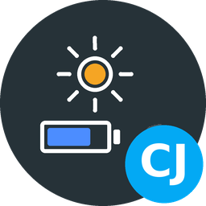

[![GitHub Activity][commits-shield]][commits]
[![License][license-shield]](LICENSE)
![Project Maintenance][maintenance-shield]

[](https://www.paypal.me/cyberjunkynl/)
[](https://github.com/sponsors/cyberjunky)

# Cyberjunky's Home Assistant Apps

My collection of Home Assistant apps (add-ons). Each app lives in its own folder with
its documentation, changelog and security policy.

## Installation

[](https://my.home-assistant.io/redirect/supervisor_add_addon_repository/?repository_url=https%3A%2F%2Fgithub.com%2Fcyberjunky%2Fhome-assistant-apps)

Alternatively:

1. Go to **Settings → Apps → App Store**
2. Open the menu (⋮) and choose **Repositories**
3. Add the following URL and click **Add**:

```txt
https://github.com/cyberjunky/home-assistant-apps
```

The apps below then appear in the store under **Cyberjunky's Home Assistant Apps**.

## Apps

###  [Dishylink](app-dishylink/)

![Version][dishylink-version-shield]
![Supports aarch64 Architecture][aarch64-shield]
![Supports amd64 Architecture][amd64-shield]

Starlink dish and router dashboard with 24/7 recorded history, powered by
[Dishylink](https://github.com/DaveyHert/Dishylink). Reads the dish and router over the
local network, opens from the sidebar through ingress, follows your light/dark mode and
keeps flash writes low by recording in RAM.

[:books: Documentation](app-dishylink/DOCS.md) · [:memo: Changelog](app-dishylink/CHANGELOG.md) · [:lock: Security](app-dishylink/SECURITY.md)

###  [GoodWe Monitor](app-goodwe/)

![Version][goodwe-version-shield]
![Supports aarch64 Architecture][aarch64-shield]
![Supports amd64 Architecture][amd64-shield]

GoodWe inverter dashboard and battery controller, opened from the sidebar. Live energy flow,
solar, battery and grid statistics, a solar forecast that holds the battery for the evening,
a charge cap, zero export and a solar-surplus signal, all published to Home Assistant over MQTT.

[:books: Documentation](app-goodwe/DOCS.md) · [:memo: Changelog](app-goodwe/CHANGELOG.md) · [:lock: Security](app-goodwe/SECURITY.md)

###  [Meldkamer](app-meldkamer/)

![Version][meldkamer-version-shield]
![Supports aarch64 Architecture][aarch64-shield]
![Supports amd64 Architecture][amd64-shield]

P2000 FLEX pager decoder dashboard for Dutch emergency services, opened from the sidebar.
Decodes an RTL-SDR, HackRF or network `rtl_tcp` stream onto a live incident map with
street-level pins, statistics, Home Assistant sensors, events and text-to-speech.

[:books: Documentation](app-meldkamer/DOCS.md) · [:memo: Changelog](app-meldkamer/CHANGELOG.md) · [:lock: Security](app-meldkamer/SECURITY.md)

###  [pgAdmin 4](app-pgadmin4/)

![Version][pgadmin4-version-shield]
![Supports aarch64 Architecture][aarch64-shield]
![Supports amd64 Architecture][amd64-shield]

Web-based administration for PostgreSQL, opened from the sidebar. Registers the TimescaleDB
app automatically. Apache 2.0, derived from an earlier add-on (see its NOTICE).

[:books: Documentation](app-pgadmin4/DOCS.md) · [:memo: Changelog](app-pgadmin4/CHANGELOG.md) · [:lock: Security](app-pgadmin4/SECURITY.md)

###  [TeslaMeter](app-teslameter/)

![Version][teslameter-version-shield]
![Supports aarch64 Architecture][aarch64-shield]
![Supports amd64 Architecture][amd64-shield]

Tesla logger and dashboard, opened from the sidebar. Records every trip and charging
session on a live map, with statistics on distance, energy, consumption, charging and
battery health. Runs entirely on your Home Assistant; no cloud, no telemetry.

[:books: Documentation](app-teslameter/DOCS.md) · [:memo: Changelog](app-teslameter/CHANGELOG.md) · [:lock: Security](app-teslameter/SECURITY.md)

###  [TimescaleDB](app-timescaledb/)

![Version][timescaledb-version-shield]
![Supports aarch64 Architecture][aarch64-shield]
![Supports amd64 Architecture][amd64-shield]

PostgreSQL with the TimescaleDB time-series extension plus PostGIS, pgvector, pg_cron,
pgAgent and TimescaleDB Toolkit. Apache 2.0, derived from an earlier add-on (see its NOTICE).

[:books: Documentation](app-timescaledb/DOCS.md) · [:memo: Changelog](app-timescaledb/CHANGELOG.md) · [:lock: Security](app-timescaledb/SECURITY.md)

## Releases

Each app is versioned on its own, following [Semantic Versioning](https://semver.org/):
`MAJOR` for incompatible changes, `MINOR` for new features, `PATCH` for fixes. The
version in an app's `config.yaml` is what Home Assistant offers as an update; the
matching entry in its `CHANGELOG.md` describes what changed.

Images are built by GitHub Actions and published to the GitHub Container Registry.
Every push to `main` builds the apps whose files changed and pushes
`ghcr.io/cyberjunky/<app>:<version>` plus `latest` for every architecture the app
supports, unless that version is already published. Raising the version in an app's
`config.yaml` together with its changelog entry is therefore the whole release. Pull
requests only test-build.

## 💖 Support This Project

If you find these apps useful, please consider supporting their continued development
and maintenance:

### 🌟 Ways to Support

- **⭐ Star this repository** - Help others discover the project
- **💰 Financial Support** - Contribute to development and hosting costs
- **🐛 Report Issues** - Help improve stability and compatibility
- **📖 Spread the Word** - Share with other Home Assistant users

### 💳 Financial Support Options

[](https://www.paypal.me/cyberjunkynl/)
[](https://github.com/sponsors/cyberjunky)

Every contribution, no matter the size, makes a difference and is greatly appreciated! 🙏

## Community

Questions, ideas or just want to chat? Join The Junkyard on Discord:

<a href="https://discord.gg/hUBQxRhJCU">
  
</a>

## License

Unless an app folder contains its own `LICENSE` file, this repository is licensed under the
MIT License - see the [LICENSE](LICENSE) file for details. Apps derived from other projects
keep that project's license and a `NOTICE` file with attribution in their own folder. The
software each app packages keeps its own license, noted in the app's README.

---

[commits-shield]: https://img.shields.io/github/commit-activity/y/cyberjunky/home-assistant-apps.svg?style=for-the-badge
[commits]: https://github.com/cyberjunky/home-assistant-apps/commits/main
[license-shield]: https://img.shields.io/github/license/cyberjunky/home-assistant-apps.svg?style=for-the-badge
[maintenance-shield]: https://img.shields.io/badge/maintainer-cyberjunky-blue.svg?style=for-the-badge
[aarch64-shield]: https://img.shields.io/badge/aarch64-yes-green.svg?style=for-the-badge
[amd64-shield]: https://img.shields.io/badge/amd64-yes-green.svg?style=for-the-badge
[pgadmin4-version-shield]: https://img.shields.io/badge/dynamic/yaml?url=https%3A%2F%2Fraw.githubusercontent.com%2Fcyberjunky%2Fhome-assistant-apps%2Fmain%2Fapp-pgadmin4%2Fconfig.yaml&query=%24.version&label=version&style=for-the-badge
[timescaledb-version-shield]: https://img.shields.io/badge/dynamic/yaml?url=https%3A%2F%2Fraw.githubusercontent.com%2Fcyberjunky%2Fhome-assistant-apps%2Fmain%2Fapp-timescaledb%2Fconfig.yaml&query=%24.version&label=version&style=for-the-badge
[dishylink-version-shield]: https://img.shields.io/badge/dynamic/yaml?url=https%3A%2F%2Fraw.githubusercontent.com%2Fcyberjunky%2Fhome-assistant-apps%2Fmain%2Fapp-dishylink%2Fconfig.yaml&query=%24.version&label=version&style=for-the-badge
[goodwe-version-shield]: https://img.shields.io/badge/dynamic/yaml?url=https%3A%2F%2Fraw.githubusercontent.com%2Fcyberjunky%2Fhome-assistant-apps%2Fmain%2Fapp-goodwe%2Fconfig.yaml&query=%24.version&label=version&style=for-the-badge
[meldkamer-version-shield]: https://img.shields.io/badge/dynamic/yaml?url=https%3A%2F%2Fraw.githubusercontent.com%2Fcyberjunky%2Fhome-assistant-apps%2Fmain%2Fapp-meldkamer%2Fconfig.yaml&query=%24.version&label=version&style=for-the-badge
[teslameter-version-shield]: https://img.shields.io/badge/dynamic/yaml?url=https%3A%2F%2Fraw.githubusercontent.com%2Fcyberjunky%2Fhome-assistant-apps%2Fmain%2Fapp-teslameter%2Fconfig.yaml&query=%24.version&label=version&style=for-the-badge
