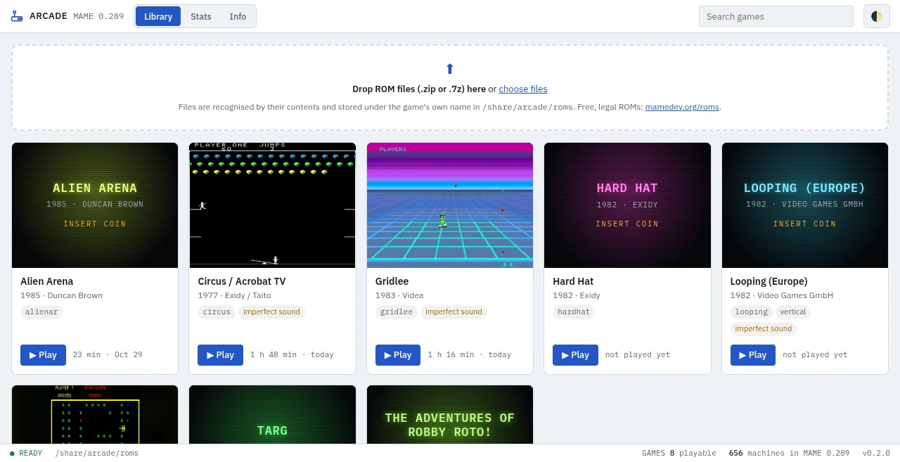
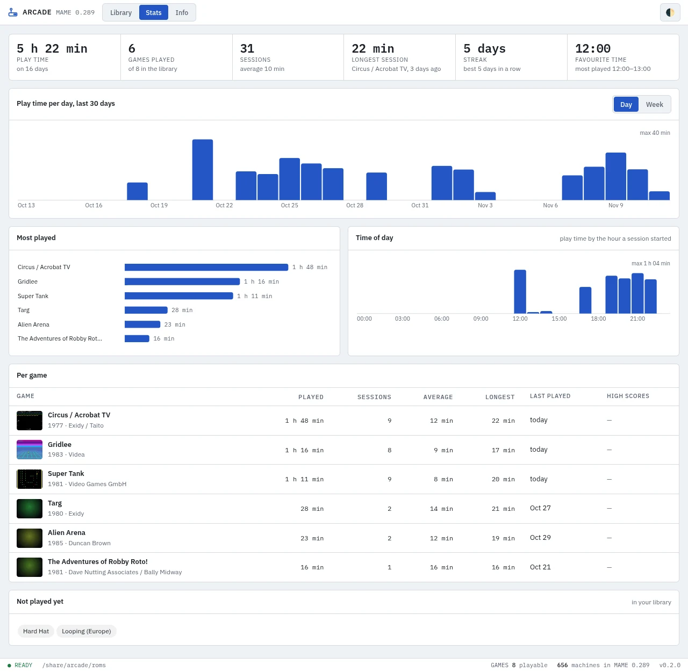
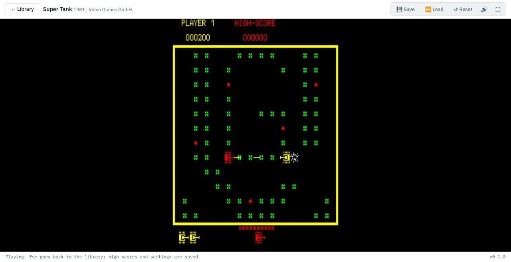
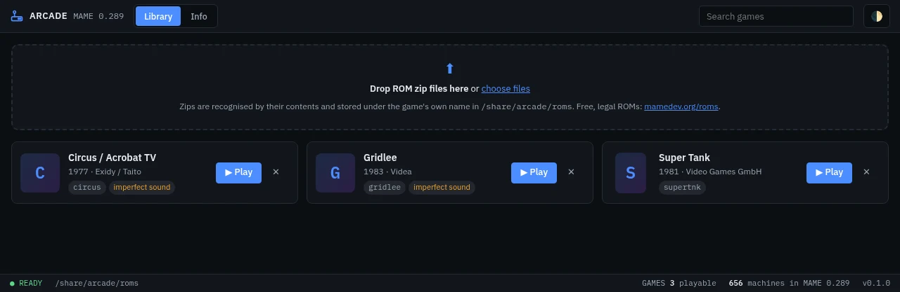
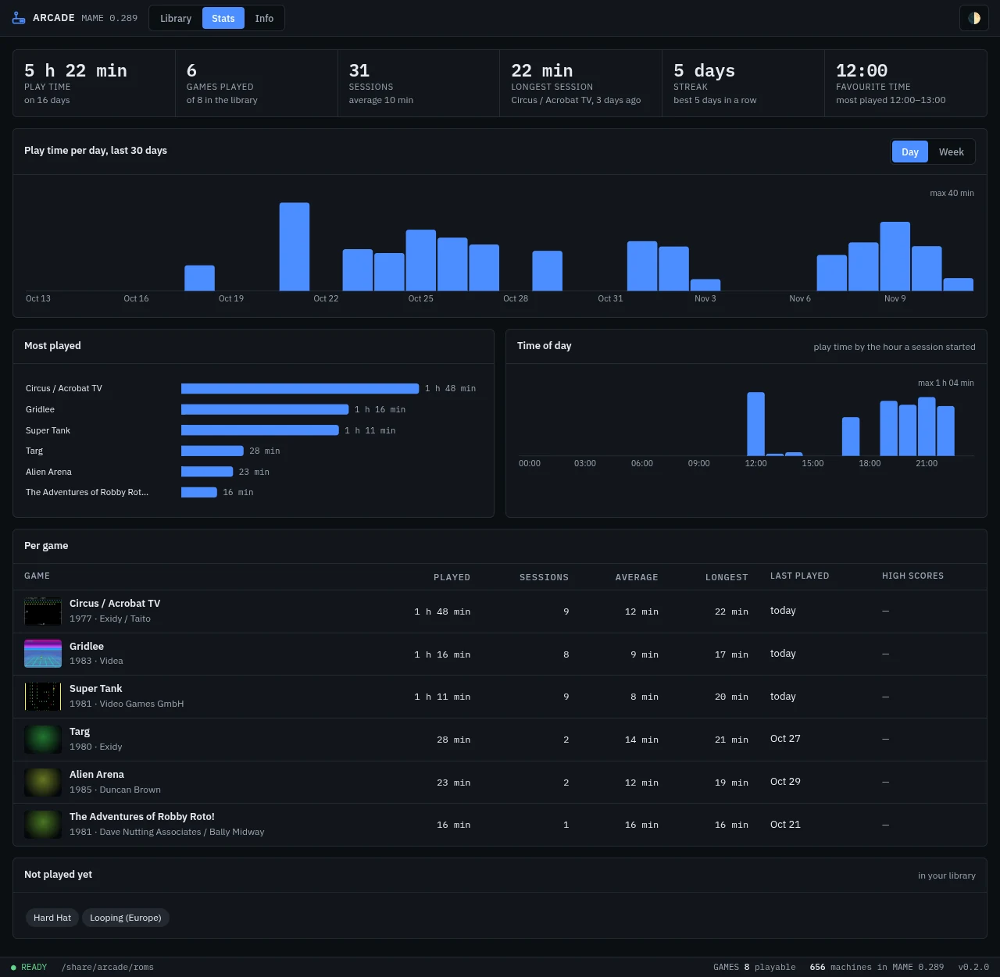

[![Version][version-shield]][changelog]
[![GitHub Activity][commits-shield]][commits]
[![License][license-shield]](LICENSE)
![Project Maintenance][maintenance-shield]
![Supports aarch64 Architecture][aarch64-shield]
![Supports amd64 Architecture][amd64-shield]

# Arcade App for Home Assistant

> **No games included.** This app contains the MAME emulator only. You add the games
> yourself, as ROM files you have the right to use. See [Legal](#legal).

Classic arcade games in Home Assistant, opened from the sidebar. The MAME emulator runs in
your browser, so the games look and sound exactly like the original machines. Your high
scores, settings and save states are kept on the server, so they follow you from the
laptop to the tablet.

## Supported Features

- 🕹️ **The real thing**: MAME emulates the original arcade hardware, so graphics, sound and timing are the original's
- 🖼️ **Thumbnails**: each game's card shows a picture taken from the game itself while you play it
- 📊 **Stats**: play time per game and per day, most played games, longest session, streak and favourite time of day
- 🕹️ **Neo Geo**: the MVS games run too, with the Neo Geo BIOS set (`neogeo.zip`) you add next to them
- 🎰 **Pinball, slot machines and more**: video pinball, video poker and slot machines (Aristocrat MK5, Cherry Master), Out Run, After Burner, Mortal Kombat, Gauntlet, Tetris, Rainbow Islands, R-Type and the IGS PGM games: 4182 games and versions
- 🔎 **Which driver is missing**: a file the app can't run says which MAME driver it needs, from an index of every machine in MAME
- 📚 **Library**: drop ROM files (`.zip` or `.7z`) on the page; each one is recognised by its contents and stored under the game's own name, with what is still missing if a set is incomplete
- 🏆 **High scores kept**: MAME's hiscore plugin saves them as soon as they change, also for games that forgot them at power-off
- 📋 **High score tables**: rank, initials and score of most games, read with the [hi2txt](https://github.com/GreatStoneEx/hi2txt-xml) definitions by GreatStone
- 💾 **Save states**: save the game at any moment and go back to it later, on any device
- 🎮 **Controls**: keyboard, gamepad, and on-screen controls on a touch screen
- 🖥️ **Full screen** with sharp pixels, vertical games the right way up
- 📁 **Your ROM folder in /share**: reachable over the Samba app; files dropped there show up too

## Screenshots

More screenshots (dark theme)

**Library, dark theme** — follows Home Assistant's light/dark mode

**Stats, dark theme**

## Installation

Alternatively:

1. Go to **Settings → Apps → App Store**
2. Open the menu (⋮) and choose **Repositories**
3. Add `https://github.com/cyberjunky/home-assistant-apps`
4. Install **Arcade** from the store, start it and open it from the sidebar
5. Read and accept the notice, then add ROM files you have the right to use

## Legal

This app contains no games. A game's ROM files are copies of the program chips of the
original arcade machine and are copyrighted by the company that made the game, also when
it is decades old and no longer sold. Only add ROM files you have the right to use:
dumped from an arcade board you own, bought as a licensed release, or released for free
by the rights holder. The MAME team offers such free ROMs on
[mamedev.org/roms](https://www.mamedev.org/roms/). Downloading ROMs from download sites is
not legal in most countries, the Netherlands included. You are responsible for the files
you add.

This app is not made or endorsed by the MAME team or by any game maker. MAME is a
registered trademark of Gregory Ember. Game and company names are trademarks of their
owners.

## Configuration

The only option is the ROM folder (default `/share/arcade/roms`). See [DOCS.md](DOCS.md)
for how it works, which games the built-in MAME runs, the controls and the licenses.

## 💖 Support This Project

If you find this app useful, please consider supporting its continued development and
maintenance:

### 🌟 Ways to Support

- **⭐ Star this repository** - Help others discover the project
- **💰 Financial Support** - Contribute to development and hosting costs
- **🐛 Report Issues** - Help improve stability and compatibility
- **📖 Spread the Word** - Share with other Home Assistant users

### 💳 Financial Support Options

Every contribution, no matter the size, makes a difference and is greatly appreciated! 🙏

## License

The app's own code is licensed under the MIT License, see [LICENSE](LICENSE). The MAME
emulator it contains is licensed under the GNU GPL version 2 or later; its source is at
[github.com/mamedev/mame](https://github.com/mamedev/mame) and the build is described in
[mame/](mame/). See [DOCS.md](DOCS.md#legal-and-licenses).

---

[version-shield]: https://img.shields.io/badge/dynamic/yaml?url=https%3A%2F%2Fraw.githubusercontent.com%2Fcyberjunky%2Fhome-assistant-apps%2Fmain%2Fapp-arcade%2Fconfig.yaml&query=%24.version&label=version&style=for-the-badge
[changelog]: https://github.com/cyberjunky/home-assistant-apps/blob/main/app-arcade/CHANGELOG.md
[commits-shield]: https://img.shields.io/github/commit-activity/y/cyberjunky/home-assistant-apps.svg?style=for-the-badge
[commits]: https://github.com/cyberjunky/home-assistant-apps/commits/main
[license-shield]: https://img.shields.io/github/license/cyberjunky/home-assistant-apps.svg?style=for-the-badge
[maintenance-shield]: https://img.shields.io/badge/maintainer-cyberjunky-blue.svg?style=for-the-badge
[aarch64-shield]: https://img.shields.io/badge/aarch64-yes-green.svg?style=for-the-badge
[amd64-shield]: https://img.shields.io/badge/amd64-yes-green.svg?style=for-the-badge
