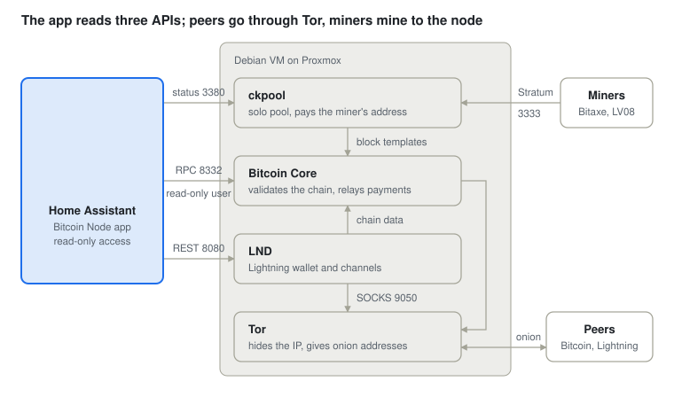

# Bitcoin node on Proxmox: download, install and setup

A guide to the node the Bitcoin Node app reads: Bitcoin Core, Tor and LND in one Debian VM on Proxmox, with an optional solo mining pool (ckpool) for miners such as a Bitaxe or a Lucky Miner.

## Overview

The node is one Debian VM on Proxmox running three services: Bitcoin Core, Tor and LND, plus ckpool when you mine. The Home Assistant app only reads from them over the LAN and holds no funds.



LND uses Bitcoin Core for chain data, and both reach their peers only through Tor.

| Service | Role | Ports used | What the app reads |
| --- | --- | --- | --- |
| Bitcoin Core (`bitcoind`) | Downloads and validates the chain, relays transactions | 8333 peers, 8332 JSON-RPC, 28332/28333 ZMQ | Sync progress, block height, mempool, fees, peers, traffic, disk use |
| Tor | Hides the node's IP address and gives it onion addresses | 9050 SOCKS, 9051 control | Bootstrap status, circuits, onion service state |
| LND | Lightning wallet and channels, uses Bitcoin Core as its backend | 9735 peers, 8080 REST, 10009 gRPC | Balances, channels, liquidity, payments, invoices, routing fees |

Choices made in this guide:

- **Plain packages, no Docker.** Three official binaries and three systemd services are easier to verify, update and back up than a stack.
- **Full node, not pruned.** LND works best with the full chain, and the app can show every statistic.
- **Tor for all peer traffic.** Bitcoin Core and LND connect through Tor only, so your home IP address is never published.
- **Read-only access for the app.** The app gets a credential that can look but not spend.

All commands run as your normal user inside the VM. Replace `192.168.1.50` with the VM's address and `192.168.1.10` with the Home Assistant address.

## Create the VM in Proxmox

Use a VM with three virtual disks, so the large chain data can be left out of backups while the small Lightning data is backed up often.

| Setting | Value | Why |
| --- | --- | --- |
| OS | Debian 13 netinst ISO | Small, stable, long support |
| Machine | q35, OVMF (UEFI), QEMU guest agent on | Current defaults, clean shutdown from Proxmox |
| CPU | 4 cores, type `host` | Initial sync is CPU-bound on signature checks |
| Memory | 8 GB, ballooning off | Bitcoin Core's cache is sized to fixed memory |
| SCSI controller | VirtIO SCSI single | Fastest disk path |
| Disk 1 (`scsi0`) | 32 GB, OS | |
| Disk 2 (`scsi1`) | 1 TB, chain data, **Backup off**, Discard on, SSD emulation on | Must be on SSD or NVMe storage; can be re-downloaded |
| Disk 3 (`scsi2`) | 16 GB, Lightning data | Small and irreplaceable |
| Network | VirtIO, your LAN bridge (`vmbr0`) | |

Steps:

1. Download the Debian 13 netinst ISO from [debian.org](https://www.debian.org/distrib/netinst) to the Proxmox ISO storage.
2. In Proxmox choose **Create VM** and fill in the values from the table. Add disks 2 and 3 on the Disks tab with **Add**.
3. On disk 2, open **Advanced** and untick **Backup**.
4. Under **Options**, set **Start at boot** to yes.
5. Give the VM a fixed address: a DHCP reservation in your router for the VM's MAC address is the simplest.

**Check the storage first.** The chain disk must sit on a Proxmox storage with that much real free space: run `pvesm status` on the host and compare the Available column. A virtual disk can be created larger than its storage (thin provisioning); the VM then stalls with an I/O error when the storage fills, while the disk inside the VM still looks half empty. If it ended up on the wrong storage, move it with **Hardware → the disk → Disk Action → Move Storage**.

The chain is roughly 750 to 800 GB and grows roughly 80 GB a year; the optional transaction index adds roughly 70 GB. These are estimates. On a storage of 1 TB or less, leave the index off.

## Install the operating system

Install Debian with only **SSH server** and **standard system utilities** selected, no desktop, on the 32 GB disk.

After the first boot, update and install the tools this guide uses:

```bash
sudo apt update && sudo apt full-upgrade -y
sudo apt install -y qemu-guest-agent ufw gnupg curl wget git jq xxd python3
```

### Network at boot

Bitcoin Core, LND and Tor listen on the VM's LAN address for the app. Debian's installer marks the network card `allow-hotplug`, and then services start before the address is there: they fail to bind it at boot. Make the system wait for the address:

```bash
grep -n "hotplug\|^auto\|iface" /etc/network/interfaces
sudo sed -i 's/^allow-hotplug /auto /' /etc/network/interfaces
```

It takes effect at the next reboot. After any reboot, check `systemctl is-active tor@default bitcoind lnd`.

### Data disks

Check which device is which by size, then format and mount them by label:

```bash
lsblk                       # expect sdb = 1T, sdc = 16G
sudo mkfs.ext4 -L chain /dev/sdb
sudo mkfs.ext4 -L lightning /dev/sdc
sudo mkdir -p /data/bitcoin /data/lnd
echo 'LABEL=chain     /data/bitcoin ext4 defaults,noatime 0 2' | sudo tee -a /etc/fstab
echo 'LABEL=lightning /data/lnd     ext4 defaults,noatime 0 2' | sudo tee -a /etc/fstab
sudo systemctl daemon-reload && sudo mount -a
df -h /data/bitcoin /data/lnd
```

`mkfs` erases the disk it is pointed at, so confirm the sizes in `lsblk` first.

### Service users

Each service runs as its own user without a login shell:

```bash
sudo adduser --system --group --home /data/bitcoin --no-create-home bitcoin
sudo adduser --system --group --home /data/lnd --no-create-home lnd
sudo chown bitcoin:bitcoin /data/bitcoin && sudo chmod 750 /data/bitcoin
sudo chown lnd:lnd /data/lnd && sudo chmod 750 /data/lnd
```

### Firewall

Deny everything inbound except SSH from the LAN and the API ports from Home Assistant:

```bash
sudo ufw default deny incoming
sudo ufw default allow outgoing
sudo ufw allow from 192.168.1.0/24 to any port 22 proto tcp
sudo ufw allow from 192.168.1.10 to any port 8332,8080 proto tcp
sudo ufw enable
```

No port needs forwarding in your router: inbound peers arrive through Tor.

## Tor

Tor comes from Debian's own package; Bitcoin Core and LND create their onion addresses themselves through Tor's control port.

```bash
sudo apt install -y tor
```

Add these lines to `/etc/tor/torrc`:

```
ControlPort 9051
CookieAuthentication 1
CookieAuthFileGroupReadable 1
```

Let both services read the control cookie, then restart Tor:

```bash
sudo usermod -aG debian-tor bitcoin
sudo usermod -aG debian-tor lnd
sudo systemctl restart tor
sudo systemctl enable tor
```

Check that Tor works. The answer must contain `"IsTor":true`:

```bash
curl --socks5-hostname 127.0.0.1:9050 https://check.torproject.org/api/ip
```

The control port stays on `127.0.0.1` here. The app reads Tor reachability and the onion addresses from Bitcoin Core and LND, which need nothing extra.

### Optional: Tor's own status in the app

Bootstrap progress and the circuit list come only from the control port, so showing them means opening that port to Home Assistant. The control port gives full control over Tor and is not encrypted, so only do this on a LAN you trust.

```bash
tor --hash-password 'choose-a-password'     # prints a line starting with 16:
```

Add to `/etc/tor/torrc`, restart Tor and open the port:

```
ControlPort 192.168.1.50:9051
HashedControlPassword 16:...the line printed above...
```

```bash
sudo systemctl restart tor
sudo ufw allow from 192.168.1.10 to any port 9051 proto tcp
```

With the LAN line, Tor must start after the VM has its address, or it can't bind to it at boot and stays down; Bitcoin Core and LND then have no peers. Note that `systemctl is-active tor` says `active` even then: the real service is `tor@default`. Make it wait for the network with `sudo systemctl edit tor@default`:

```ini
[Unit]
After=network-online.target
Wants=network-online.target

[Service]
Restart=on-failure
RestartSec=15
```

Reboot once and check that `sudo ss -ltnp | grep 9051` shows both control ports.

## Bitcoin Core

Bitcoin Core 32.1 is the current release on the [download page](https://bitcoincore.org/en/download/); check that page first and change `VERSION` if a newer one is out.

### Download and verify

```bash
cd /tmp
VERSION=32.1
wget https://bitcoincore.org/bin/bitcoin-core-$VERSION/bitcoin-$VERSION-x86_64-linux-gnu.tar.gz
wget https://bitcoincore.org/bin/bitcoin-core-$VERSION/SHA256SUMS
wget https://bitcoincore.org/bin/bitcoin-core-$VERSION/SHA256SUMS.asc

sha256sum --ignore-missing --check SHA256SUMS
```

The output must contain `bitcoin-32.1-x86_64-linux-gnu.tar.gz: OK`. Then check that the checksum file is signed by the release builders:

```bash
git clone https://github.com/bitcoin-core/guix.sigs
gpg --import guix.sigs/builder-keys/*
gpg --verify SHA256SUMS.asc SHA256SUMS
```

Expect several lines saying `gpg: Good signature`. The warning that the keys are not certified with a trusted signature is normal. Stop if you see `BAD signature`.

### Install

```bash
tar -xzf bitcoin-$VERSION-x86_64-linux-gnu.tar.gz
sudo install -m 0755 -o root -g root -t /usr/local/bin bitcoin-$VERSION/bin/*
bitcoind --version
```

### RPC users

Create two RPC users: `lnd` for the Lightning service and `homeassistant` for the app. The script prints a `rpcauth=` line and a password for each; keep both.

```bash
wget https://raw.githubusercontent.com/bitcoin/bitcoin/v$VERSION/share/rpcauth/rpcauth.py
python3 rpcauth.py lnd
python3 rpcauth.py homeassistant
```

### Configuration

Create `/data/bitcoin/bitcoin.conf` with `sudo -u bitcoin nano /data/bitcoin/bitcoin.conf`:

```ini
# General
server=1
# txindex=1             # optional: about 70 GB more; LND and the app don't need it
dbcache=4096            # lower to 1024 once the initial sync is done

# Network: Tor only
proxy=127.0.0.1:9050
onlynet=onion
listen=1
bind=127.0.0.1
bind=127.0.0.1:8334=onion
listenonion=1
torcontrol=127.0.0.1:9051

# RPC: this VM and Home Assistant only
rpcbind=127.0.0.1
rpcbind=192.168.1.50
rpcallowip=127.0.0.1
rpcallowip=192.168.1.10
rpcauth=lnd:...paste the line for lnd...
rpcauth=homeassistant:...paste the line for homeassistant...

# The app's user may only call read-only methods
rpcwhitelistdefault=0
rpcwhitelist=homeassistant:getblockchaininfo,getmempoolinfo,getnetworkinfo,getpeerinfo,getnettotals,uptime,getmininginfo,getindexinfo,getchaintxstats,getblockstats,getblockhash,getblockheader,getbestblockhash,getblockcount,estimatesmartfee,getmemoryinfo,getdeploymentinfo,getrawmempool,getchaintips

# ZMQ: raw feeds for LND on localhost
zmqpubrawblock=tcp://127.0.0.1:28332
zmqpubrawtx=tcp://127.0.0.1:28333
# No ZMQ line on the LAN address: if it can't bind at boot, Bitcoin Core turns all ZMQ off and LND can't start
```

The file holds password hashes, so keep it private:

```bash
sudo chown bitcoin:bitcoin /data/bitcoin/bitcoin.conf
sudo chmod 640 /data/bitcoin/bitcoin.conf
```

### Service

Create `/etc/systemd/system/bitcoind.service`:

```ini
[Unit]
Description=Bitcoin Core
After=network-online.target tor.service
Wants=network-online.target

[Service]
User=bitcoin
Group=bitcoin
ExecStart=/usr/local/bin/bitcoind -datadir=/data/bitcoin
Restart=on-failure
RestartSec=30
TimeoutStopSec=600
PrivateTmp=true
ProtectSystem=full
NoNewPrivileges=true
PrivateDevices=true

[Install]
WantedBy=multi-user.target
```

```bash
sudo systemctl daemon-reload
sudo systemctl enable --now bitcoind
sudo tail -f /data/bitcoin/debug.log        # Ctrl+C to stop watching
```

### Initial sync

The first sync downloads and checks the whole chain. Over Tor only, expect 3 to 7 days on NVMe; follow it with:

```bash
sudo -u bitcoin bitcoin-cli -datadir=/data/bitcoin getblockchaininfo | jq '{blocks, headers, verificationprogress, initialblockdownload}'
```

It is done when `initialblockdownload` is `false`. To sync in 1 to 2 days instead, comment out `onlynet=onion` until it finishes; during that time your home IP address is visible to the peers you download from.

The transaction index builds after the sync and takes a few more hours. LND can be installed meanwhile but only starts working once the sync is done.

## LND

LND v0.21.8-beta is the current release on the [releases page](https://github.com/lightningnetwork/lnd/releases/latest); check that page first and change `VERSION` if a newer one is out.

### Download and verify

```bash
cd /tmp
VERSION=v0.21.8-beta
BASE=https://github.com/lightningnetwork/lnd/releases/download/$VERSION
wget $BASE/lnd-linux-amd64-$VERSION.tar.gz
wget $BASE/manifest-$VERSION.txt
wget $BASE/manifest-roasbeef-$VERSION.sig

curl https://raw.githubusercontent.com/lightningnetwork/lnd/master/scripts/keys/roasbeef.asc | gpg --import
gpg --verify manifest-roasbeef-$VERSION.sig manifest-$VERSION.txt
sha256sum --ignore-missing --check manifest-$VERSION.txt
```

Expect `gpg: Good signature` and `lnd-linux-amd64-v0.21.8-beta.tar.gz: OK`.

### Install

```bash
tar -xzf lnd-linux-amd64-$VERSION.tar.gz
sudo install -m 0755 -o root -g root -t /usr/local/bin lnd-linux-amd64-$VERSION/*
lnd --version
```

### Configuration

Create `/data/lnd/lnd.conf` with `sudo -u lnd nano /data/lnd/lnd.conf`. Use the password that `rpcauth.py lnd` printed.

```ini
[Application Options]
alias=choose-a-node-name
listen=localhost:9735
rpclisten=localhost:10009
restlisten=localhost:8080
restlisten=192.168.1.50:8080
tlsextraip=192.168.1.50
wallet-unlock-password-file=/data/lnd/wallet-password.txt
wallet-unlock-allow-create=true

[Bitcoin]
bitcoin.mainnet=true
bitcoin.node=bitcoind

[Bitcoind]
bitcoind.rpchost=127.0.0.1:8332
bitcoind.rpcuser=lnd
bitcoind.rpcpass=...the password for lnd...
bitcoind.zmqpubrawblock=tcp://127.0.0.1:28332
bitcoind.zmqpubrawtx=tcp://127.0.0.1:28333

[tor]
tor.active=true
tor.v3=true
tor.streamisolation=true
tor.socks=127.0.0.1:9050
tor.control=127.0.0.1:9051
```

Store the wallet password in a file only the `lnd` user can read, so LND unlocks itself after a reboot:

```bash
sudo -u lnd sh -c 'umask 077; nano /data/lnd/wallet-password.txt'   # one line, at least 8 characters
sudo chown lnd:lnd /data/lnd/lnd.conf /data/lnd/wallet-password.txt
sudo chmod 600 /data/lnd/lnd.conf /data/lnd/wallet-password.txt
sudo ls -la /data/lnd        # both files must show: lnd lnd
```

Both files must belong to the `lnd` user. When LND can't read `lnd.conf` it doesn't say so: it starts with defaults and fails with "either --bitcoin.mainnet, or --bitcoin.testnet ... must be specified".

### Service

Create `/etc/systemd/system/lnd.service`:

```ini
[Unit]
Description=Lightning Network Daemon
After=bitcoind.service tor.service
Wants=bitcoind.service

[Service]
User=lnd
Group=lnd
ExecStart=/usr/local/bin/lnd --lnddir=/data/lnd --configfile=/data/lnd/lnd.conf
Restart=on-failure
RestartSec=60
TimeoutStopSec=300
PrivateTmp=true
ProtectSystem=full
NoNewPrivileges=true
PrivateDevices=true

[Install]
WantedBy=multi-user.target
```

```bash
sudo systemctl daemon-reload
sudo systemctl enable --now lnd
```

### Create the wallet

Run this once, enter the same password as in `wallet-password.txt`, and choose a new seed:

```bash
sudo -u lnd lncli --lnddir=/data/lnd create
```

LND prints 24 words. **Write them on paper and keep them offline.** They are the only way to recover on-chain funds, and they are never shown again.

To save typing later, add an alias to `~/.bashrc`:

```bash
echo "alias lncli='sudo -u lnd lncli --lnddir=/data/lnd'" >> ~/.bashrc && source ~/.bashrc
lncli getinfo
```

## Access for the app

The app needs the values below, all read-only; none of them can move funds.

| Value | Where it comes from | Used for |
| --- | --- | --- |
| Bitcoin RPC address | `http://192.168.1.50:8332` | Node statistics |
| Bitcoin RPC user and password | `homeassistant` and the password `rpcauth.py` printed | Node statistics, limited to the whitelisted methods |
| LND REST address | `https://192.168.1.50:8080` | Lightning data |
| LND read-only macaroon (hex) | Command below | Lightning data, cannot pay or open channels |
| LND TLS certificate | `/data/lnd/tls.cert` | Lets the app check it talks to your node |

Print the read-only macaroon as hex, and the certificate:

```bash
sudo xxd -ps -u -c 1000 /data/lnd/data/chain/bitcoin/mainnet/readonly.macaroon
sudo cat /data/lnd/tls.cert
```

LND writes three macaroons. Only hand out `readonly.macaroon`; `admin.macaroon` can spend everything in the wallet.

Test both APIs from another machine on the LAN that the firewall allows, such as the Home Assistant terminal:

```bash
curl -s --user homeassistant:PASSWORD \
  --data-binary '{"jsonrpc":"1.0","id":"t","method":"getblockchaininfo","params":[]}' \
  http://192.168.1.50:8332/ | head -c 300

curl -sk -H "Grpc-Metadata-macaroon: MACAROON_HEX" https://192.168.1.50:8080/v1/getinfo | head -c 300
```

Both must answer with JSON. A whitelisted user calling another method, such as `stop`, gets HTTP 403.

In the Bitcoin Node app these go in its configuration: the RPC address, user and password under `bitcoin`, the LND address, macaroon and certificate under `lightning`. The certificate may be pasted on one line.

## Backups

Three things protect the funds: the 24 words, the channel backup file, and never starting LND from an old copy of its database.

| What | How | How often |
| --- | --- | --- |
| 24-word seed | On paper, offline | Once |
| `channel.backup` | Copied off the VM automatically, see below | On every channel change |
| OS disk and Lightning disk | Proxmox backup job to Proxmox Backup Server | Daily |
| Chain disk | Not backed up; it re-downloads | Never |

The app also stores LND's channel backup whenever a channel opens or closes, to download from its Lightning page.

### Copy the channel backup off the VM

LND rewrites `/data/lnd/data/chain/bitcoin/mainnet/channel.backup` whenever a channel opens or closes. A systemd path unit can copy it to a mounted share each time. Replace `/mnt/backup` with a location outside this VM, such as an NFS or SMB mount.

`/etc/systemd/system/lnd-scb.path`:

```ini
[Unit]
Description=Watch the LND channel backup

[Path]
PathChanged=/data/lnd/data/chain/bitcoin/mainnet/channel.backup

[Install]
WantedBy=multi-user.target
```

`/etc/systemd/system/lnd-scb.service`:

```ini
[Unit]
Description=Copy the LND channel backup

[Service]
Type=oneshot
ExecStart=/bin/sh -c 'cp /data/lnd/data/chain/bitcoin/mainnet/channel.backup /mnt/backup/channel-$(date +%%Y%%m%%d-%%H%%M%%S).backup'
```

```bash
sudo systemctl daemon-reload
sudo systemctl enable --now lnd-scb.path
```

### Restoring

**Never start LND from a restored Lightning disk while channels were open.** The restored database holds old channel balances; publishing one counts as cheating and the other side may take all the funds in that channel.

The safe recovery after losing the Lightning disk:

1. Restore the OS disk, or reinstall with this guide.
2. Start with an empty `/data/lnd` holding only `lnd.conf` and `wallet-password.txt`.
3. Run `lncli create`, choose to restore, and enter the 24 words.
4. Run `lncli restorechanbackup --multi_file /mnt/backup/channel-LATEST.backup`.

LND then asks every channel partner to close the channel, and the funds return to the on-chain wallet after the closing transactions confirm. The channels themselves are gone and must be reopened.

The daily backup of the Lightning disk is still useful for its configuration, certificate and macaroons, and for restoring when no channels were open.

## Check that it works

Run these in order; each one depends on the one before.

| Check | Command | Expected |
| --- | --- | --- |
| Services run | `systemctl is-active tor bitcoind lnd` | `active` three times |
| Tor is used | `curl --socks5-hostname 127.0.0.1:9050 https://check.torproject.org/api/ip` | `"IsTor":true` |
| Chain is synced | `sudo -u bitcoin bitcoin-cli -datadir=/data/bitcoin getblockchaininfo` | `initialblockdownload` is `false`, `blocks` equals `headers` |
| Peers are onion only | `sudo -u bitcoin bitcoin-cli -datadir=/data/bitcoin -netinfo` | Peers only in the `onion` column |
| Node has an onion address | `sudo -u bitcoin bitcoin-cli -datadir=/data/bitcoin getnetworkinfo` | `localaddresses` lists an address ending in `.onion` |
| Transaction index is ready | `sudo -u bitcoin bitcoin-cli -datadir=/data/bitcoin getindexinfo` | `txindex` has `synced: true` |
| LND follows the chain | `lncli getinfo` | `synced_to_chain` is `true`, `uris` ends in `.onion:9735` |
| Wallet answers | `lncli walletbalance` | A JSON balance, zero on a new wallet |
| Backup watcher runs | `systemctl is-active lnd-scb.path` | `active` |
| App access works | The two `curl` tests under Access for the app | JSON from both |

After a reboot of the VM all three services must come back on their own, and `lncli getinfo` must answer without asking for a password.

If a service fails, its log says why:

```bash
sudo journalctl -u bitcoind -n 50
sudo journalctl -u lnd -n 50
sudo journalctl -u tor@default -n 50
```

## Updating

An update repeats the download, verify and install steps with a new `VERSION`, between a stop and a start of the service. Take a Proxmox snapshot of the VM first, and read the release notes of the new version.

Bitcoin Core:

```bash
sudo systemctl stop lnd bitcoind
# download, verify and install as under Bitcoin Core, with the new VERSION
sudo systemctl start bitcoind lnd
```

LND:

```bash
sudo systemctl stop lnd
# download, verify and install as under LND, with the new VERSION
sudo systemctl start lnd
```

Tor and Debian update through `apt`:

```bash
sudo apt update && sudo apt full-upgrade -y
```

Delete the Proxmox snapshot once the node runs well. Do not roll back to it after LND has run with open channels, for the same reason as under Restoring.

## Local mining pool (ckpool solo)

[ckpool](https://github.com/ckolivas/ckpool) in solo mode runs on this VM, takes block templates from your Bitcoin Core and pays a found block in full to the address each miner logs in with. A Bitaxe and a Lucky Miner LV08 both connect to it with plain Stratum V1 on port 3333, so the stock LV08 firmware works. There is no fee: `donation` defaults to 0.

The node must be fully synced first: Bitcoin Core hands out no block template during the initial sync.

### Build

ckpool has no release tarballs; you build the master branch. Note the commit it prints, so you know what you run.

```bash
sudo apt install -y build-essential yasm autoconf automake libtool pkgconf libzmq3-dev libcapnp-dev capnproto libsodium-dev
cd /tmp
git clone https://bitbucket.org/ckolivas/ckpool.git
cd ckpool
git log -1 --format='%h %cd'
./autogen.sh && ./configure && make
sudo install -m 755 src/ckpool /usr/local/bin/ckpool
```

### Service user and RPC user

```bash
sudo adduser --system --group --home /data/ckpool --no-create-home ckpool
sudo mkdir -p /data/ckpool/logs
sudo chown -R ckpool:ckpool /data/ckpool && sudo chmod 750 /data/ckpool
cd /tmp
wget https://raw.githubusercontent.com/bitcoin/bitcoin/v32.1/share/rpcauth/rpcauth.py
python3 rpcauth.py ckpool
```

`/tmp` is emptied at a reboot, so the script is downloaded again here. Add these lines to `/data/bitcoin/bitcoin.conf`:

```ini
# ckpool on this VM
rpcauth=ckpool:...paste the line for ckpool...
zmqpubhashblock=tcp://127.0.0.1:28334
```

The `ckpool` user gets no `rpcwhitelist` line, so it may call every method; with `rpcwhitelistdefault=0` that is the same as for `lnd`, and RPC only listens on this VM and Home Assistant. Then `sudo systemctl restart bitcoind`: Bitcoin Core reads `rpcauth` lines only when it starts.

### Configuration

Create `/data/ckpool/ckpool.conf` with `sudo -u ckpool nano /data/ckpool/ckpool.conf`. Use the password that `rpcauth.py ckpool` printed (the last line of its output, not the `salt$hash` part).

```json
{
"btcd": [{
  "url": "127.0.0.1:8332",
  "auth": "ckpool",
  "pass": "...the password for ckpool...",
  "notify": true
}],
"btcsig": "/solo/",
"serverurl": ["0.0.0.0:3333"],
"mindiff": 1,
"startdiff": 1000,
"maxdiff": 0,
"zmqblock": "tcp://127.0.0.1:28334",
"logdir": "/data/ckpool/logs"
}
```

```bash
sudo chmod 600 /data/ckpool/ckpool.conf
```

`btcaddress` is left out on purpose: in solo mode ckpool ignores it and pays the miner's own address. `btcsig` is the short text written into a block you find. `notify: true` with `zmqblock` makes ckpool hear of a new block at once instead of polling.

### Service

Create `/etc/systemd/system/ckpool.service`:

```ini
[Unit]
Description=ckpool solo mining
After=bitcoind.service
Wants=bitcoind.service

[Service]
User=ckpool
Group=ckpool
WorkingDirectory=/data/ckpool
RuntimeDirectory=ckpool
ExecStart=/usr/local/bin/ckpool -B -k -c /data/ckpool/ckpool.conf -s /run/ckpool
Restart=on-failure
RestartSec=30
PrivateTmp=true
ProtectSystem=full
NoNewPrivileges=true

[Install]
WantedBy=multi-user.target
```

`-B` is solo mode, `-k` replaces a ckpool that is still running, `-s` keeps its sockets in `/run/ckpool`.

```bash
sudo systemctl daemon-reload
sudo systemctl enable --now ckpool
sudo ufw allow from 192.168.1.0/24 to any port 3333 proto tcp
sudo journalctl -u ckpool -f
```

Port 3333 is for the LAN only; never forward it in your router.

While Bitcoin Core starts, ckpool logs `Loading block index…` and `No bitcoinds active!`: it retries by itself. It is ready when the journal says `Connected to bitcoind`, `Mining solo to any incoming valid BTC address username` and the network difficulty. `HTTP/1.1 401 Unauthorized` means the user or password doesn't match the `rpcauth` line, or Bitcoin Core wasn't restarted after it was added.

### Point the miners at it

Both miners use the same web settings (AxeOS on the Bitaxe, the Lucky Miner web page on the LV08), under Pool or Settings:

| Field | Bitaxe | LV08 |
| --- | --- | --- |
| Stratum URL | `192.168.1.50` | `192.168.1.50` |
| Port | `3333` | `3333` |
| User | `bc1q…your address….bitaxe` | `bc1q…your address….lv08` |
| Password | `x` | `x` |

The part before the dot must be a valid bitcoin address of a wallet you hold the keys to (next section); the part after it is only a worker name. Save and restart the miner. Within a minute the journal shows the worker connect and accept shares.

Per-address statistics land in `/data/ckpool/logs/users/<address>` and the pool totals in `/data/ckpool/logs/pool/pool.status`:

```bash
sudo cat /data/ckpool/logs/pool/pool.status
sudo cat /data/ckpool/logs/users/bc1q…your address…
```

`bestshare` there is the highest share difficulty you reached; a block needs the network difficulty.

### Show the pool in the Bitcoin Node app

The app's Pool page reads ckpool's status files. ckpool has no network interface for its statistics: it only writes them as files in its logs folder, once a minute. So a second, separate service shares that folder read-only with Home Assistant, using Python's built-in web server. The pool runs without it; only the Pool page needs it. Create `/etc/systemd/system/ckpool-status.service`:

```ini
[Unit]
Description=ckpool status, read-only for Home Assistant
After=network-online.target ckpool.service
Wants=network-online.target

[Service]
User=ckpool
Group=ckpool
ExecStart=/usr/bin/python3 -m http.server 3380 --bind 192.168.1.50 --directory /data/ckpool/logs
Restart=on-failure
RestartSec=30
ProtectSystem=full
NoNewPrivileges=true

[Install]
WantedBy=multi-user.target
```

```bash
sudo systemctl daemon-reload
sudo systemctl enable --now ckpool-status
sudo ufw allow from 192.168.1.10 to any port 3380 proto tcp
```

Port 3380 is for Home Assistant only: the folder also holds ckpool's log, with your miners' addresses on the network. In the app's configuration set `pool.url` to `http://192.168.1.50:3380` and restart the app (version 0.1.6 or later).

### Notes

- Your node only talks over Tor, so a block you find reaches the network a few seconds later than over the open internet. That gives a very small extra chance that another block wins the race.
- To update ckpool, repeat Build, then `sudo systemctl restart ckpool`.
- ckpool's master branch now also speaks Stratum V2 (`sv2url` and key settings in its README). The Bitaxe could use that later; V1 above is the setup that has run for years.

## Moving won bitcoin

A block you find pays the whole reward (3.125 BTC plus the fees in it) straight to the address in the miner's user name. ckpool never holds the coins, so there is nothing to withdraw from the pool. The coins sit in the wallet that address belongs to, and you send them on from that wallet like any other payment.

### Pick the payout wallet first

Use an address from a wallet whose recovery words you hold. [Sparrow Wallet](https://sparrowwallet.com) on your PC is the usual choice, on its own or with a hardware wallet (the safest: the keys never touch a computer).

1. Install Sparrow and create a new wallet (or connect the hardware wallet). Choose Native SegWit.
2. Write the 12 or 24 recovery words on paper and keep them offline. Lose them and a won block is lost.
3. Open **Receive**, copy the `bc1q…` address and put it in both miners (previous section).

Don't use an exchange deposit address: many exchanges don't credit coinbase payments. Don't use the LND wallet either: it is a hot wallet on this VM.

### Let Sparrow use your own node (optional)

Out of the box Sparrow asks public servers about your address. To keep that private, point it at your node. Make an RPC user for it:

```bash
cd /tmp
wget https://raw.githubusercontent.com/bitcoin/bitcoin/v32.1/share/rpcauth/rpcauth.py
python3 rpcauth.py sparrow
```

Add to `/data/bitcoin/bitcoin.conf` (replace `192.168.1.20` with your PC's IP), then restart:

```ini
rpcauth=sparrow:...paste the line for sparrow...
rpcallowip=192.168.1.20
```

```bash
sudo systemctl restart bitcoind
sudo ufw allow from 192.168.1.20 to any port 8332 proto tcp
```

In Sparrow: **Settings → Server → Bitcoin Core**, URL `192.168.1.50`, port `8332`, user `sparrow` and the password `rpcauth.py` printed, then **Test Connection**. Sparrow keeps a watch-only copy of the wallet in Bitcoin Core; your keys stay in Sparrow.

### When a block is found

1. The miner's web page and `journalctl -u ckpool` report the block; Sparrow shows an incoming transaction marked as a coinbase. The app's Pool page tells it under Activity and as a `block_found` event in Home Assistant.
2. Wait 100 blocks, about 17 hours. Bitcoin rules don't let a block reward be spent before that, and a send before then is refused.
3. In Sparrow open **Send**: paste the destination address in **Pay to**, enter the amount (or **Max**), pick a fee rate, then **Create Transaction → Finalize → Sign → Broadcast**. With a hardware wallet you confirm the address and amount on its screen.
4. Follow it under **Transactions** until it has a few confirmations.

Send a small test amount first when the destination is new. To fund Lightning channels, get an address from LND with `lncli newaddress p2tr` and send part of it there.

## Sources

- [Bitcoin Core download and verification](https://bitcoincore.org/en/download/), version and commands read on 16 November 2026
- [LND latest release](https://github.com/lightningnetwork/lnd/releases/latest), version and verification commands read on 16 November 2026
- [ckpool README](https://github.com/ckolivas/ckpool) (official mirror of the Bitbucket repository), build steps, solo mode and config keys read on 26 November 2026; the status file format checked in its source

Disk size, sync times and chain growth are approximate figures, not taken from these pages.
