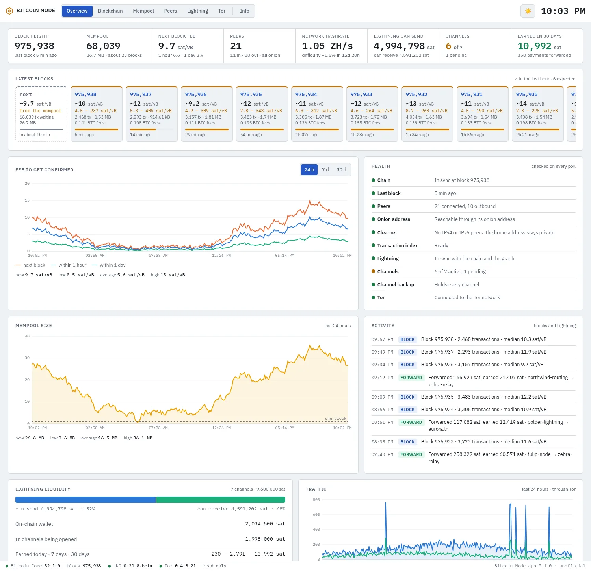
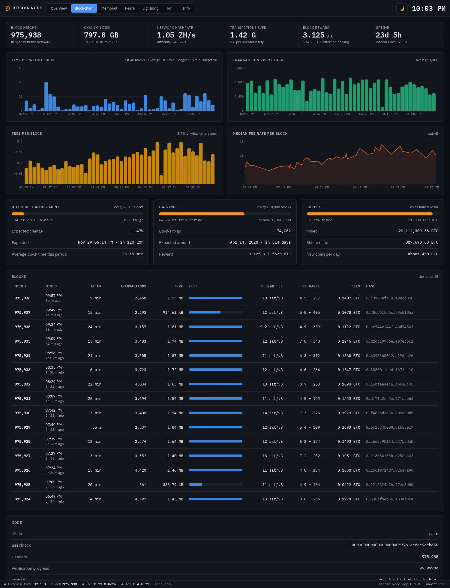
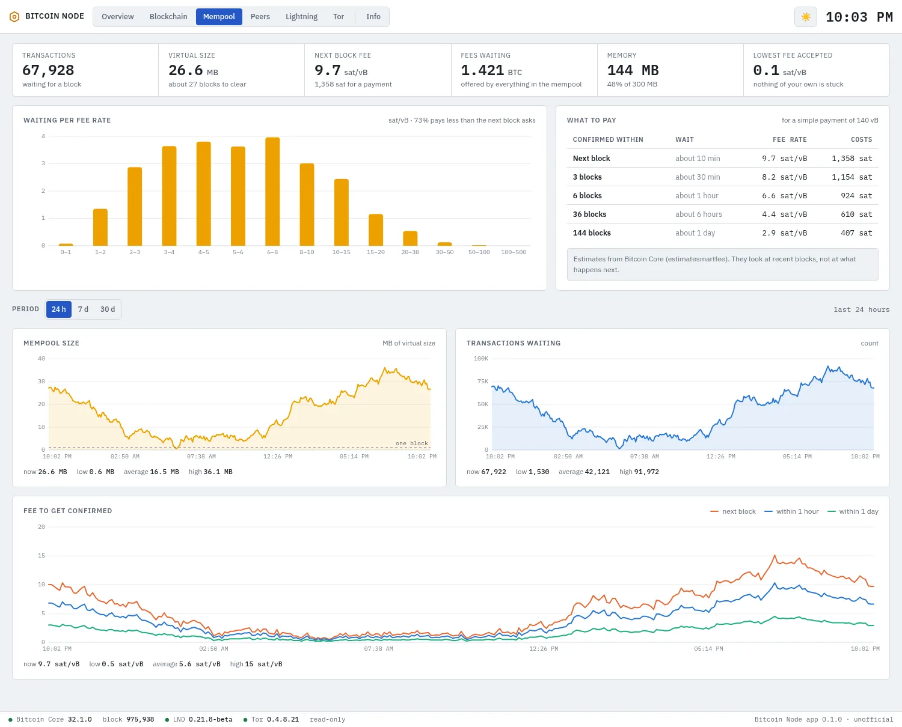
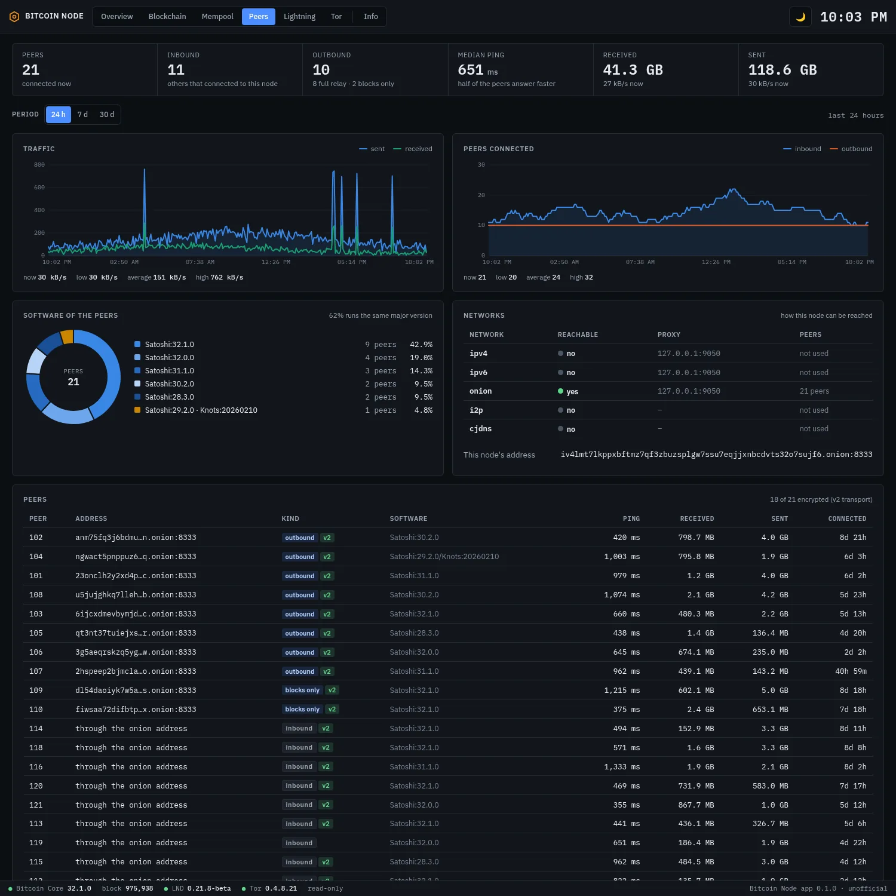
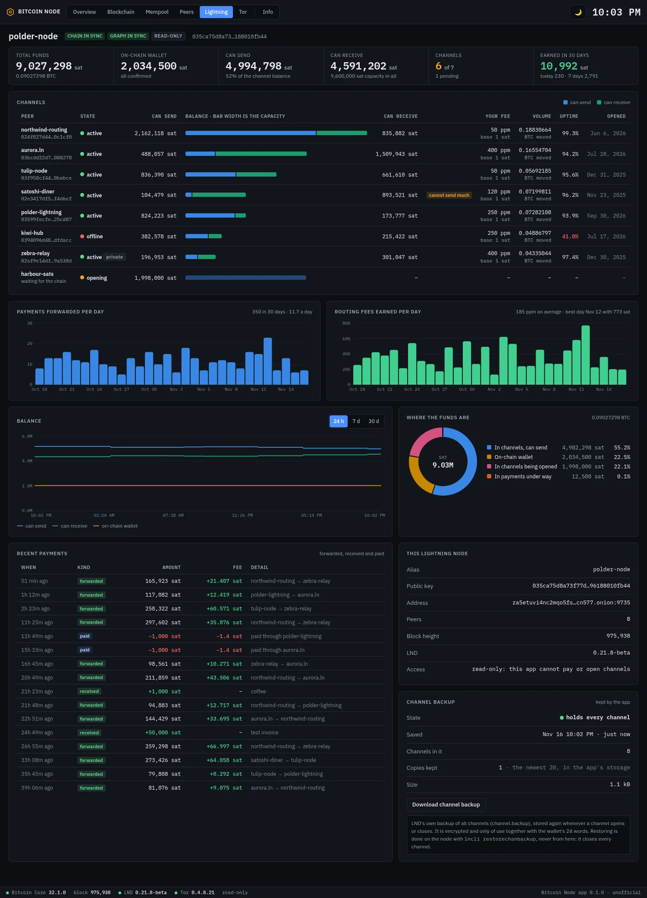
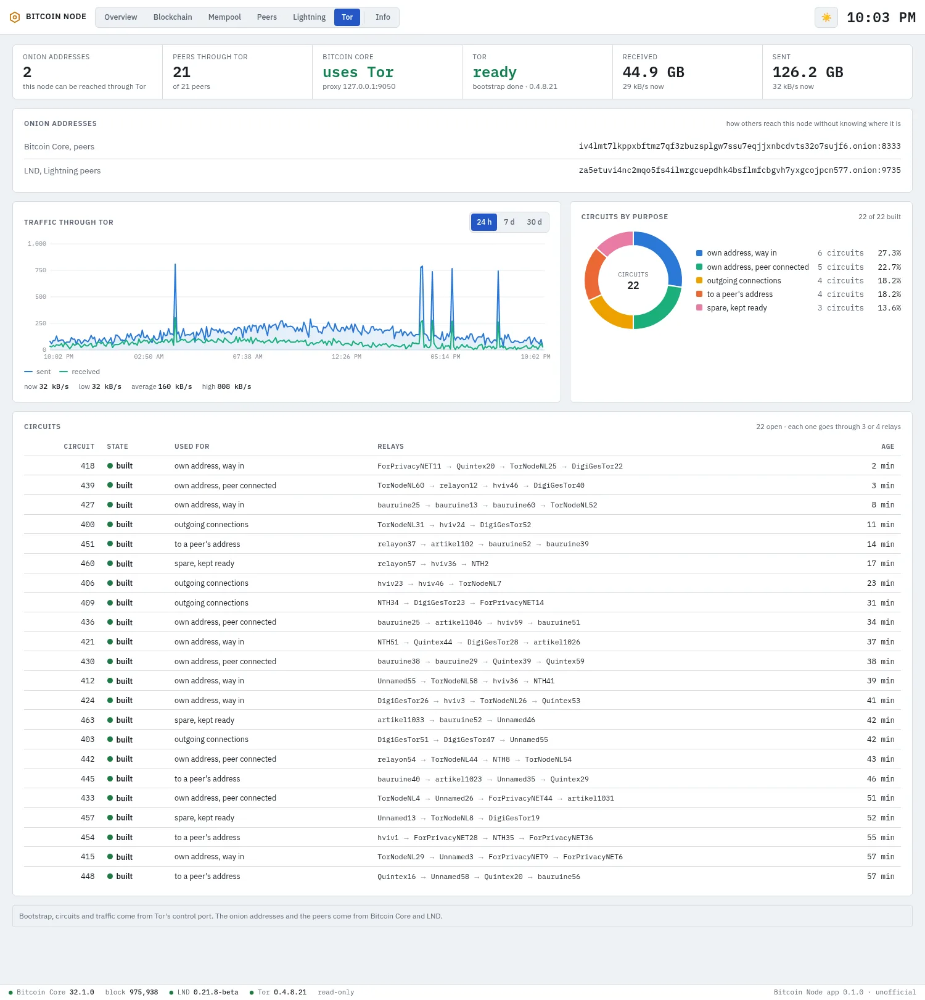
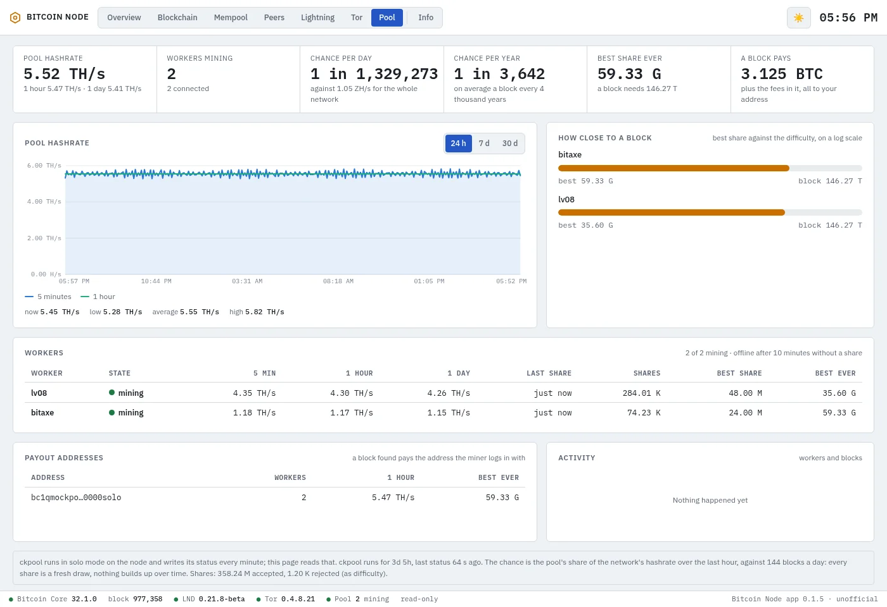
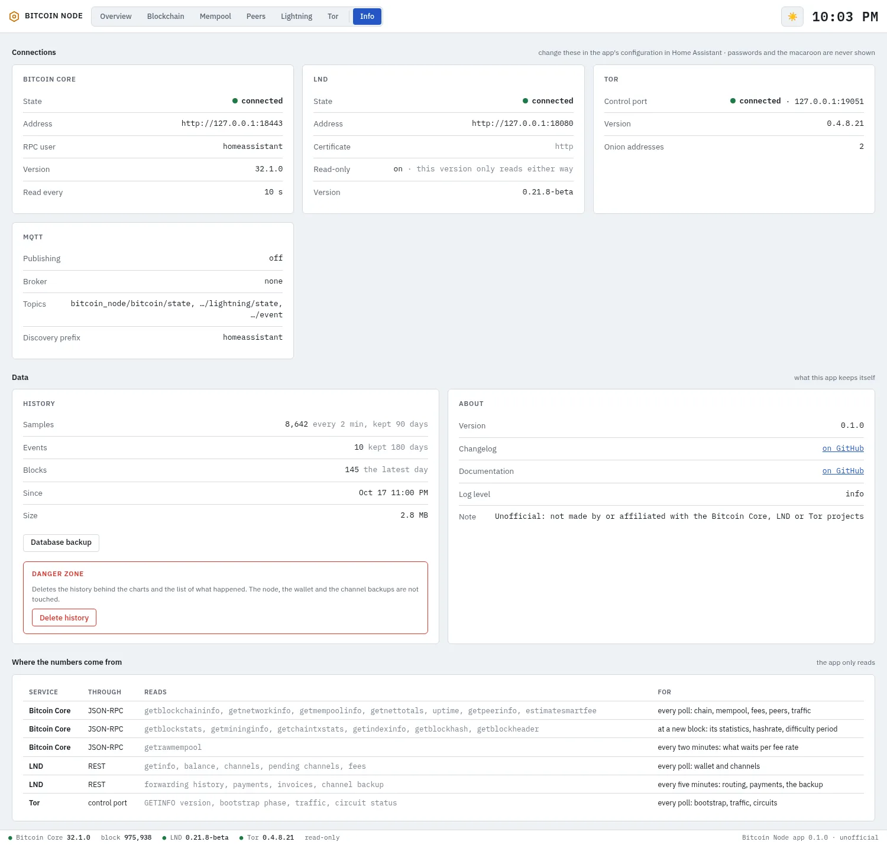
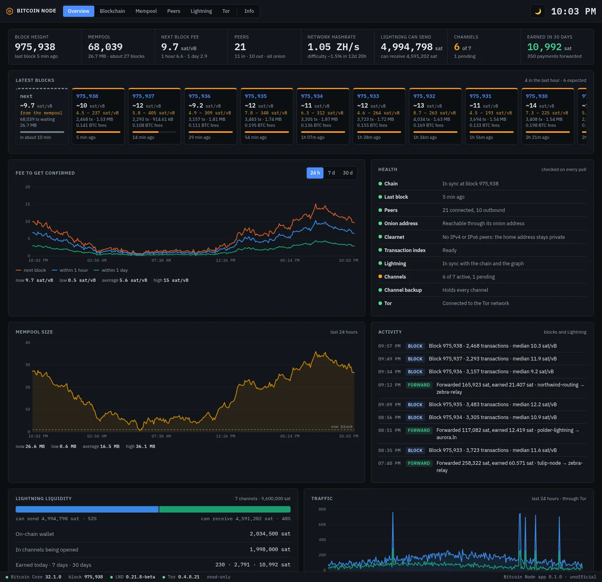

[![Version][version-shield]][changelog]
[![GitHub Activity][commits-shield]][commits]
[![License][license-shield]](https://github.com/cyberjunky/home-assistant-apps/blob/main/app-bitcoin-node/LICENSE)
![Project Maintenance][maintenance-shield]
![Supports aarch64 Architecture][aarch64-shield]
![Supports amd64 Architecture][amd64-shield]

# Bitcoin Node App for Home Assistant

> **Unofficial.** An independent project, not affiliated with, endorsed by or sponsored by the Bitcoin Core, LND or Tor projects.

Dashboard for your own Bitcoin node in Home Assistant. The chain, the mempool, fee estimates
and peers from [Bitcoin Core](https://bitcoincore.org/), your Lightning wallet, channels and
routing from [LND](https://github.com/lightningnetwork/lnd), and Tor: the node's onion
addresses, and with Tor's control port its circuits and traffic. The node also appears in Home
Assistant over MQTT, with events for new blocks, payments and channels to use in automations.

The app is not a node and holds no funds. It runs entirely on your Home Assistant and talks to
your node over your own network; the node keeps running where it runs.

**It only reads.** This version cannot pay, open or close a channel, or change anything on the
node. It works with an RPC user that may only read and with LND's read-only macaroon.

More screenshots

**Blockchain** — time between blocks, transactions and fees per block, the difficulty adjustment, the halving, the supply and the latest blocks

**Mempool** — what waits per fee rate, what to pay to confirm within a block up to a day, and size, count and fees over time

**Peers** — traffic and peers over time, the software the peers run, the networks in use and every peer

**Lightning** — funds, every channel with its balance, payments forwarded and fees earned per day, recent payments and the channel backup

**Tor** — the onion addresses, traffic through Tor and every circuit with what it is used for

**Pool** — your own solo mining pool (ckpool): hashrate, every worker, how close the best share came to a block, and your chance of finding one

**Info** — the connections, MQTT, the app's data and where every number comes from

**Overview, dark theme** — follows Home Assistant's light/dark mode

## Supported Features

- ⛓️ **The chain** — Block height, sync, hashrate, the latest blocks with their fees, time between blocks, the difficulty adjustment it is heading for, the halving and the supply
- 🧮 **Mempool and fees** — What waits per fee rate, how many blocks it takes to clear, and what to pay to confirm within a block, an hour or a day
- 🌐 **Peers** — Inbound and outbound, traffic, ping, the software your peers run and which networks the node uses
- ⚡ **Lightning** — Funds, what you can send and receive, every channel's balance, uptime and fee, payments forwarded and routing fees earned
- 🧅 **Tor** — The node's onion addresses, whether any peer sees your IP address, and Tor's circuits and traffic
- ⛏️ **Mining pool** — A ckpool solo pool on the node: hashrate, every worker (Bitaxe, Lucky Miner), the best share against the difficulty and your chance of a block
- 📈 **Charts and health** — Every number over 24 hours, 7 and 30 days with its low, average and high, and a health list that warns
- 💾 **Channel backup** — LND's channel backup stored again whenever a channel opens or closes, to download
- 📨 **MQTT discovery** — Bitcoin Core, Lightning, Tor and the mining pool as devices with their sensors, and event entities for automations

## Requirements

- A Bitcoin Core node with its RPC reachable from Home Assistant, and an RPC user for the app
- Optional: LND with its REST API reachable, and its read-only macaroon
- Optional: Tor's control port, for Tor's own state
- Optional: ckpool's logs folder served read-only, for the Pool page
- An MQTT broker for the entities in Home Assistant (optional; the dashboard works without one)

## Installation

Alternatively:

1. Go to **Settings → Apps → App Store**
2. Open the menu (⋮) and choose **Repositories**
3. Add `https://github.com/cyberjunky/home-assistant-apps`
4. Install **Bitcoin Node**
5. Enter Bitcoin Core's address, RPC user and password under `bitcoin` in the app's configuration; LND and Tor are optional
6. Start the app and open **Bitcoin Node** from the sidebar

## Configuration

Bitcoin Node needs the address of Bitcoin Core's RPC and a user that may read. See
[DOCS.md](https://github.com/cyberjunky/home-assistant-apps/blob/main/app-bitcoin-node/DOCS.md) for every option, the settings on the node's side, how it works and what
the dashboard shows.

New to Lightning? [LIGHTNING.md](https://github.com/cyberjunky/home-assistant-apps/blob/main/app-bitcoin-node/LIGHTNING.md) goes from an empty wallet to a first channel:
what it brings and costs, how much to put in, and the commands.

## Disclaimer

This app is an independent project. It is not affiliated with, endorsed by or sponsored by the
Bitcoin Core, LND or Tor projects. It shows what your node reports; fee estimates and forecasts
are estimates. Keep your own backups of your wallet's seed and channel backup. Nothing in this
app is financial advice.

## 💖 Support This Project

If you find this app useful, please consider supporting its continued development and
maintenance:

### 🌟 Ways to Support

- **⭐ Star this repository** - Help others discover the project
- **💰 Financial Support** - Contribute to development and hosting costs
- **🐛 Report Issues** - Help improve stability and compatibility
- **📖 Spread the Word** - Share with other Home Assistant users

### 💳 Financial Support Options

Every contribution, no matter the size, makes a difference and is greatly appreciated! 🙏

## License

This project is licensed under the MIT License - see the [LICENSE](https://github.com/cyberjunky/home-assistant-apps/blob/main/app-bitcoin-node/LICENSE) file for
details. Bitcoin Core, LND and Tor are not part of this app; the app only talks to their interfaces.

---

[version-shield]: https://img.shields.io/badge/dynamic/yaml?url=https%3A%2F%2Fraw.githubusercontent.com%2Fcyberjunky%2Fhome-assistant-apps%2Fmain%2Fapp-bitcoin-node%2Fconfig.yaml&query=%24.version&label=version&style=for-the-badge
[changelog]: https://github.com/cyberjunky/home-assistant-apps/blob/main/app-bitcoin-node/CHANGELOG.md
[commits-shield]: https://img.shields.io/github/commit-activity/y/cyberjunky/home-assistant-apps.svg?style=for-the-badge
[commits]: https://github.com/cyberjunky/home-assistant-apps/commits/main
[license-shield]: https://img.shields.io/github/license/cyberjunky/home-assistant-apps.svg?style=for-the-badge
[maintenance-shield]: https://img.shields.io/badge/maintainer-cyberjunky-blue.svg?style=for-the-badge
[aarch64-shield]: https://img.shields.io/badge/aarch64-yes-green.svg?style=for-the-badge
[amd64-shield]: https://img.shields.io/badge/amd64-yes-green.svg?style=for-the-badge
