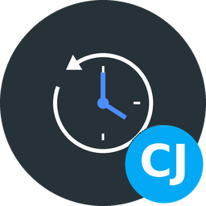
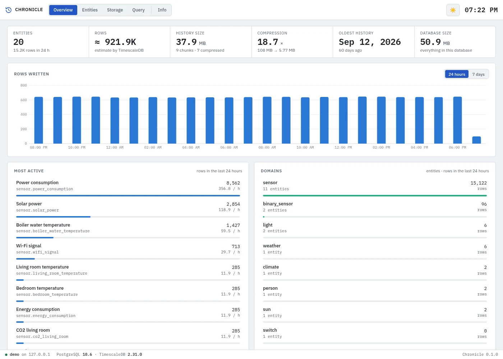
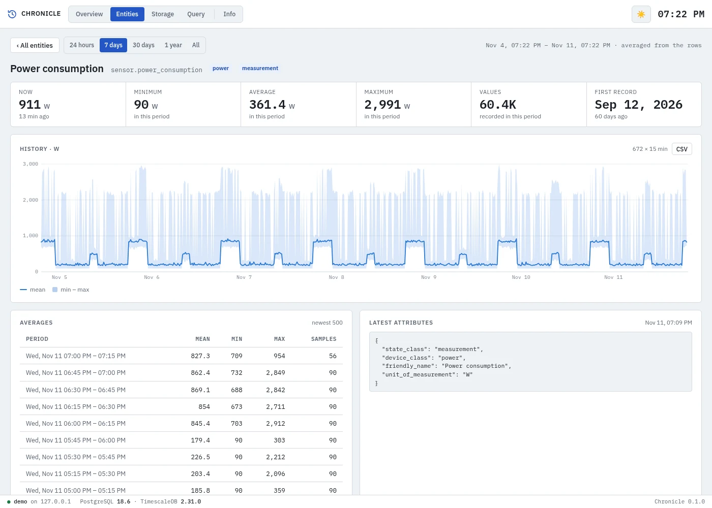
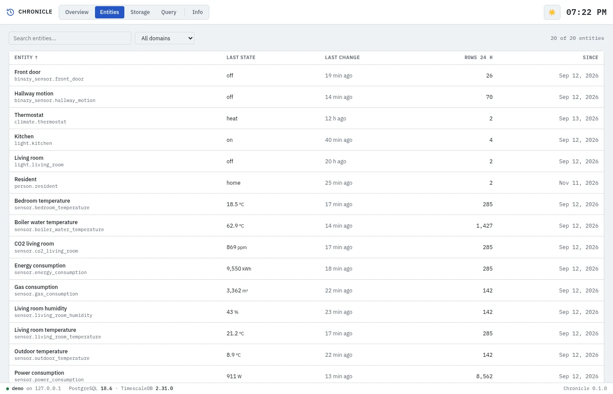
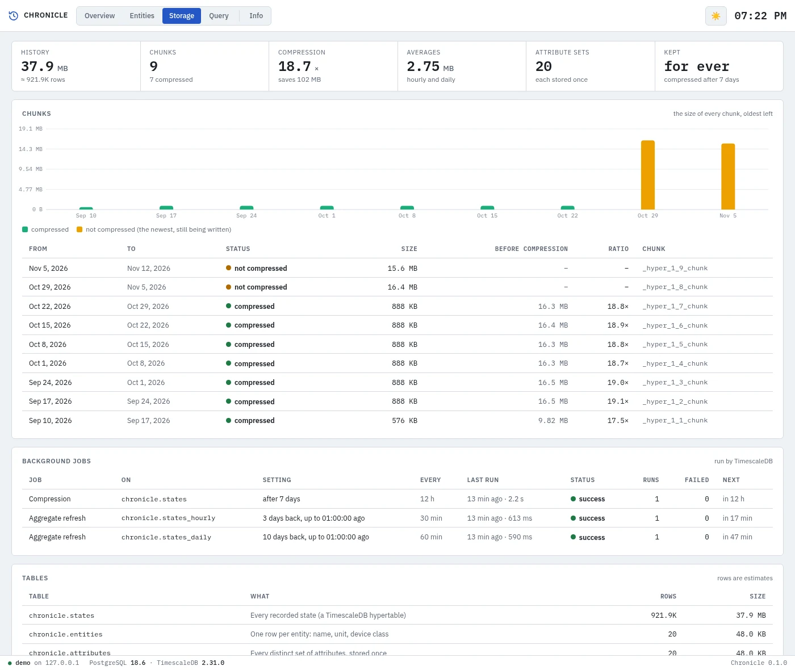
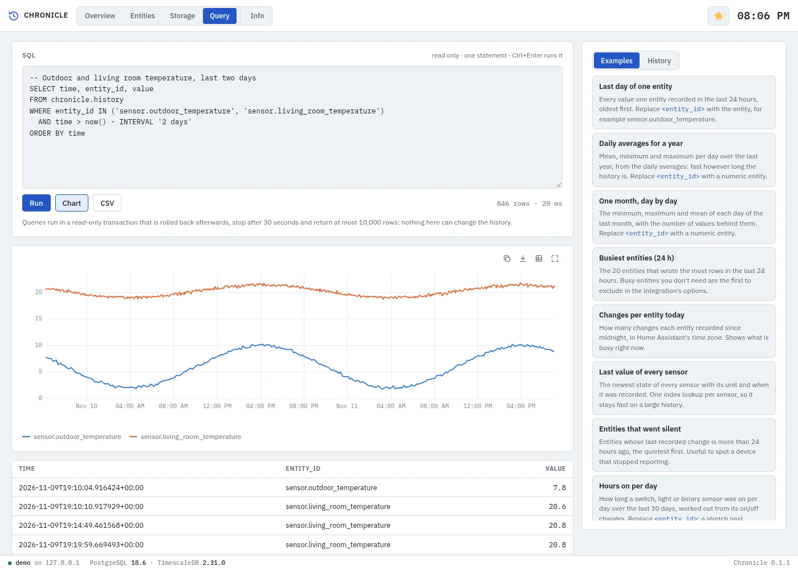
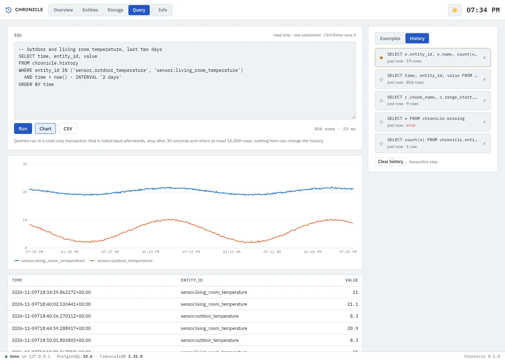
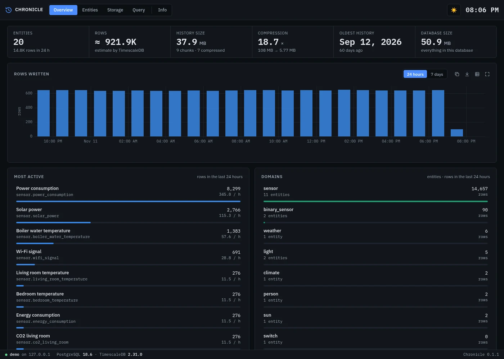

[![Version][version-shield]][changelog]
[![GitHub Activity][commits-shield]][commits]
[![License][license-shield]](LICENSE)
![Project Maintenance][maintenance-shield]
![Supports aarch64 Architecture][aarch64-shield]
![Supports amd64 Architecture][amd64-shield]

# Chronicle App for Home Assistant

A dashboard for the long-term history that the
[Chronicle integration](https://github.com/cyberjunky/home-assistant-chronicle) keeps in
TimescaleDB: what is recorded and how much, the history of every entity as a chart, how the
storage and compression are doing, and a read-only SQL page for your own questions. Opened
from the sidebar, it follows Home Assistant's light and dark mode.

The app only reads. It connects to the same database as the integration, and every query it
runs is read-only: it can't change or delete the history.

More screenshots

**An entity** — a week of power use: the mean line inside the minimum–maximum band, with the averages below

**Entities** — search and filter every recorded entity

**Storage** — chunks, compression and TimescaleDB's background jobs

**Query** — read-only SQL, with described examples beside the editor, a chart and CSV

**Query history** — the queries you ran, with favourites pinned at the top

**Overview, dark theme** — follows Home Assistant's light/dark mode

## Supported Features

- 📊 **Overview** — Entities, rows, history size, compression ratio, oldest history and database size; rows written per hour over 24 hours or 7 days; the most active entities and domains
- 🔎 **Entities** — Every recorded entity with its last state, last change and rows in 24 hours; search, filter on domain and sort
- 📈 **History** — Any entity over 24 hours, 7 days, 30 days, a year or everything: numbers as a line with their minimum–maximum band, on/off and other states as a timeline with the time spent in each; the latest attributes; CSV of what is shown
- 🗄️ **Storage** — Every chunk with its size before and after compression, TimescaleDB's compression, retention and averaging jobs with their last run, and the size of each table
- 🧮 **Query** — Read-only SQL with twelve described examples, a history of what you ran with favourites, a chart of the result, and CSV
- 🔒 **Read only** — The app never writes; even a `DELETE` typed on the Query page is refused by PostgreSQL itself

## Installation

Alternatively:

1. Go to **Settings → Apps → App Store**
2. Open the menu (⋮) and choose **Repositories**
3. Add `https://github.com/cyberjunky/home-assistant-apps`
4. Install **Chronicle**, enter the database on its Configuration tab (the same one as the Chronicle integration), and start it
5. Open **Chronicle** from the sidebar

## Configuration

| Option | Default | |
|---|---|---|
| `host` | `1b41fb55-timescaledb` | The TimescaleDB app from this repository; or a host name or IP address |
| `port` | `5432` | |
| `username` | `postgres` | A read-only user is enough, see [DOCS.md](DOCS.md) |
| `password` | | |
| `database` | `homeassistant` | The database the Chronicle integration records into |

See [DOCS.md](DOCS.md) for every page, how the charts choose their data, the Query page and
its limits, and a read-only database user.

## 💖 Support This Project

If you find this app useful, please consider supporting its continued development and
maintenance:

### 🌟 Ways to Support

- **⭐ Star this repository** - Help others discover the project
- **💰 Financial Support** - Contribute to development and hosting costs
- **🐛 Report Issues** - Help improve stability and compatibility
- **📖 Spread the Word** - Share with other Home Assistant users

### 💳 Financial Support Options

Every contribution, no matter the size, makes a difference and is greatly appreciated! 🙏

## License

This project is licensed under the MIT License - see the [LICENSE](LICENSE) file for
details.

---

[version-shield]: https://img.shields.io/badge/dynamic/yaml?url=https%3A%2F%2Fraw.githubusercontent.com%2Fcyberjunky%2Fhome-assistant-apps%2Fmain%2Fapp-chronicle%2Fconfig.yaml&query=%24.version&label=version&style=for-the-badge
[changelog]: https://github.com/cyberjunky/home-assistant-apps/blob/main/app-chronicle/CHANGELOG.md
[commits-shield]: https://img.shields.io/github/commit-activity/y/cyberjunky/home-assistant-apps.svg?style=for-the-badge
[commits]: https://github.com/cyberjunky/home-assistant-apps/commits/main
[license-shield]: https://img.shields.io/github/license/cyberjunky/home-assistant-apps.svg?style=for-the-badge
[maintenance-shield]: https://img.shields.io/badge/maintainer-cyberjunky-blue.svg?style=for-the-badge
[aarch64-shield]: https://img.shields.io/badge/aarch64-yes-green.svg
[amd64-shield]: https://img.shields.io/badge/amd64-yes-green.svg
