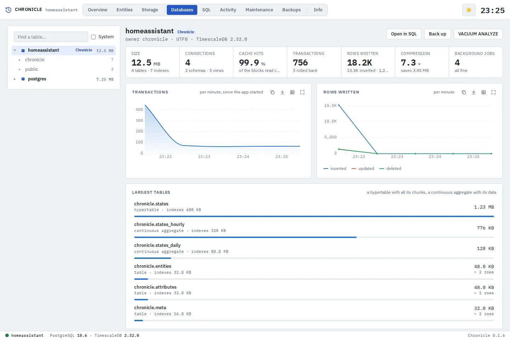
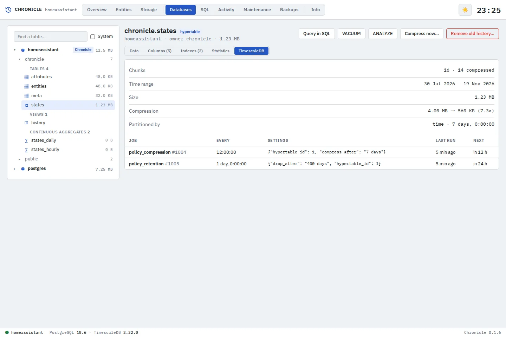
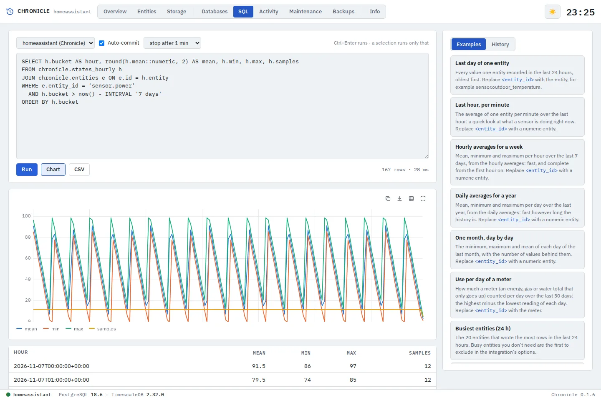
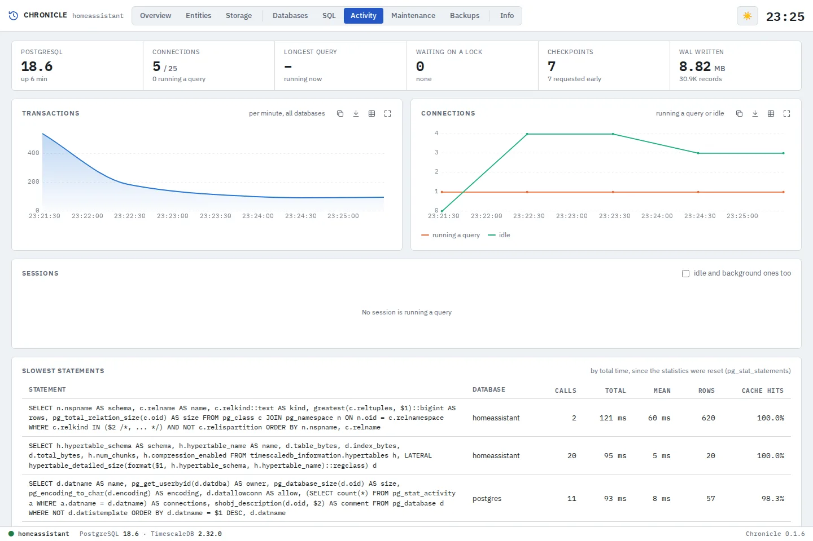
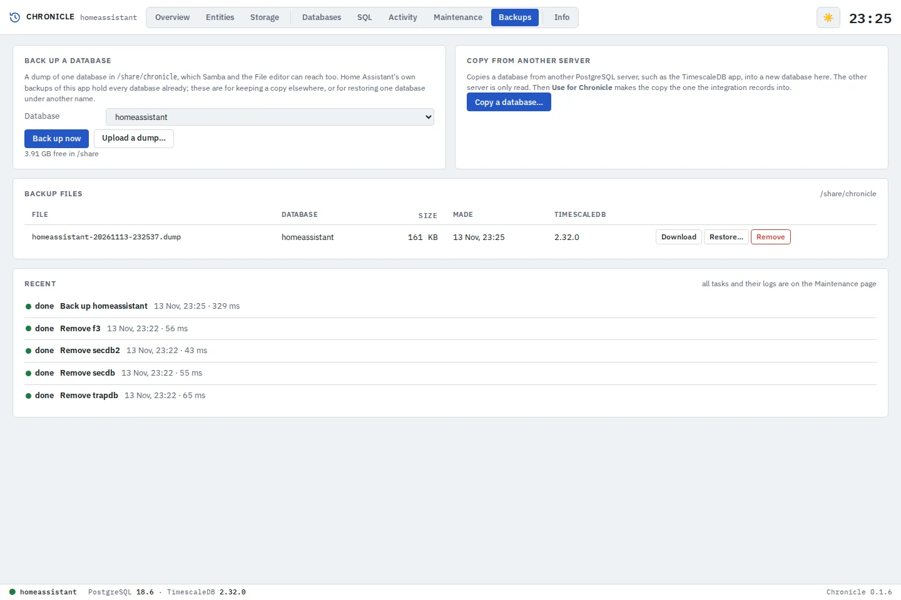

[![Version][version-shield]][changelog]
[![GitHub Activity][commits-shield]][commits]
[![License][license-shield]](https://github.com/cyberjunky/home-assistant-apps/blob/main/app-chronicle/LICENSE)
![Project Maintenance][maintenance-shield]
![Supports aarch64 Architecture][aarch64-shield]
![Supports amd64 Architecture][amd64-shield]

# Chronicle App for Home Assistant

The database of the [Chronicle integration](https://github.com/cyberjunky/home-assistant-chronicle),
and the place to look into it: PostgreSQL with TimescaleDB, set up for Chronicle, with a
dashboard of what is recorded (the history of every entity as a chart, the storage and its
compression) and a small pgAdmin: every database and table to browse, SQL, what the server is
doing, upkeep, backups and restores. Opened from the sidebar, it follows Home Assistant's
light and dark mode.

Install it, start it, and Home Assistant offers the Chronicle integration with the connection
filled in. A history in the TimescaleDB app moves over with **Copy from another server**.

More screenshots

**An entity** — a week of power use (the mean inside its minimum–maximum band) compared with the outdoor temperature on a second axis, with the tooltip

**Entities** — search and filter every recorded entity

**Storage** — chunks, compression and TimescaleDB's background jobs

**Databases** — a database's dashboard: size, cache hits, transactions and rows written per minute, the largest tables

**A table** — a hypertable's TimescaleDB details: chunks, compression, partitioning and its jobs, with the upkeep buttons

**SQL** — scripts against any database, auto-commit or a transaction, examples that ask for the entity, a chart and CSV

**Activity** — sessions and their queries, the slowest statements, transactions and connections per minute

**Backups** — dumps to download, upload and restore, and copying a database from another server

**Overview, dark theme** — follows Home Assistant's light/dark mode

## Supported Features

- 🗃️ **The database** — PostgreSQL 18 with TimescaleDB, set up for the Chronicle integration: its own role and password, found by Home Assistant by itself; tuned to the memory you give it
- 📊 **Overview** — Entities, rows, history size, compression ratio, oldest history and database size; rows written per hour over 24 hours or 7 days; the most active entities and domains
- 🔎 **Entities** — Every recorded entity with its last state, last change and rows in 24 hours; search, filter on domain and sort
- 📈 **History** — Any entity over 24 hours, 7 days, 30 days, a year or everything: numbers as a line with their minimum–maximum band (steps for counters, gaps where unavailable), on/off and other states as a timeline with the time spent in each; compare up to four more entities, with a second axis for another unit
- 🔍 **Charts** — Every chart follows the page's width, zooms by dragging (an entity fetches finer data as you zoom in), has a tooltip and a legend that hides lines, and copies as an image or as CSV
- 🗄️ **Storage** — Every chunk with its size before and after compression, TimescaleDB's compression, retention and averaging jobs with their last run, and the size of each table
- 🌳 **Databases** — Every database as a tree of schemas, tables, hypertables, views and continuous aggregates; a dashboard per database (size, cache hits, transactions and rows written per minute, the largest tables, table health); a table's rows, columns, indexes, statistics and TimescaleDB details
- 🧮 **SQL** — Scripts against any database like pgAdmin's query tool: auto-commit or a transaction you commit or roll back, a confirmation before anything that changes data, seventeen described examples that ask for the entity, a history with favourites, a chart of the result, and CSV
- 📡 **Activity** — The sessions and their queries (stop or disconnect one), sessions waiting on a lock, the slowest statements, transactions and connections per minute, the main settings
- 🧹 **Maintenance** — VACUUM, ANALYZE and REINDEX, compress chunks now, refresh the averages, remove old history; read-only logins for Grafana; every task with its log
- 💾 **Backups** — Dumps of a database in `/share/chronicle` to download, upload and restore as a new database; copy a database from another server such as the TimescaleDB app; Home Assistant's backups of the app hold every database
- ⬆️ **Updates** — TimescaleDB and PostgreSQL major versions are upgraded on the first start after an app update, with the old database put back when anything fails
- 🚫 **Exclude and delete** — Stop recording an entity or a whole domain, or delete an entity's history, from its page; done by the Chronicle integration, so exclusions stay in its options
- 🔒 **Locked down** — Only through Home Assistant; the superuser only inside the app; the web UI has its own role without superuser powers; restores and copies in a separate process that only takes those tasks

## Installation

Alternatively:

1. Go to **Settings → Apps → App Store**
2. Open the menu (⋮) and choose **Repositories**
3. Add `https://github.com/cyberjunky/home-assistant-apps`
4. Install **Chronicle** and start it
5. Add the Chronicle integration that Home Assistant offers: **Settings → Devices & services → Discovered**
6. Open **Chronicle** from the sidebar

## Configuration

| Option | Default | |
|---|---|---|
| `max_memory` | `512MB` | The memory PostgreSQL is tuned for, such as `512MB` or `2GB` |
| `log_level` | `info` | `debug`, `info`, `warning` or `error` |

The database is reachable on Home Assistant's internal network; to reach it from another
machine (Grafana, ..), set a port on the app's Network settings and use a read-only login.

See [DOCS.md](https://github.com/cyberjunky/home-assistant-apps/blob/main/app-chronicle/DOCS.md) for setting up, moving from the TimescaleDB
app, every page, backups, updates and security.

## 💖 Support This Project

If you find this app useful, please consider supporting its continued development and
maintenance:

### 🌟 Ways to Support

- **⭐ Star this repository** - Help others discover the project
- **💰 Financial Support** - Contribute to development and hosting costs
- **🐛 Report Issues** - Help improve stability and compatibility
- **📖 Spread the Word** - Share with other Home Assistant users

### 💳 Financial Support Options

Every contribution, no matter the size, makes a difference and is greatly appreciated! 🙏

## License

This project is licensed under the MIT License - see the [LICENSE](https://github.com/cyberjunky/home-assistant-apps/blob/main/app-chronicle/LICENSE) file for
details.

---

[version-shield]: https://img.shields.io/badge/dynamic/yaml?url=https%3A%2F%2Fraw.githubusercontent.com%2Fcyberjunky%2Fhome-assistant-apps%2Fmain%2Fapp-chronicle%2Fconfig.yaml&query=%24.version&label=version&style=for-the-badge
[changelog]: https://github.com/cyberjunky/home-assistant-apps/blob/main/app-chronicle/CHANGELOG.md
[commits-shield]: https://img.shields.io/github/commit-activity/y/cyberjunky/home-assistant-apps.svg?style=for-the-badge
[commits]: https://github.com/cyberjunky/home-assistant-apps/commits/main
[license-shield]: https://img.shields.io/github/license/cyberjunky/home-assistant-apps.svg?style=for-the-badge
[maintenance-shield]: https://img.shields.io/badge/maintainer-cyberjunky-blue.svg?style=for-the-badge
[aarch64-shield]: https://img.shields.io/badge/aarch64-yes-green.svg
[amd64-shield]: https://img.shields.io/badge/amd64-yes-green.svg
