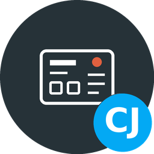
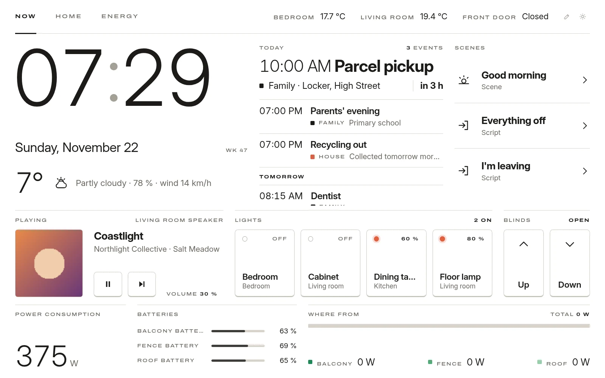
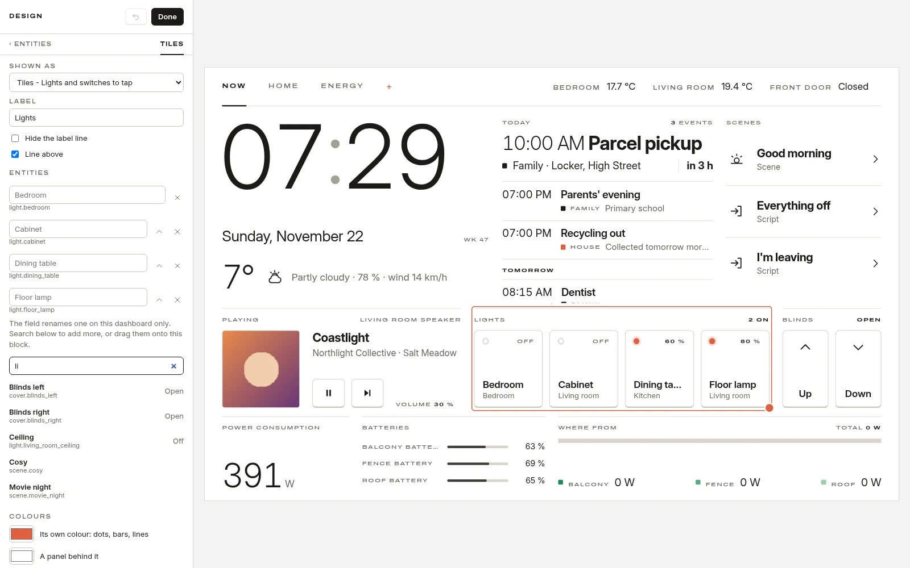
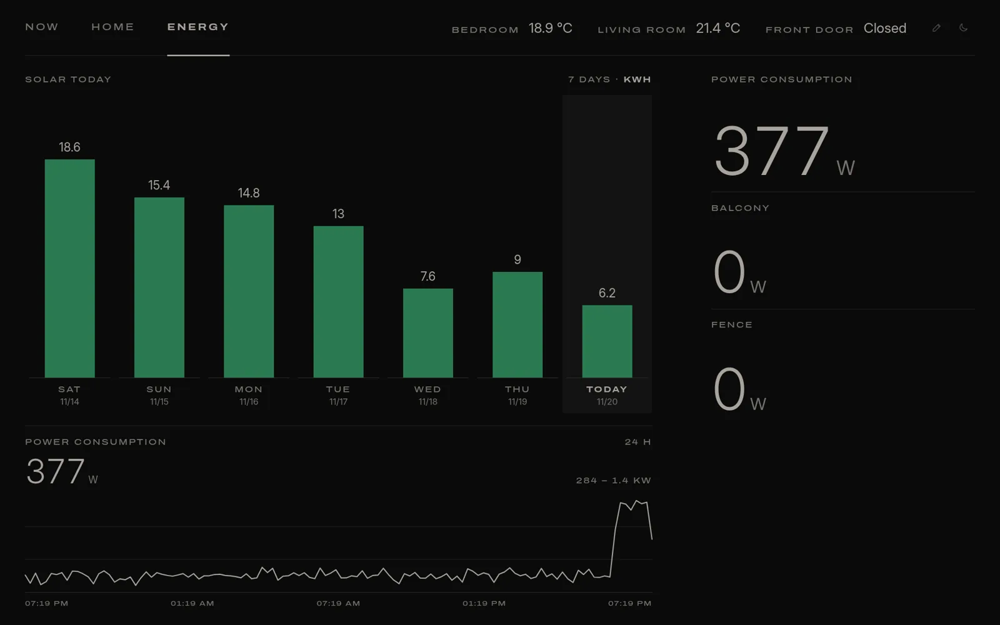
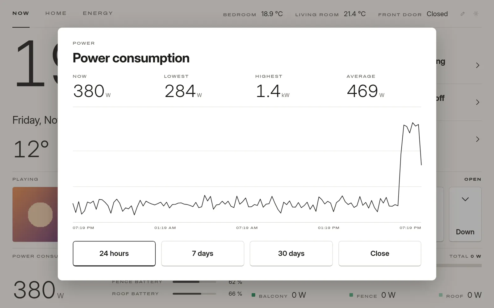

[![Version][version-shield]][changelog]
[![GitHub Activity][commits-shield]][commits]
[![License][license-shield]](https://github.com/cyberjunky/home-assistant-apps/blob/main/app-dashboard/LICENSE)
![Project Maintenance][maintenance-shield]
![Supports aarch64 Architecture][aarch64-shield]
![Supports amd64 Architecture][amd64-shield]

# Dashboard App for Home Assistant

Your home on a wall tablet, in a calm, typographic style: paper and ink, large light numerals,
bold names and small wide capitals, with lines instead of cards. Only what you can press gets a
box. No YAML and no cards to install: press the pencil and drag your sensors, lights, thermostat,
blinds, scenes, charts, calendars and cameras onto pages you make yourself.

Tap a reading for its history, hold a light for its slider, tap a camera for its live picture.
When the doorbell goes, every tablet shows the door. At night the tablet turns dark and dims, and
a block can show only in the morning or the evening, so the page fits the time of day. Choose the
fonts, the background and the accent colour; give a block its own colour.

More screenshots

## Supported Features

- ✏️ **Design it by dragging** — Press the pencil and drag entities from the drawer onto a page; move and size blocks on a grid that always fills the screen. No YAML, no cards to install, undo for everything
- 📄 **Your own pages** — As many as you like, with readings on the top bar that show on all of them; swipe between them
- 🧱 **Sixteen blocks** — Clock, heading, value, weather, tiles, slider, climate, blinds, actions, list, media, bars, split bar, chart, agenda and camera
- 📈 **History at a tap** — Any reading opens its last 24 hours, 7 or 30 days with lowest, highest and average; energy as a bar per day
- 💡 **Hold for more** — A light's brightness, a blind's position, a speaker's volume
- 📅 **Agenda** — Your calendars together: the next event large, then today and what follows
- 🌦️ **Weather ahead** — The days or the hours to come, in the block or in a popup
- 📷 **Cameras and the doorbell** — Pictures that renew themselves, live at a tap, and the door on every tablet when someone rings
- 🌙 **Follows the day** — Blocks that show only in the morning, the day, the evening or the night; a dark, dimmed screen at night that wakes at a touch; back to the first page when left alone
- 🎨 **Your look** — Six bundled fonts, the weight of the numbers, both backgrounds and the accent; a colour and a panel per block
- 🖥️ **Made for a wall tablet** — Scales to any screen, `?kiosk` hides the pencil, works without internet
- 💾 **Yours to keep** — In Home Assistant's backups, and as a file to save and load

## Requirements

- Home Assistant with the Supervisor (Home Assistant OS or Supervised)
- A tablet or screen with a recent browser; for a wall tablet a kiosk browser such as Fully Kiosk Browser, signed in to Home Assistant

## Installation

Alternatively:

1. Go to **Settings → Apps → App Store**
2. Open the menu (⋮) and choose **Repositories**
3. Add `https://github.com/cyberjunky/home-assistant-apps`
4. Install **Dashboard**
5. Start the app and open **Dashboard** from the sidebar

There is nothing to configure: the first start makes a dashboard from the entities it finds, and
the pencil makes it yours. See the [documentation](DOCS.md) for design mode, the blocks, the
tablet's settings and use on a wall tablet.

## 💖 Support This Project

If you find this app useful, please consider supporting its continued development and
maintenance:

### 🌟 Ways to Support

- **⭐ Star this repository** - Help others discover the project
- **💰 Financial Support** - Contribute to development and hosting costs
- **🐛 Report Issues** - Help improve stability and compatibility
- **📖 Spread the Word** - Share with other Home Assistant users

### 💳 Financial Support Options

Every contribution, no matter the size, makes a difference and is greatly appreciated! 🙏

## License

This project is licensed under the MIT License - see the [LICENSE](https://github.com/cyberjunky/home-assistant-apps/blob/main/app-dashboard/LICENSE) file for
details. The bundled fonts are under the SIL Open Font License 1.1.

---

[version-shield]: https://img.shields.io/badge/dynamic/yaml?url=https%3A%2F%2Fraw.githubusercontent.com%2Fcyberjunky%2Fhome-assistant-apps%2Fmain%2Fapp-dashboard%2Fconfig.yaml&query=%24.version&label=version&style=for-the-badge
[changelog]: https://github.com/cyberjunky/home-assistant-apps/blob/main/app-dashboard/CHANGELOG.md
[commits-shield]: https://img.shields.io/github/commit-activity/y/cyberjunky/home-assistant-apps.svg?style=for-the-badge
[commits]: https://github.com/cyberjunky/home-assistant-apps/commits/main
[license-shield]: https://img.shields.io/github/license/cyberjunky/home-assistant-apps.svg?style=for-the-badge
[maintenance-shield]: https://img.shields.io/badge/maintainer-cyberjunky-blue.svg?style=for-the-badge
[aarch64-shield]: https://img.shields.io/badge/aarch64-yes-green.svg?style=for-the-badge
[amd64-shield]: https://img.shields.io/badge/amd64-yes-green.svg?style=for-the-badge
