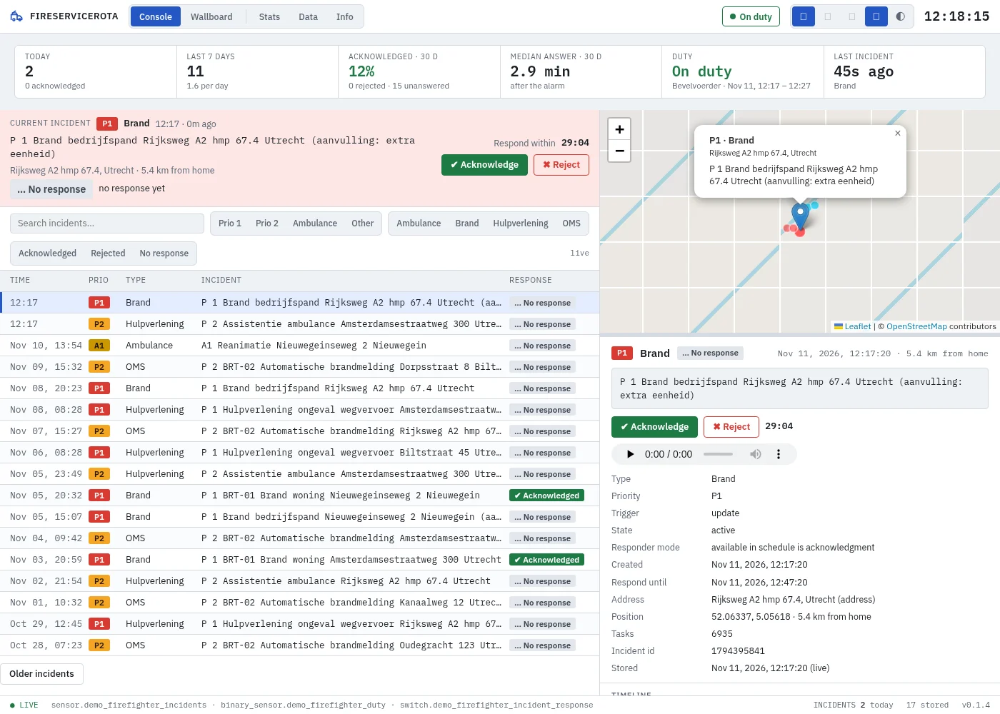
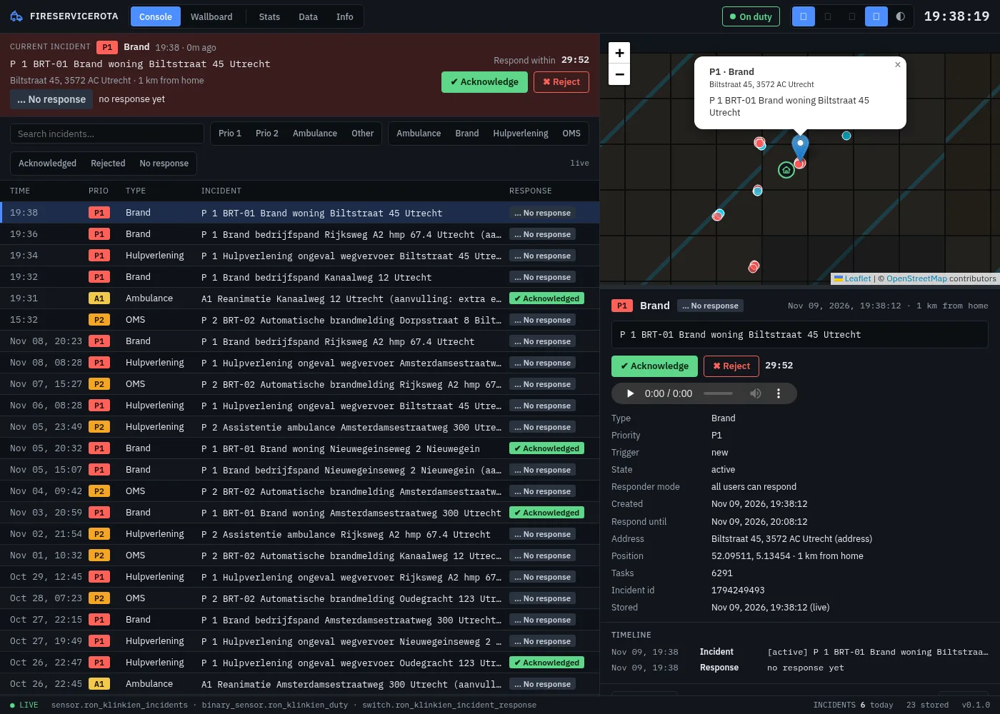
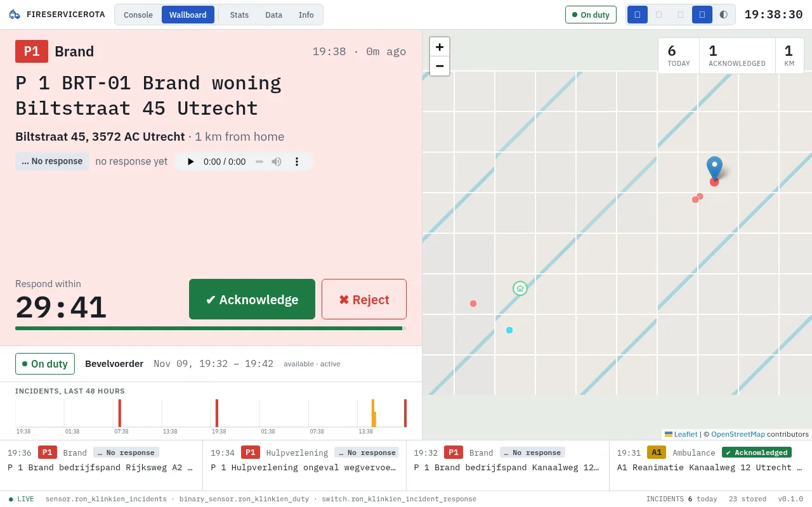
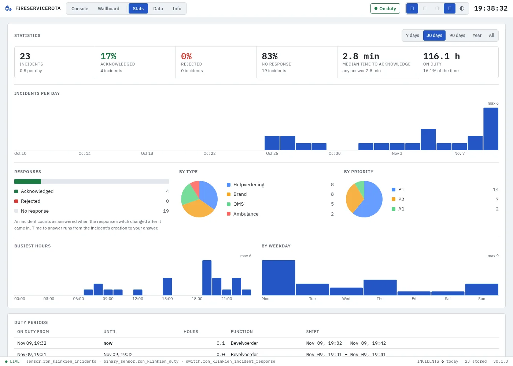

[![Version][version-shield]][changelog]
[![GitHub Activity][commits-shield]][commits]
[![License][license-shield]](LICENSE)
![Project Maintenance][maintenance-shield]
![Supports aarch64 Architecture][aarch64-shield]
![Supports amd64 Architecture][amd64-shield]

# FireServiceRota App for Home Assistant

> **Unofficial.** An independent project, not affiliated with, endorsed by or sponsored by FireServiceRota or Brandweerrooster.

A dashboard for Home Assistant's FireServiceRota integration (Brandweerrooster in the
Netherlands): the incident you are called for on a live map, with a countdown to the end of
the response window and buttons to acknowledge or reject it, your duty, and the history
of every incident and response with statistics.

The app reads everything from the integration in Home Assistant. It never contacts
FireServiceRota or Brandweerrooster itself and needs no account of its own. Everything it
records stays in the app's data folder and is included in your Home Assistant backups.

More screenshots (dark theme, Wallboard, Stats)

**Console, dark theme** — follows Home Assistant's light/dark mode

**Wallboard** — the current incident large with the countdown and answer buttons, the map, your duty, the last 48 hours and a ticker of recent incidents

**Stats** — totals and response rates, incidents per day, by type and priority, busiest hours and weekdays, duty periods

## Supported Features

- 🚒 **Live incident**: priority, type, the text, the address on the map and the distance from home, as soon as the integration gets it
- ⏱️ **Response window**: a countdown to `can_respond_until`, with a bar that runs out
- ✅ **Acknowledge or reject** from the dashboard, after a confirmation; greyed out with the reason when you are off duty or the window has closed
- 🟢 **Duty**: on or off duty, your shift and function, and your hours on duty
- 🖥️ **Wallboard**: the incident with its details and the buttons, duty, an hourly chart of the last 48 hours, the last 10 calls and the map, for an always-on screen down to 1024x600
- 🗂️ **History**: every incident, its updates, your responses and duty, stored live and imported from Home Assistant's recorder, never twice
- 📊 **Statistics**: incidents per day, week or month, by type, priority and hour, how often and how fast you answered
- 🔊 **Spoken message**: play FireServiceRota's spoken message in your browser; sound, browser speech and browser notifications on a new incident
- ⚡ **Home Assistant events**: `fireservicerota_app_incident` with a link that opens the incident in the dashboard, and optional announcements on your speakers with quiet hours
- 💾 **Your data**: CSV export, backup and restore of the database

## Installation

Alternatively:

1. Go to **Settings → Apps → App Store**
2. Open the menu (⋮) and choose **Repositories**
3. Add `https://github.com/cyberjunky/home-assistant-apps`
4. Set up the **FireServiceRota** integration in Home Assistant, if you haven't yet
5. Install **FireServiceRota** from the store, start it and open it from the sidebar

## Configuration

This app works out of the box: it finds the integration's entities by itself. The
options cover the entities (if you want other ones), how much history to import,
events and announcements. See [DOCS.md](DOCS.md) for every option, how it works, the
data it handles, the requirements and development notes.

## Disclaimer

This app is an independent project. It is not affiliated with, endorsed by or sponsored
by FireServiceRota or Brandweerrooster; the names are trademarks of their owners. It only
uses Home Assistant's FireServiceRota integration. Always check an answer in the
FireServiceRota app when it matters.

## 💖 Support This Project

If you find this app useful, please consider supporting its continued development and
maintenance:

### 🌟 Ways to Support

- **⭐ Star this repository** - Help others discover the project
- **💰 Financial Support** - Contribute to development and hosting costs
- **🐛 Report Issues** - Help improve stability and compatibility
- **📖 Spread the Word** - Share with other Home Assistant users

### 💳 Financial Support Options

Every contribution, no matter the size, makes a difference and is greatly appreciated! 🙏

## License

This project is licensed under the MIT License - see the [LICENSE](LICENSE) file for
details.

---

[version-shield]: https://img.shields.io/badge/dynamic/yaml?url=https%3A%2F%2Fraw.githubusercontent.com%2Fcyberjunky%2Fhome-assistant-apps%2Fmain%2Fapp-fireservicerota%2Fconfig.yaml&query=%24.version&label=version&style=for-the-badge
[changelog]: https://github.com/cyberjunky/home-assistant-apps/blob/main/app-fireservicerota/CHANGELOG.md
[commits-shield]: https://img.shields.io/github/commit-activity/y/cyberjunky/home-assistant-apps.svg?style=for-the-badge
[commits]: https://github.com/cyberjunky/home-assistant-apps/commits/main
[license-shield]: https://img.shields.io/github/license/cyberjunky/home-assistant-apps.svg?style=for-the-badge
[maintenance-shield]: https://img.shields.io/badge/maintainer-cyberjunky-blue.svg?style=for-the-badge
[aarch64-shield]: https://img.shields.io/badge/aarch64-yes-green.svg?style=for-the-badge
[amd64-shield]: https://img.shields.io/badge/amd64-yes-green.svg?style=for-the-badge
