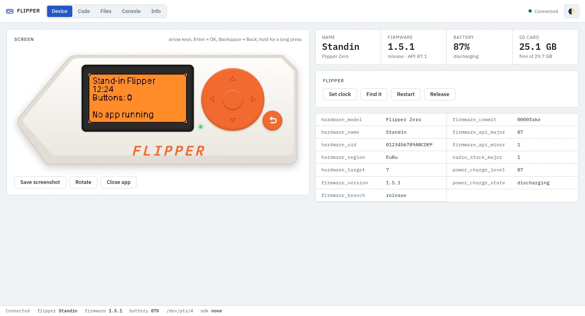
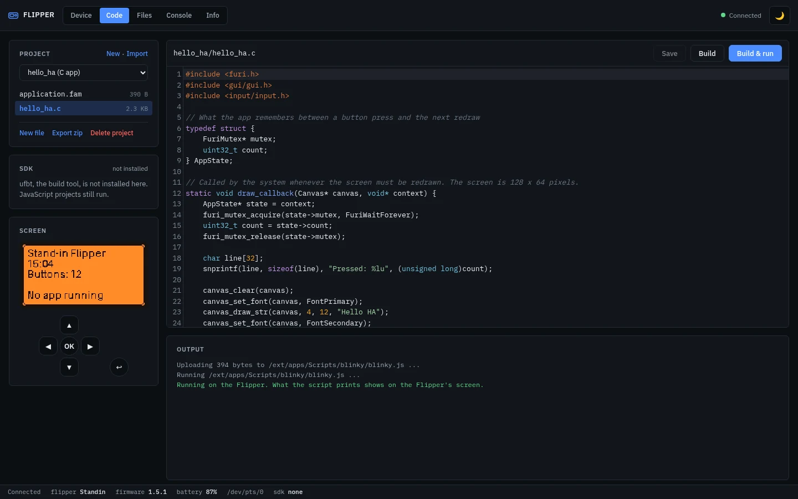
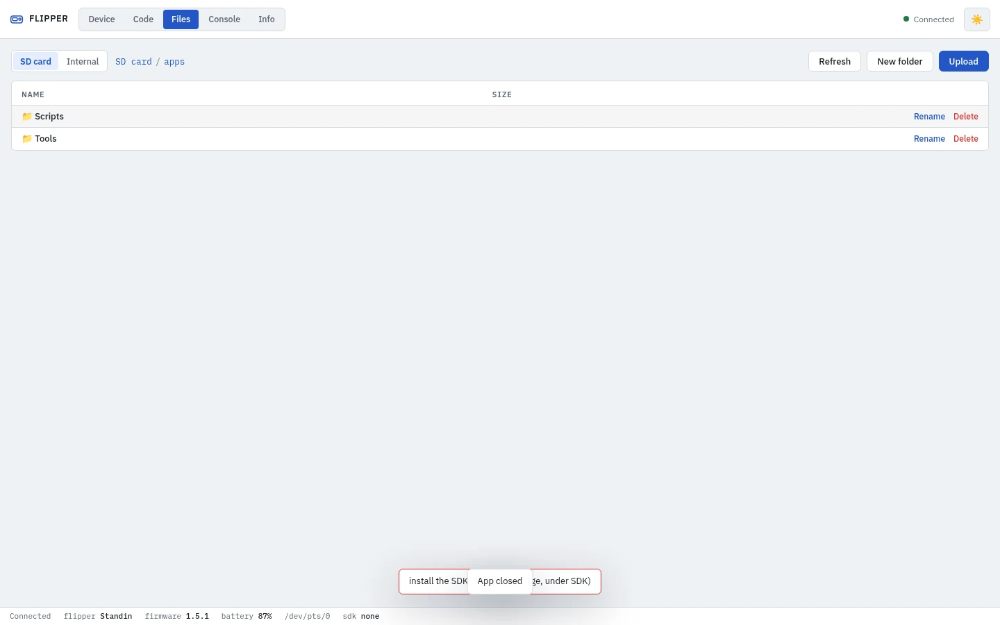
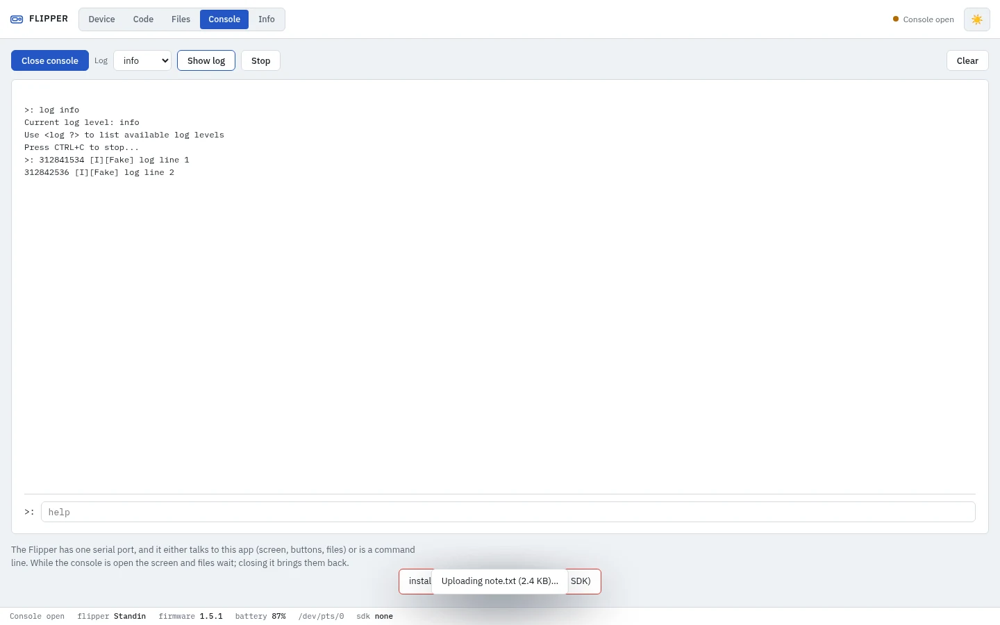

[![Version][version-shield]][changelog]
[![GitHub Activity][commits-shield]][commits]
[![License][license-shield]](https://github.com/cyberjunky/home-assistant-apps/blob/main/app-flipper/LICENSE)
![Project Maintenance][maintenance-shield]
![Supports aarch64 Architecture][aarch64-shield]
![Supports amd64 Architecture][amd64-shield]

# Flipper App for Home Assistant

A workbench for a Flipper Zero plugged into the machine Home Assistant runs on. Open it from the
sidebar to see the Flipper's screen and press its buttons, browse and change the files on its SD card,
and write, build and start apps on it: C apps built with Flipper's own build tool, and JavaScript the
Flipper runs as it is. The Flipper's command line and log are a tab away.

Not made by, or affiliated with, Flipper Devices.

More screenshots

**Code** — projects, the editor, Build & run, the build's output, and the Flipper's screen beside it

**Files** — what is on the SD card and the internal storage: upload, download, rename, delete, run

**Console** — the Flipper's own command line and its log

The screenshots show a stand-in Flipper used for development, not a real one.

## Supported Features

- 📺 **Screen and buttons**: the Flipper's screen, live, and its six buttons on the page and on your keyboard, with short and long presses; save a screenshot
- 📁 **Files**: browse the SD card and the internal storage; upload, download, rename, delete, make folders; start a `.fap` or a `.js`
- 🛠️ **C apps**: a project with an editor, **Build** (ufbt, Flipper's build tool) and **Build & run**, which puts the app on the Flipper and starts it; a compiler error is a click away from its line
- 📜 **JavaScript**: scripts are put on the Flipper and started with its JS Runner, with no build and no SDK
- 💻 **Console**: the Flipper's command line and its log, at the level you choose
- 🐬 **Device**: name, firmware, battery, SD card; set the clock, make it beep to find it, restart it

## Requirements

- A Flipper Zero on official firmware 1.x, plugged into the machine Home Assistant runs on with a USB cable that carries data
- For building C apps: 2 GB of free disk for the Flipper SDK and compiler, installed from the app

## Installation

Alternatively:

1. Go to **Settings → Apps → App Store**
2. Open the menu (⋮) and choose **Repositories**
3. Add `https://github.com/cyberjunky/home-assistant-apps`
4. Install **Flipper** from the store, start it and open it from the sidebar
5. Plug in the Flipper: the top bar says **Connected** and the Device page shows its screen

## Configuration

See [DOCS.md](https://github.com/cyberjunky/home-assistant-apps/blob/main/app-flipper/DOCS.md) for building apps, the SDK,
the console and what to know.

## Status

Version 0.1.0 is new. The SDK install and the build of both C templates were run for real in the app's
image; the link to the Flipper was written from the firmware's source and tested against a stand-in,
not yet on a real Flipper. Please report what you find.

## License

This project is licensed under the MIT License - see the [LICENSE](https://github.com/cyberjunky/home-assistant-apps/blob/main/app-flipper/LICENSE) file for
details.

---

## 💖 Support This Project

If you find this app useful, please consider supporting its continued development and
maintenance:

### 🌟 Ways to Support

- **⭐ Star this repository** - Help others discover the project
- **💰 Financial Support** - Contribute to development and hosting costs
- **🐛 Report Issues** - Help improve stability and compatibility
- **📖 Spread the Word** - Share with other Home Assistant users

### 💳 Financial Support Options

Every contribution, no matter the size, makes a difference and is greatly appreciated! 🙏

---

[version-shield]: https://img.shields.io/badge/dynamic/yaml?url=https%3A%2F%2Fraw.githubusercontent.com%2Fcyberjunky%2Fhome-assistant-apps%2Fmain%2Fapp-flipper%2Fconfig.yaml&query=%24.version&label=version&style=for-the-badge
[changelog]: https://github.com/cyberjunky/home-assistant-apps/blob/main/app-flipper/CHANGELOG.md
[commits-shield]: https://img.shields.io/github/commit-activity/y/cyberjunky/home-assistant-apps.svg?style=for-the-badge
[commits]: https://github.com/cyberjunky/home-assistant-apps/commits/main
[license-shield]: https://img.shields.io/github/license/cyberjunky/home-assistant-apps.svg?style=for-the-badge
[maintenance-shield]: https://img.shields.io/badge/maintainer-cyberjunky-blue.svg?style=for-the-badge
[aarch64-shield]: https://img.shields.io/badge/aarch64-yes-green.svg?style=for-the-badge
[amd64-shield]: https://img.shields.io/badge/amd64-yes-green.svg?style=for-the-badge
