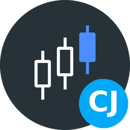

[![Version][version-shield]][changelog]
[![GitHub Activity][commits-shield]][commits]
[![License][license-shield]](LICENSE)
![Project Maintenance][maintenance-shield]
![Supports aarch64 Architecture][aarch64-shield]
![Supports amd64 Architecture][amd64-shield]

# Freqtrade App for Home Assistant

> **Unofficial.** An independent project, not affiliated with, endorsed by or sponsored by the Freqtrade project.

Dashboard for your [Freqtrade](https://www.freqtrade.io/) trading bots in Home Assistant. All
bots together on one overview, a page per bot with its trades, performance, balance and a
candle chart with the strategy's indicators and signals, and every trade the moment it happens,
heard over the bot's WebSocket. Each bot also appears in Home Assistant over MQTT, with an event
for every trade to use in automations.

The app doesn't trade and runs entirely on your Home Assistant. It talks to your bots' own API
servers, and the bots keep running where they run.

**It can change one thing: your bots**, from a bot's page: start, stop, pause entries, reload
the configuration, and exit an open trade. Each asks first. Set `read_only` to turn them off.

## Supported Features

- 🤖 **All bots at a glance** — Balance, profit, today, open trades and win rate of every bot, and of all together
- ⚡ **Live** — Entries, exits, warnings and protections arrive over each bot's WebSocket, and the numbers follow within seconds
- 🕯️ **Candle chart** — Any pair as the strategy sees it: its indicators from `plot_config`, its entry and exit signals, and your trades on it
- 📊 **Per bot** — Cumulative profit, balance, profit per day, week and month, trade profits, profit distribution, per pair, per entry tag and exit reason
- 📋 **Every trade** — Open trades with stop-loss and liquidation distance, and every closed trade to search and filter
- 💰 **Balance** — Per currency and position, and the bot's share of the account
- 🎛️ **Controls** — Start, stop, pause entries, reload config, and exit a trade
- 📨 **MQTT discovery** — Each bot as a device with its sensors, and a Trade events entity for automations

## Requirements

- One or more Freqtrade bots with their API server turned on (`api_server` in the bot's configuration), reachable from Home Assistant
- An MQTT broker for the entities in Home Assistant (optional; the dashboard works without one)

## Installation

Alternatively:

1. Go to **Settings → Apps → App Store**
2. Open the menu (⋮) and choose **Repositories**
3. Add `https://github.com/cyberjunky/home-assistant-apps`
4. Install **Freqtrade**
5. Add your bots under `bots` in the app's configuration: a name, the address of its API server, and its username and password
6. Start the app and open **Freqtrade** from the sidebar

## Configuration

Freqtrade needs the address, username and password of each bot's API server. See
[DOCS.md](DOCS.md) for every option, the settings on the bot's side, how it works and what the
dashboard shows.

## Disclaimer

This app is an independent project. It is not affiliated with, endorsed by or sponsored by the
Freqtrade project. Trading cryptocurrencies carries risk; the controls in this app act on your
bots for real. Nothing in this app is financial advice.

## 💖 Support This Project

If you find this app useful, please consider supporting its continued development and
maintenance:

### 🌟 Ways to Support

- **⭐ Star this repository** - Help others discover the project
- **💰 Financial Support** - Contribute to development and hosting costs
- **🐛 Report Issues** - Help improve stability and compatibility
- **📖 Spread the Word** - Share with other Home Assistant users

### 💳 Financial Support Options

Every contribution, no matter the size, makes a difference and is greatly appreciated! 🙏

## License

This project is licensed under the MIT License - see the [LICENSE](LICENSE) file for
details. Freqtrade itself is GPL-3.0 and is not part of this app; the app only talks to its API.

---

[version-shield]: https://img.shields.io/badge/dynamic/yaml?url=https%3A%2F%2Fraw.githubusercontent.com%2Fcyberjunky%2Fhome-assistant-apps%2Fmain%2Fapp-freqtrade%2Fconfig.yaml&query=%24.version&label=version&style=for-the-badge
[changelog]: https://github.com/cyberjunky/home-assistant-apps/blob/main/app-freqtrade/CHANGELOG.md
[commits-shield]: https://img.shields.io/github/commit-activity/y/cyberjunky/home-assistant-apps.svg?style=for-the-badge
[commits]: https://github.com/cyberjunky/home-assistant-apps/commits/main
[license-shield]: https://img.shields.io/github/license/cyberjunky/home-assistant-apps.svg?style=for-the-badge
[maintenance-shield]: https://img.shields.io/badge/maintainer-cyberjunky-blue.svg?style=for-the-badge
[aarch64-shield]: https://img.shields.io/badge/aarch64-yes-green.svg?style=for-the-badge
[amd64-shield]: https://img.shields.io/badge/amd64-yes-green.svg?style=for-the-badge
