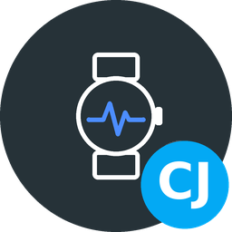
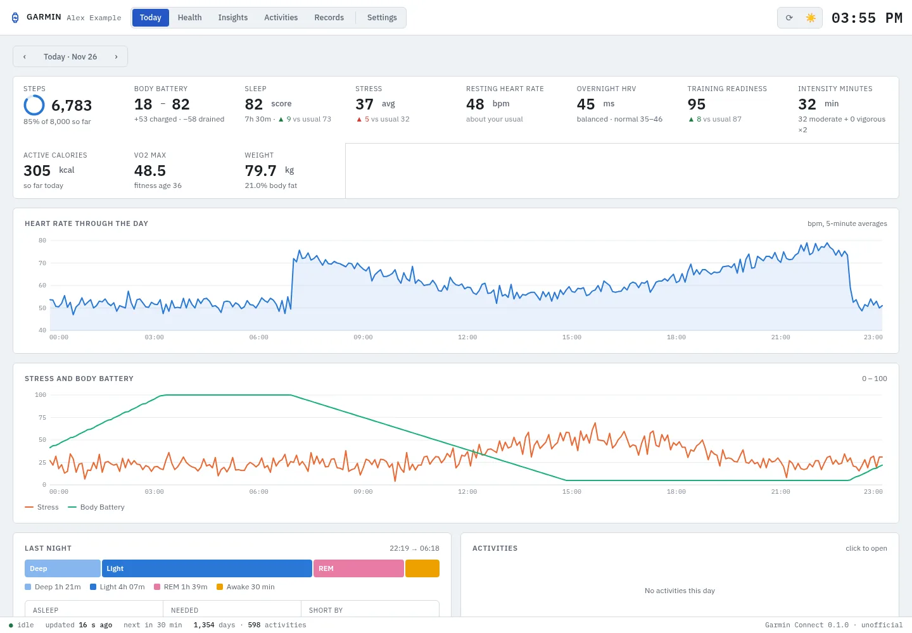
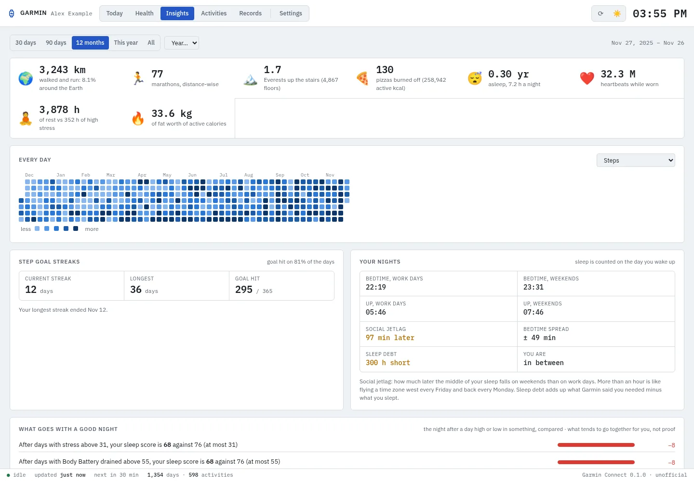
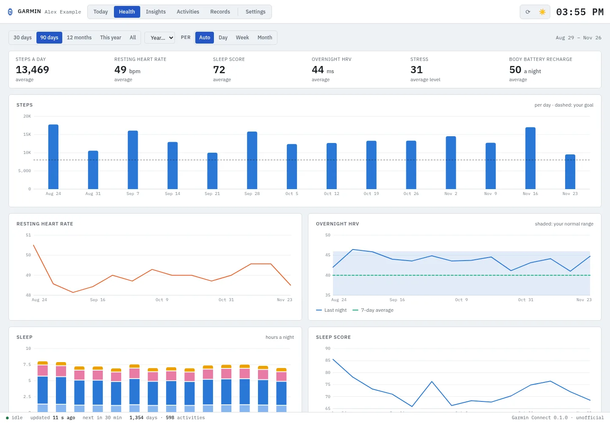
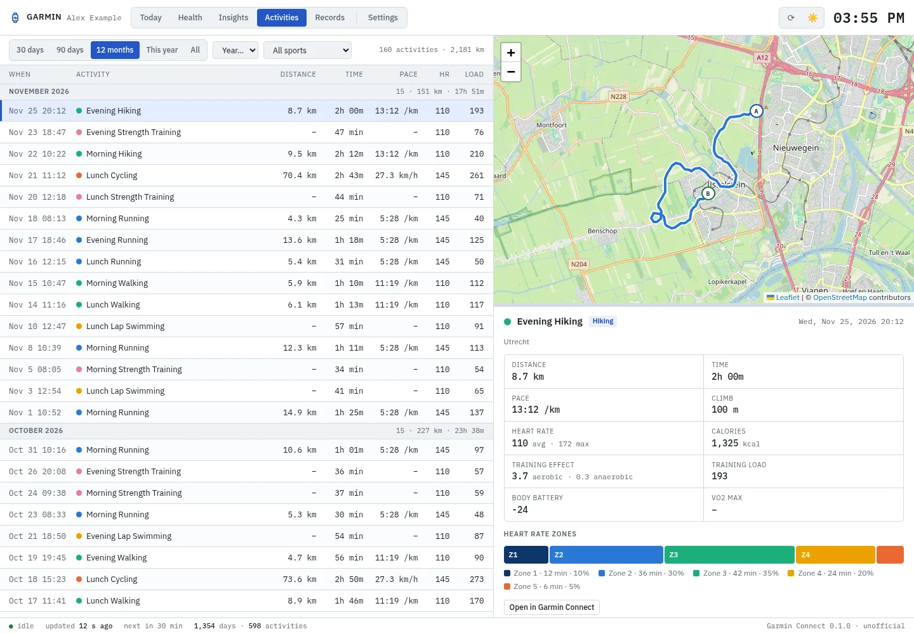
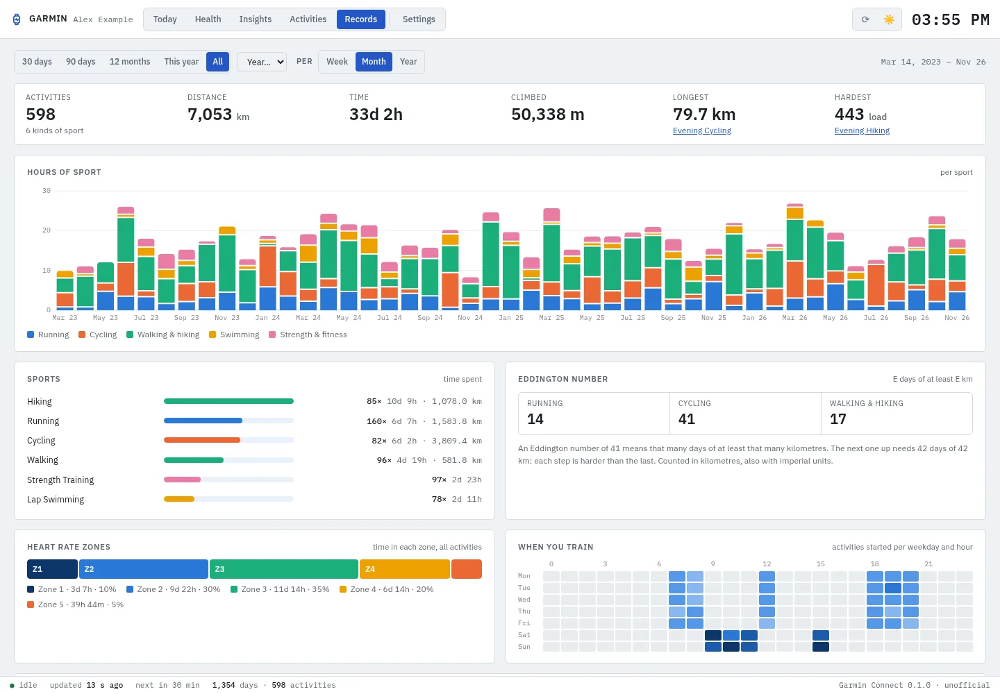
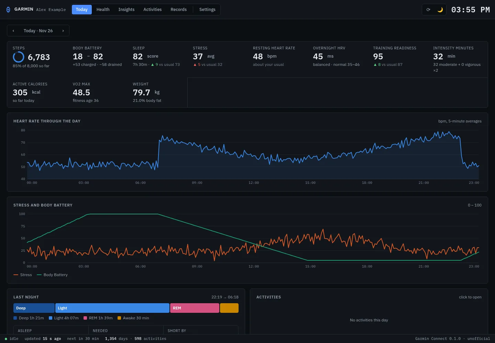

[![Version][version-shield]][changelog]
[![GitHub Activity][commits-shield]][commits]
[![License][license-shield]](https://github.com/cyberjunky/home-assistant-apps/blob/main/app-garminconnect/LICENSE)
![Project Maintenance][maintenance-shield]
![Supports aarch64 Architecture][aarch64-shield]
![Supports amd64 Architecture][amd64-shield]

# Garmin Connect App for Home Assistant

> **Unofficial.** An independent project, not affiliated with, endorsed by or sponsored by Garmin Ltd.

Your whole Garmin Connect history, kept at home, with the insights the Garmin site doesn't
show: what goes with a good night, how regular your nights are, streaks, days your body
looked off, your average day, Eddington numbers, a heat map of everywhere you've been, and
how far all those steps took you.

This app runs entirely on your Home Assistant. It has no cloud service of its own, no
analytics and no telemetry: it talks only to Garmin Connect, and everything it fetches stays
in the app's data folder and is included in your Home Assistant backups. It is standalone:
it creates no sensors.

More screenshots (Insights, Health, Activities, Records, dark theme)

This app follows Home Assistant's light or dark theme; the screenshots are made with a made-up account.

**Insights** — fun totals, a calendar of every day, streaks, your nights, what goes with a good night

**Health** — every daily value over any period, per day, week or month

**Activities** — every activity with its track on the map

**Records** — hours of sport, Eddington numbers, when you train, everywhere you've been

**Today, dark theme**

## Supported Features

- 🔑 **Sign in with MFA** — Email and password in the dashboard, plus the code when your account uses two-step verification. The password is never stored; the token refreshes itself
- 📚 **Your whole history** — Fetched once, newest first and in small pieces, back to the day your account was made; continues where it was after a restart
- 🎛️ **Data sets to choose** — Daily summaries, sleep and HRV, activities and GPS tracks, training, body composition, day curves, records; and the less common ones: ECG and Health Snapshot, performance metrics, nutrition (Connect+), menstrual cycle, golf
- 📅 **Today** — The day against your usual, heart rate, stress and Body Battery through the day, last night's sleep, the same date in earlier years
- 📈 **Health** — Every daily value over any period, per day, week or month, with an Explore chart for anything fetched
- 🌙 **Your nights** — Bedtime and wake-up on work days and weekends, social jetlag, sleep debt, early bird or night owl
- 🔎 **What goes with a good night** — The next night's sleep, HRV and resting heart rate after days high or low in steps, stress, workouts, late workouts, food or water
- 🤒 **Days your body looked off** — Resting heart rate well above its own normal, with low HRV or a poor recharge
- 🔥 **Streaks, bests and fun totals** — Step goal streaks, a calendar of every day, personal bests among your days, and your distance around the Earth, Everests climbed, pizzas burned and heartbeats counted
- 🏃 **Activities and records** — Every activity on the map, hours of sport, Eddington numbers, heart rate zones, when you train, gear life, badges and a heat map of every track
- 💾 **Your data** — Every Garmin answer is kept; CSV exports and a database backup, without your sign-in in it

## Installation

Alternatively:

1. Go to **Settings → Apps → App Store**
2. Open the menu (⋮) and choose **Repositories**
3. Add `https://github.com/cyberjunky/home-assistant-apps`
4. Install **Garmin Connect** and start it
5. Open **Garmin** from the sidebar and sign in

## Configuration

This app works out of the box; the options cover the update interval, how far back the
history goes and which data sets to fetch. See [DOCS.md](https://github.com/cyberjunky/home-assistant-apps/blob/main/app-garminconnect/DOCS.md) for every option and data set,
what the dashboard shows and the data it handles.

## Disclaimer

This app is an independent project. It is not affiliated with, endorsed by or sponsored
by Garmin Ltd.; "Garmin" and "Garmin Connect" are trademarks of Garmin Ltd. It uses the
Garmin Connect services Garmin's own apps use, through
[python-garminconnect](https://github.com/cyberjunky/python-garminconnect), which is not
an official third-party interface and can change without notice.

## 💖 Support This Project

If you find this app useful, please consider supporting its continued development and
maintenance:

### 🌟 Ways to Support

- **⭐ Star this repository** - Help others discover the project
- **💰 Financial Support** - Contribute to development and hosting costs
- **🐛 Report Issues** - Help improve stability and compatibility
- **📖 Spread the Word** - Share with other Home Assistant users

### 💳 Financial Support Options

Every contribution, no matter the size, makes a difference and is greatly appreciated! 🙏

## License

This project is licensed under the MIT License - see the [LICENSE](https://github.com/cyberjunky/home-assistant-apps/blob/main/app-garminconnect/LICENSE) file for
details.

---

[version-shield]: https://img.shields.io/badge/dynamic/yaml?url=https%3A%2F%2Fraw.githubusercontent.com%2Fcyberjunky%2Fhome-assistant-apps%2Fmain%2Fapp-garminconnect%2Fconfig.yaml&query=%24.version&label=version&style=for-the-badge
[changelog]: https://github.com/cyberjunky/home-assistant-apps/blob/main/app-garminconnect/CHANGELOG.md
[commits-shield]: https://img.shields.io/github/commit-activity/y/cyberjunky/home-assistant-apps.svg?style=for-the-badge
[commits]: https://github.com/cyberjunky/home-assistant-apps/commits/main
[license-shield]: https://img.shields.io/github/license/cyberjunky/home-assistant-apps.svg?style=for-the-badge
[maintenance-shield]: https://img.shields.io/badge/maintainer-cyberjunky-blue.svg?style=for-the-badge
[aarch64-shield]: https://img.shields.io/badge/aarch64-yes-green.svg?style=for-the-badge
[amd64-shield]: https://img.shields.io/badge/amd64-yes-green.svg?style=for-the-badge
