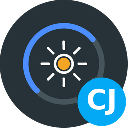
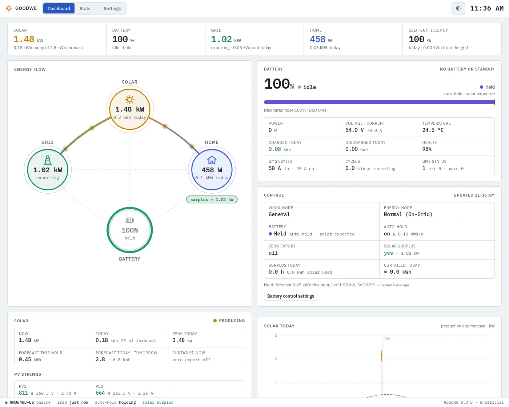
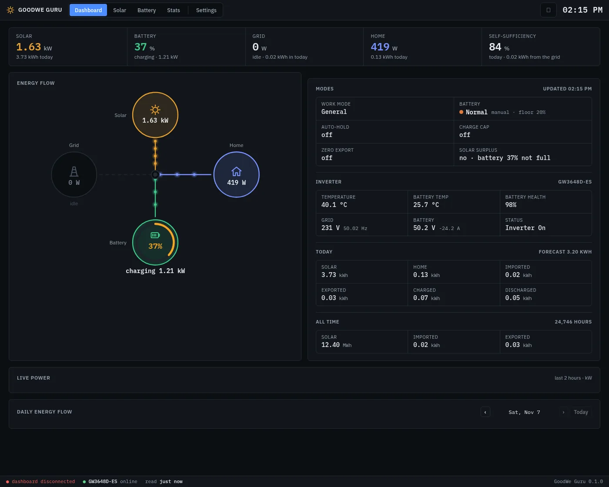

[![Version][version-shield]][changelog]
[![GitHub Activity][commits-shield]][commits]
[![License][license-shield]](LICENSE)
![Project Maintenance][maintenance-shield]
![Supports aarch64 Architecture][aarch64-shield]
![Supports amd64 Architecture][amd64-shield]

# GoodWe App for Home Assistant

> **Unofficial.** An independent project, not affiliated with, endorsed by or sponsored by GoodWe.

GoodWe inverter dashboard and battery controller for Home Assistant — the live energy flow
between solar, battery, grid and home, statistics on what was produced, used, stored and
exchanged with the grid, and a controller that times the battery with the solar forecast.

The app talks to the inverter directly over your network, the way the SolarGo app does.
It runs entirely on your Home Assistant: no cloud account, no analytics, no telemetry. The
only thing it fetches from the internet is the solar forecast, and that can be turned off.

## Why I built it

My GoodWe ES inverter doesn't offer a proper zero-export mode. That looks like a gap in the
firmware rather than a setting I missed. Feed-in earns me nothing and only costs, so every
kWh I export is wasted. The app keeps the export limit at 0 W with the limit enforced, holds the
battery for the evening by the solar forecast, and tells Home Assistant when the battery is
full and solar is still going spare. I'm preparing to work that way: in summer, use every bit
of surplus solar myself (miners, boiler, car) instead of giving it to the grid.

More screenshots (dark theme)

**Dashboard, dark theme** — follows Home Assistant's light/dark mode

## Supported Features

- ⚡ **Live dashboard** — Solar and battery together: an energy flow that shows where the solar actually goes (home, battery, grid), the battery (state of charge, power, health, BMS limits, cycles), every PV string against the forecast, and what the controller is doing
- 🧠 **Auto-hold** — Keeps the battery for the evening while the hourly solar forecast (with an offset you can tune) says the sun will cover the house, and releases it otherwise; about two inverter writes a day. Pauses, and tells you, when the inverter isn't in General mode
- 🚫 **Zero export** — Keeps the grid export limit at 0 W with the limit enforced, re-checked when the grid power says otherwise
- 🌞 **Solar surplus signal** — A binary sensor that turns on when the battery is full and solar is going spare, with a margin you set, so Home Assistant can switch on a miner, a boiler or a car charger; the miners' status, hours and energy show on the dashboard and in the stats
- 📊 **Statistics** — Energies per day, week or month, grid import and export, battery throughput and cycles, surplus hours and curtailed solar, self-sufficiency and self-consumption, a Sankey of each day, the solar forecast and its accuracy, yields and records
- 📨 **MQTT discovery** — The inverter becomes a device in Home Assistant with sensors, binary sensors and an *Events* entity for your own automations (a Telegram message on a hold, a violation, a surplus...)
- 🔧 **The right commands** — Every write uses the dedicated command that actually sticks on ES/EM/BP inverters (depth of discharge, export limit and switch, back to General mode); nothing is written on a loop
- 💾 **Your data** — Everything stays in the app; export the daily energies as CSV or download the database

## Installation

Alternatively:

1. Go to **Settings → Apps → App Store**
2. Open the menu (⋮) and choose **Repositories**
3. Add `https://github.com/cyberjunky/home-assistant-apps`
4. Install **GoodWe**, enter the inverter's IP address on its Configuration tab, and start it
5. Open **GoodWe** from the sidebar

## Configuration

The inverter's address and poll interval, the solar forecast (location and panels) and
the MQTT broker are set on the add-on's Configuration tab. The battery control (auto-hold,
zero export, surplus signal) is set on the dashboard's Settings page. See
[DOCS.md](DOCS.md) for every option, how the controller decides, the MQTT entities, the data
it handles, the requirements and development notes.

## Supported inverters

The app uses the [goodwe](https://github.com/marcelblijleven/goodwe) Python library.
It was built and tested on a GoodWe **ES** (GW3648D-ES); the other hybrid series (EM, BP,
ET, EH, BT, BH) are read the same way, but the battery control commands are only confirmed
on the ES. Grid-tied inverters without a battery (XS, DNS, SDT, ...) get the monitoring only.

## Disclaimer

This app is an independent project. It is not affiliated with, endorsed by or sponsored
by GoodWe Technologies Co., Ltd.; "GoodWe" and "SolarGo" are trademarks of their owner.
Changing inverter settings is at your own risk.

## 💖 Support This Project

If you find this app useful, please consider supporting its continued development and
maintenance:

### 🌟 Ways to Support

- **⭐ Star this repository** - Help others discover the project
- **💰 Financial Support** - Contribute to development and hosting costs
- **🐛 Report Issues** - Help improve stability and compatibility
- **📖 Spread the Word** - Share with other Home Assistant users

### 💳 Financial Support Options

Every contribution, no matter the size, makes a difference and is greatly appreciated! 🙏

## License

This project is licensed under the MIT License - see the [LICENSE](LICENSE) file for
details.

---

[version-shield]: https://img.shields.io/badge/dynamic/yaml?url=https%3A%2F%2Fraw.githubusercontent.com%2Fcyberjunky%2Fhome-assistant-apps%2Fmain%2Fapp-goodwe%2Fconfig.yaml&query=%24.version&label=version&style=for-the-badge
[changelog]: https://github.com/cyberjunky/home-assistant-apps/blob/main/app-goodwe/CHANGELOG.md
[commits-shield]: https://img.shields.io/github/commit-activity/y/cyberjunky/home-assistant-apps.svg?style=for-the-badge
[commits]: https://github.com/cyberjunky/home-assistant-apps/commits/main
[license-shield]: https://img.shields.io/github/license/cyberjunky/home-assistant-apps.svg?style=for-the-badge
[maintenance-shield]: https://img.shields.io/badge/maintainer-cyberjunky-blue.svg?style=for-the-badge
[aarch64-shield]: https://img.shields.io/badge/aarch64-yes-green.svg
[amd64-shield]: https://img.shields.io/badge/amd64-yes-green.svg
