[![Version][version-shield]][changelog]
[![GitHub Activity][commits-shield]][commits]
[![License][license-shield]](https://github.com/cyberjunky/home-assistant-apps/blob/main/app-knxray/LICENSE)
![Project Maintenance][maintenance-shield]
![Supports aarch64 Architecture][aarch64-shield]
![Supports amd64 Architecture][amd64-shield]

# KNX-Ray App for Home Assistant

An X-ray of your KNX installation. KNX-Ray listens to the bus, holds what it hears against your ETS
project and against the KNX entities in Home Assistant, and says what does not add up: a value that
does not fit its datapoint type, a read nobody answers, a device that sends where it is not linked,
an entity on an address that no longer exists. It records every telegram, so you can chart a value
or look up what happened at three in the morning. It only reads.

KNX-Ray is an unofficial KNX application: it is not made by, or associated with, the KNX Association.

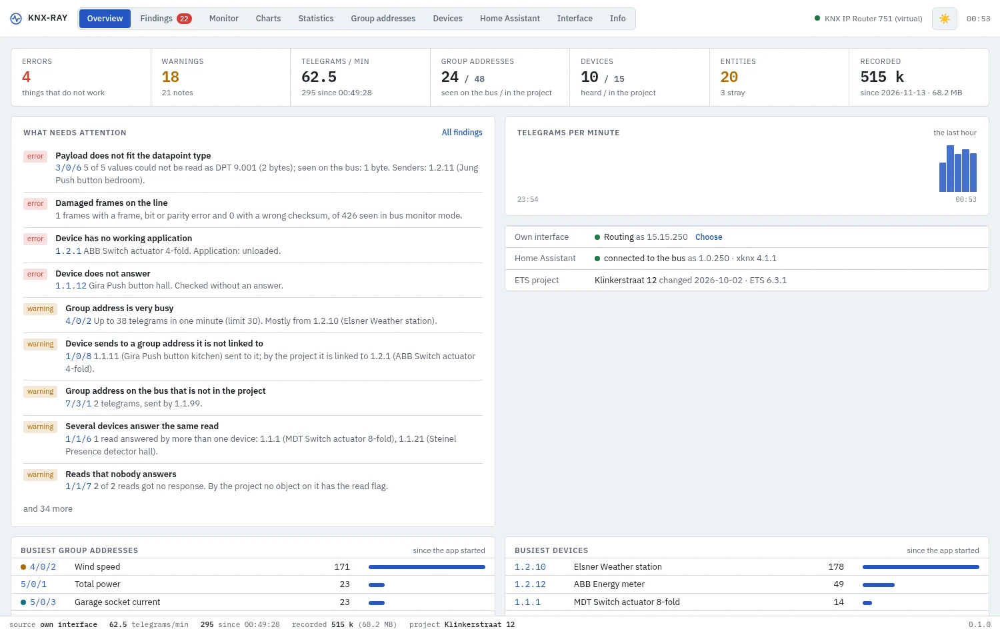

More screenshots

**Findings** — everything the checks found, by kind, each with what to do about it
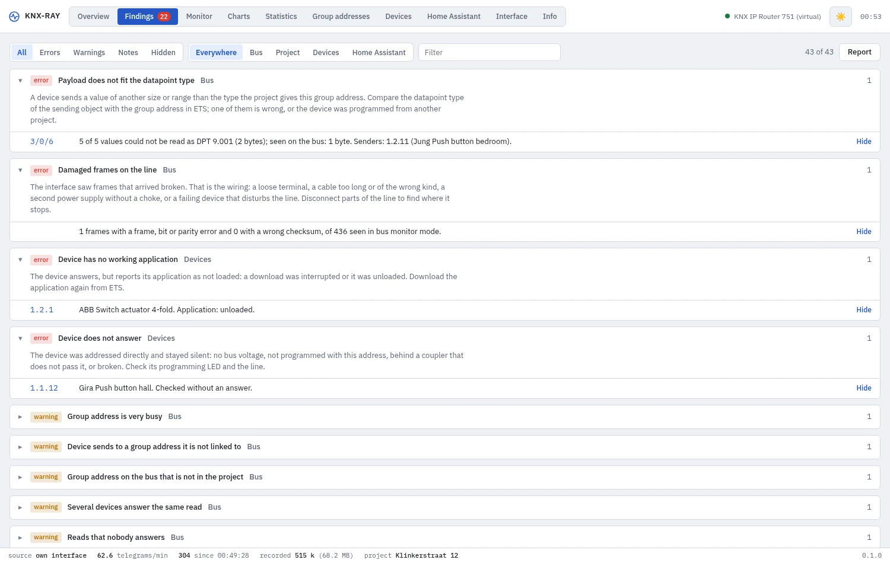

**Monitor** — the telegrams live, decoded, with the time since the one before; the Archive beside it
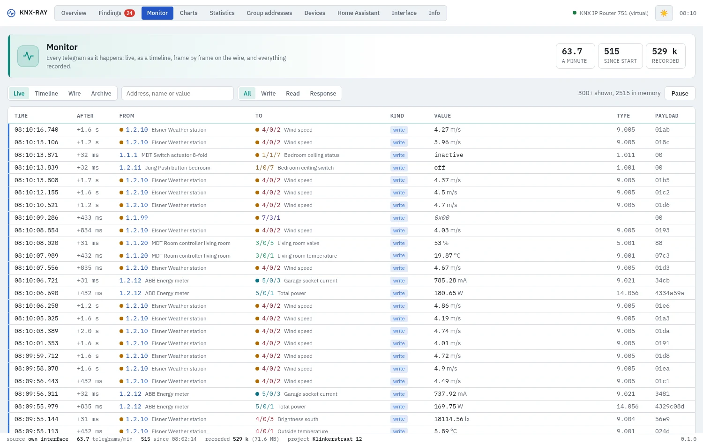

**Wire** — bus monitor mode: every frame on the line, sent again or not, and what came back
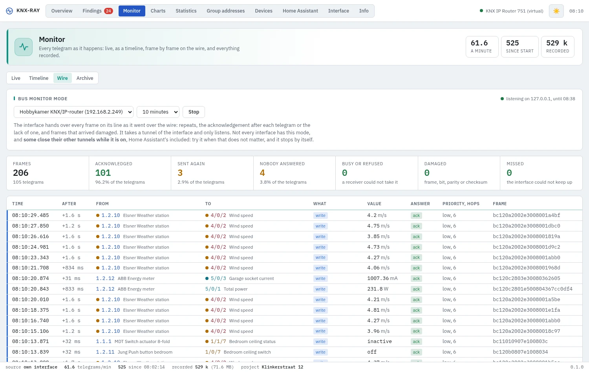

**Timeline** — who sent what when, a lane per sender
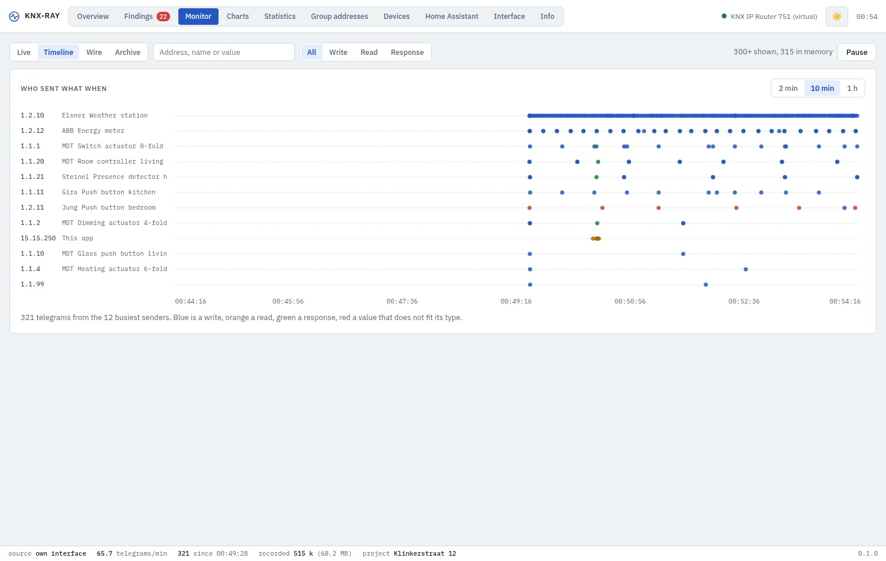

**Charts** — the recorded values of up to four group addresses
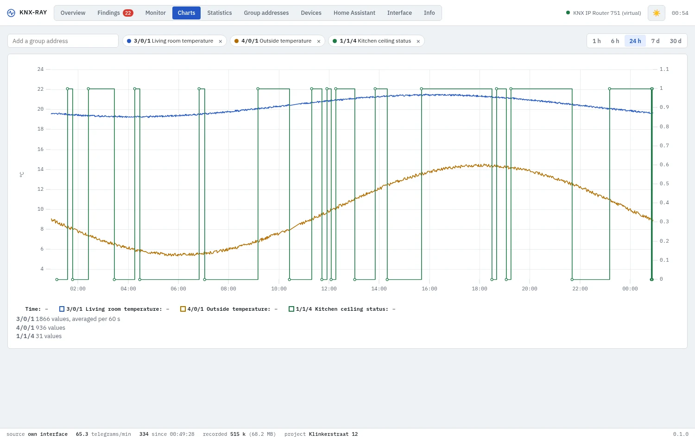

**Statistics** — telegrams over time, when the bus is busy, who talks most, and when the app was listening
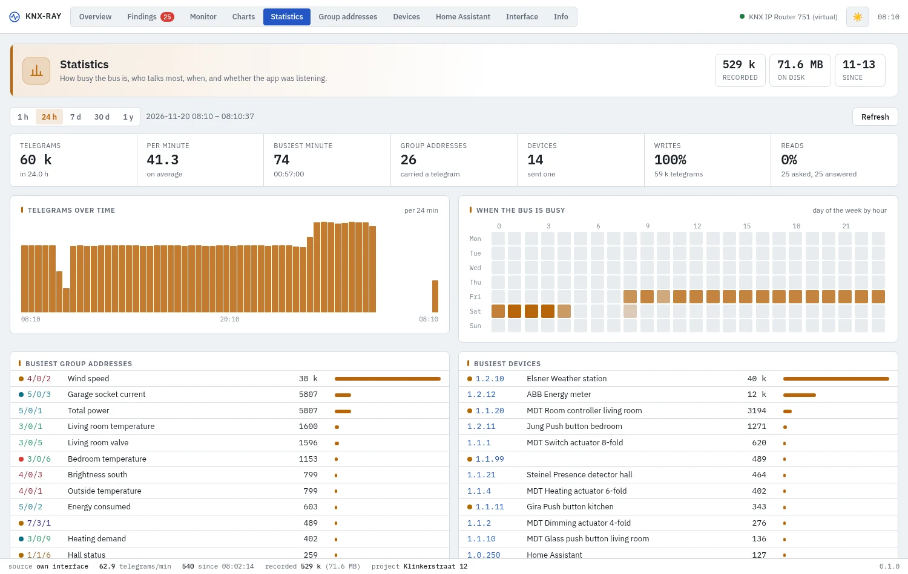

**Group addresses** — every address with its type, last value, senders, linked objects and entities
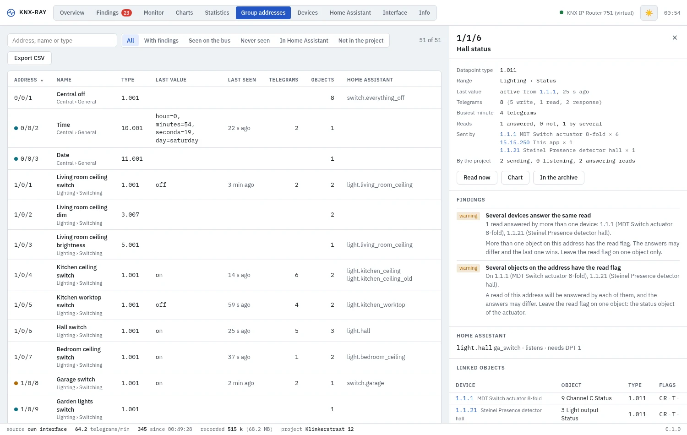

**Devices** — what a device answered when asked, and the group addresses it really holds
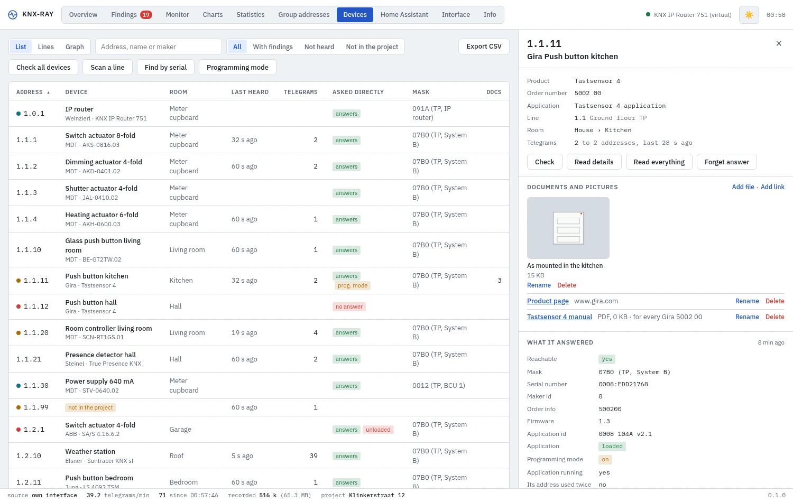

**Lines** — the installation as it is wired; a device lights up when it sends
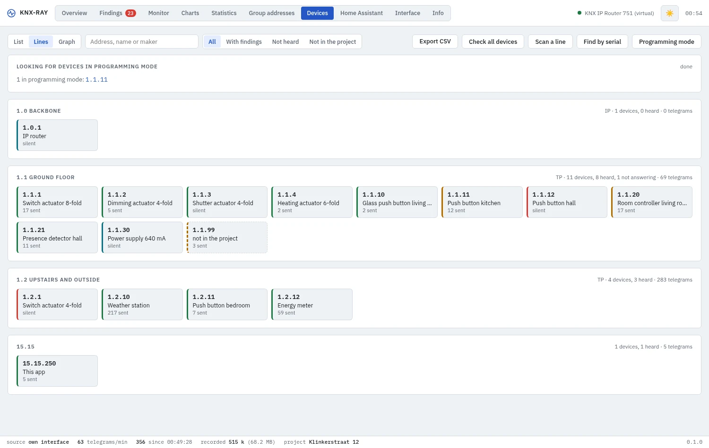

**Graph** — devices and the group addresses that tie them together, lighting up with the traffic
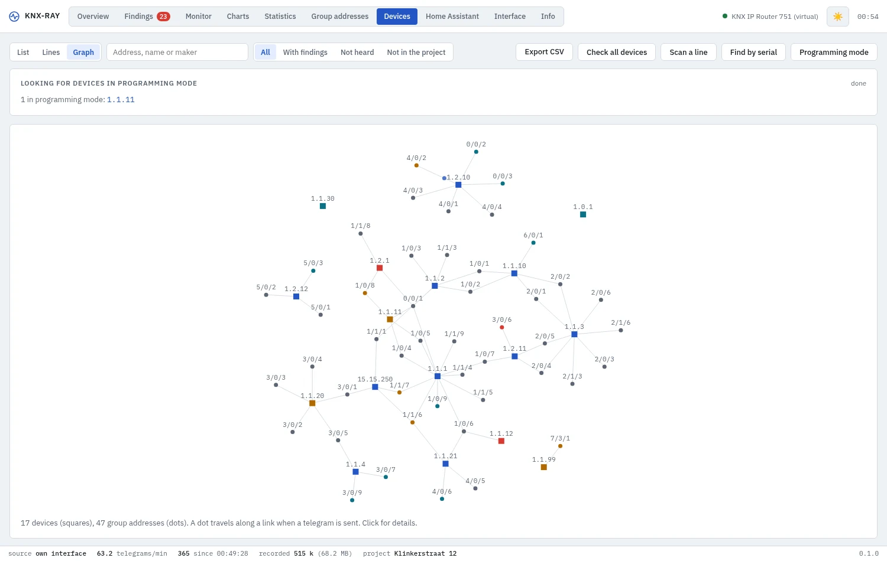

**Home Assistant** — the KNX entities with their addresses, and what was left behind
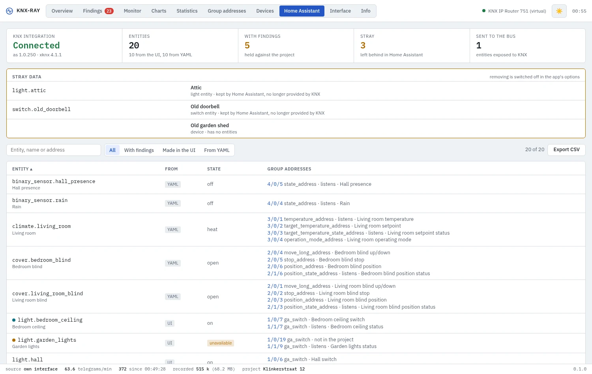

**Interface** — the KNX IP interfaces on the network, and how the app reaches the bus
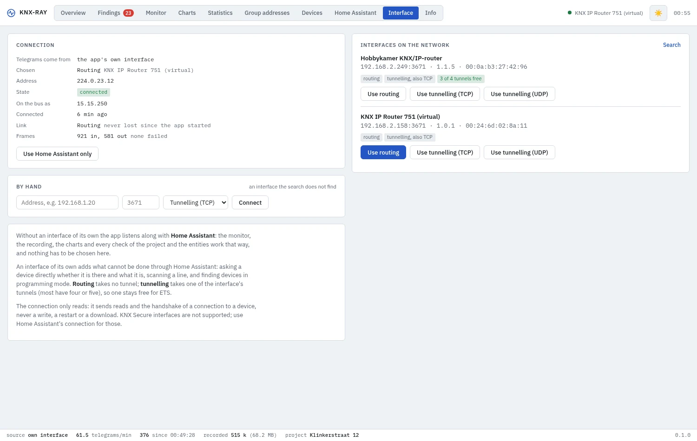

**Dark theme**
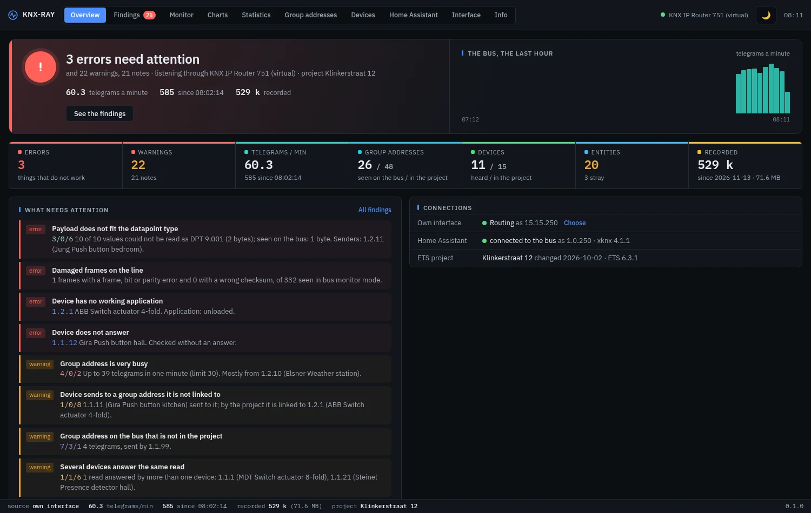

The screenshots show a made-up installation used for development, not a real one.

## Supported Features

- 🩻 **Findings**: over fifty checks of the bus, the project and Home Assistant against each other, each with what to do; hide what you have judged, download the lot as a report
- 📡 **Monitor**: every telegram live, decoded with the project's datapoint types, with sender and group address by name; a timeline per sender
- 🔬 **Bus monitor mode**: every frame on the line as it went over the wire, with repeats, acknowledgements, busy receivers and damaged frames
- 💾 **Recording**: every telegram kept for months; an archive with filters and CSV export; fills its own gaps from Home Assistant's telegram store
- 📈 **Charts**: the recorded values of up to four group addresses, from an hour to a month
- 📊 **Statistics**: telegrams over time, a weekday by hour heatmap, the busiest addresses and devices, and whether the app was listening
- 🏷️ **Group addresses**: type, last value, who sends, which objects are linked with which flags, which entities use it; read a value now and see who answers
- 🔌 **Devices**: per device or per line; ask a device whether it is there, read its serial number, firmware and application state, verify the links and flags it really holds against the project, read what a coupler passes, scan a line, find devices in programming mode or by serial number
- 📎 **Documents and pictures**: manuals as PDF, photos and links to web pages, kept per device or per product
- 🏠 **Home Assistant**: KNX entities from the UI and from YAML checked against the project; stray entities found and, if you allow it, removed
- 🔎 **Interface**: finds KNX IP interfaces and routers on the network; routing or tunnelling over UDP or TCP, or simply listening along with Home Assistant
- 🔒 **Read-only**: the app's connection refuses everything but reads

## Requirements

- Home Assistant 2026.10 or later with the **KNX** integration set up
- Your ETS project uploaded in the KNX integration, for names, datapoint types and most checks
- For the device checks: a KNX IP interface or router the app can reach (not KNX Secure)

## Installation

Alternatively:

1. Go to **Settings → Apps → App Store**
2. Open the menu (⋮) and choose **Repositories**
3. Add `https://github.com/cyberjunky/home-assistant-apps`
4. Install **KNX-Ray** from the store, start it and open it from the sidebar
5. Telegrams appear on the Monitor page; the Findings fill as the bus is heard

## Configuration

See [DOCS.md](https://github.com/cyberjunky/home-assistant-apps/blob/main/app-knxray/DOCS.md) for every page, what each finding means, choosing an interface and the
options.

## Status

Version 0.1.0 is new. It was developed against a made-up installation. On one real KNX IP router
with a handful of devices these were tried and worked: finding the interface, listening through a
tunnel, asking and reading devices, scanning a line, finding a device by its serial number, and bus
monitor mode. The device-versus-project comparison and Home Assistant's side have not yet run on a
real installation.
Please report what you find.

## License

This project is licensed under the MIT License - see the [LICENSE](https://github.com/cyberjunky/home-assistant-apps/blob/main/app-knxray/LICENSE) file for
details.

---

## 💖 Support This Project

If you find this app useful, please consider supporting its continued development and
maintenance:

### 🌟 Ways to Support

- **⭐ Star this repository** - Help others discover the project
- **💰 Financial Support** - Contribute to development and hosting costs
- **🐛 Report Issues** - Help improve stability and compatibility
- **📖 Spread the Word** - Share with other Home Assistant users

### 💳 Financial Support Options

Every contribution, no matter the size, makes a difference and is greatly appreciated! 🙏

---

[version-shield]: https://img.shields.io/badge/dynamic/yaml?url=https%3A%2F%2Fraw.githubusercontent.com%2Fcyberjunky%2Fhome-assistant-apps%2Fmain%2Fapp-knxray%2Fconfig.yaml&query=%24.version&label=version&style=for-the-badge
[changelog]: https://github.com/cyberjunky/home-assistant-apps/blob/main/app-knxray/CHANGELOG.md
[commits-shield]: https://img.shields.io/github/commit-activity/y/cyberjunky/home-assistant-apps.svg?style=for-the-badge
[commits]: https://github.com/cyberjunky/home-assistant-apps/commits/main
[license-shield]: https://img.shields.io/github/license/cyberjunky/home-assistant-apps.svg?style=for-the-badge
[maintenance-shield]: https://img.shields.io/badge/maintainer-cyberjunky-blue.svg?style=for-the-badge
[aarch64-shield]: https://img.shields.io/badge/aarch64-yes-green.svg?style=for-the-badge
[amd64-shield]: https://img.shields.io/badge/amd64-yes-green.svg?style=for-the-badge
