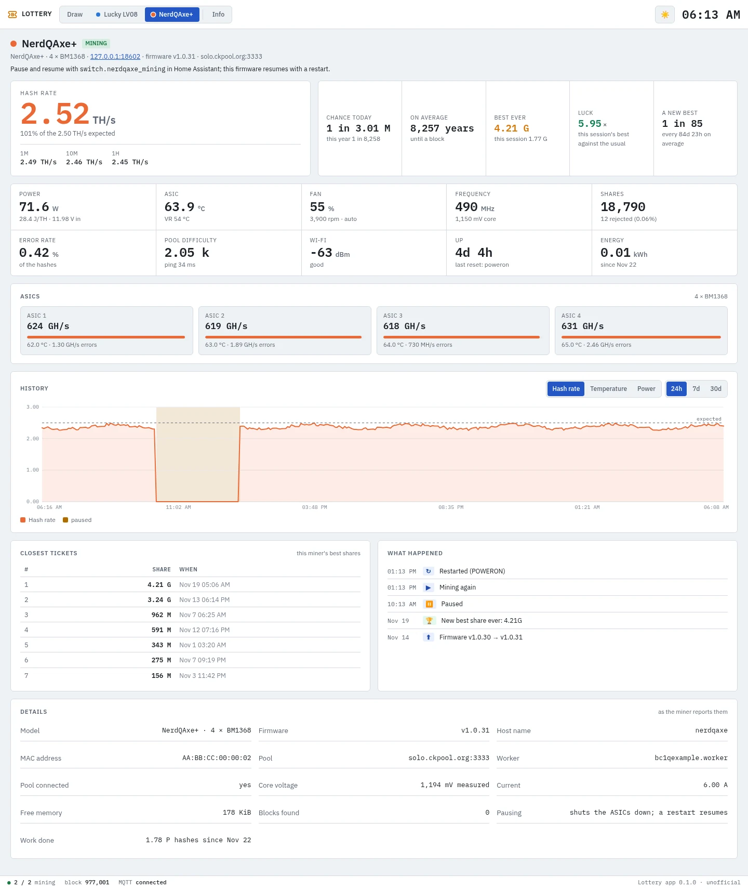
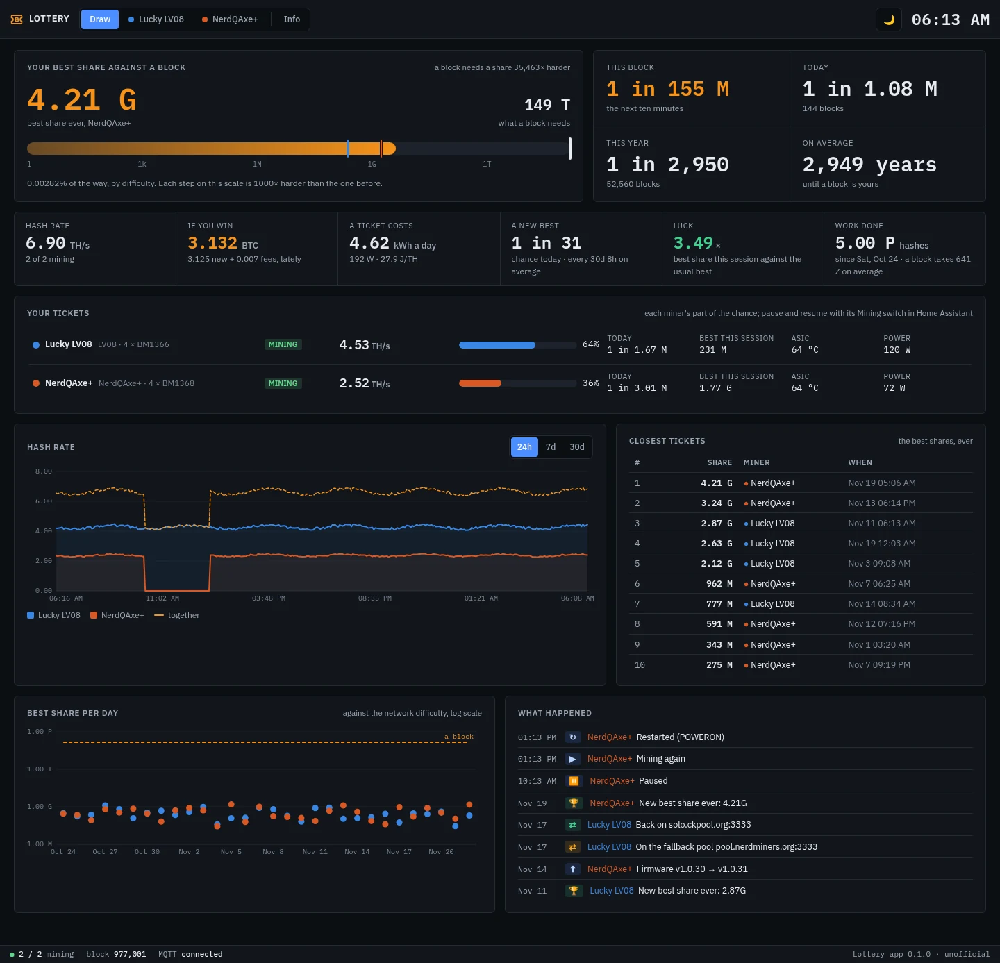
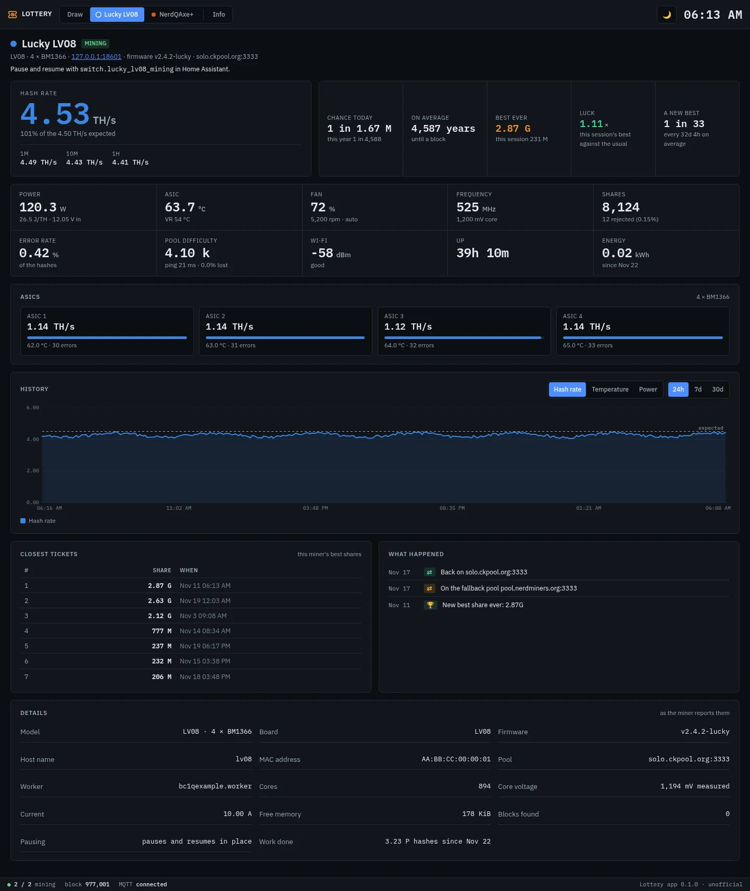
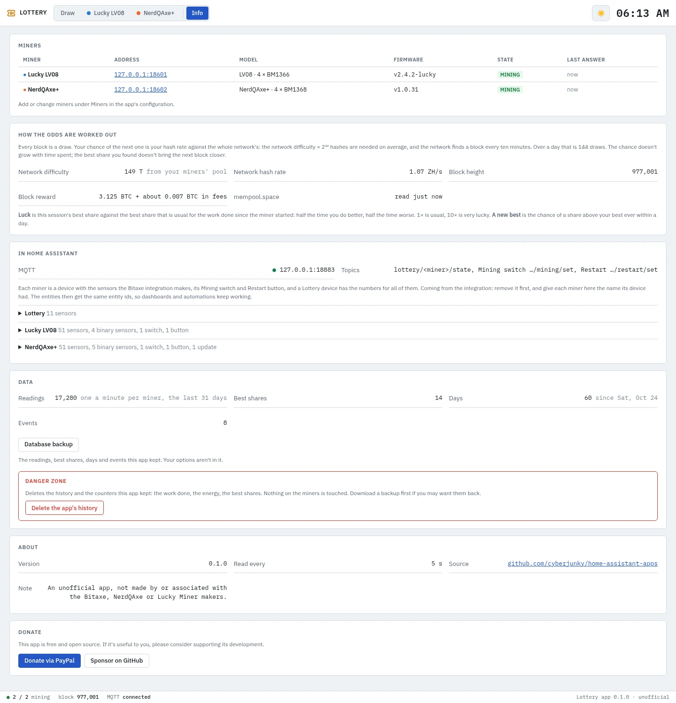

[![Version][version-shield]][changelog]
[![GitHub Activity][commits-shield]][commits]
[![License][license-shield]](https://github.com/cyberjunky/home-assistant-apps/blob/main/app-lottery/LICENSE)
![Project Maintenance][maintenance-shield]
![Supports aarch64 Architecture][aarch64-shield]
![Supports amd64 Architecture][amd64-shield]

# Lottery App for Home Assistant

Solo mining is a lottery: every block is a draw, and your miners hold a few tickets. This app shows
what your tickets are worth. It is a dashboard for your Bitaxe, NerdQAxe, Lucky Miner and other
AxeOS miners in Home Assistant. Your odds come first: the chance of a block in the next ten minutes,
today and this year, how close your best share came, and what a block pays. A page per miner has
its hash rate, temperatures, ASICs, history and events.

Each miner also appears in Home Assistant over MQTT, with the sensors the Bitaxe integration makes,
under the same names, and its **Mining** switch and **Restart** button. The app replaces the
integration: remove it, and your dashboards and automations keep working.

The app runs entirely on your Home Assistant and reads your miners over their own web API. It
changes nothing on them by itself: pausing, resuming and restarting happen only when you use a
miner's Mining switch or Restart button in Home Assistant, or an automation of yours does.

More screenshots

**A miner** — its hash rate and averages, its own odds and luck, power, temperatures, fan, shares, the ASICs, the history with paused stretches, its best shares and events

**The draw, dark theme** — follows Home Assistant's light/dark mode

**A miner, dark theme**

**Info** — the miners, how the odds are worked out, the entities in Home Assistant, and the app's data

## Supported Features

- 🎟️ **Your odds** — The chance of a block this block, today and this year, and how many years it takes on average, for all miners together and per miner
- 🎯 **How close you came** — Your best share against what a block needs, on a scale you can read, and the closest tickets ever
- 🍀 **Luck** — This session's best share against what is usual for the work done, and the chance of a new best today
- 💰 **The prize and the price** — What a block pays now (reward plus recent fees) and what a day of tickets costs in kWh
- ⛏️ **Per miner** — Hash rate and its averages, power and efficiency, temperatures, fan, frequency, shares, error rate, pool, Wi-Fi and every ASIC
- 📈 **History** — Hash rate, temperature and power over 24 hours to 30 days with the paused stretches, and the best share per day against the network
- 🔔 **What happened** — Paused, resumed, restarted, a new best, a pool lost, overheating, new firmware, and a found block
- 📨 **MQTT discovery** — Each miner as a device with the Bitaxe integration's sensors, a Mining switch, a Restart button and a Firmware entity, plus a Lottery device with the totals

## Requirements

- One or more miners with AxeOS firmware or a fork of it (Bitaxe, NerdQAxe, Lucky Miner and others), reachable from Home Assistant
- An MQTT broker for the entities in Home Assistant (optional; the dashboard works without one)

## Installation

Alternatively:

1. Go to **Settings → Apps → App Store**
2. Open the menu (⋮) and choose **Repositories**
3. Add `https://github.com/cyberjunky/home-assistant-apps`
4. Install **Lottery**
5. Add your miners under `miners` in the app's configuration: a name and its IP address
6. Start the app and open **Lottery** from the sidebar

## Configuration

Lottery needs only a name and the address of each miner. See
[DOCS.md](https://github.com/cyberjunky/home-assistant-apps/blob/main/app-lottery/DOCS.md) for every option, moving over
from the Bitaxe integration, the entities, and how the odds are worked out.

## Disclaimer

The odds are statistics: they tell what to expect on
average, not what will happen. Nothing in this app is financial advice.

## 💖 Support This Project

If you find this app useful, please consider supporting its continued development and
maintenance:

### 🌟 Ways to Support

- **⭐ Star this repository** - Help others discover the project
- **💰 Financial Support** - Contribute to development and hosting costs
- **🐛 Report Issues** - Help improve stability and compatibility
- **📖 Spread the Word** - Share with other Home Assistant users

### 💳 Financial Support Options

Every contribution, no matter the size, makes a difference and is greatly appreciated! 🙏

## License

This project is licensed under the MIT License - see the [LICENSE](https://github.com/cyberjunky/home-assistant-apps/blob/main/app-lottery/LICENSE) file for
details.

---

[version-shield]: https://img.shields.io/badge/dynamic/yaml?url=https%3A%2F%2Fraw.githubusercontent.com%2Fcyberjunky%2Fhome-assistant-apps%2Fmain%2Fapp-lottery%2Fconfig.yaml&query=%24.version&label=version&style=for-the-badge
[changelog]: https://github.com/cyberjunky/home-assistant-apps/blob/main/app-lottery/CHANGELOG.md
[commits-shield]: https://img.shields.io/github/commit-activity/y/cyberjunky/home-assistant-apps.svg?style=for-the-badge
[commits]: https://github.com/cyberjunky/home-assistant-apps/commits/main
[license-shield]: https://img.shields.io/github/license/cyberjunky/home-assistant-apps.svg?style=for-the-badge
[maintenance-shield]: https://img.shields.io/badge/maintainer-cyberjunky-blue.svg?style=for-the-badge
[aarch64-shield]: https://img.shields.io/badge/aarch64-yes-green.svg?style=for-the-badge
[amd64-shield]: https://img.shields.io/badge/amd64-yes-green.svg?style=for-the-badge
