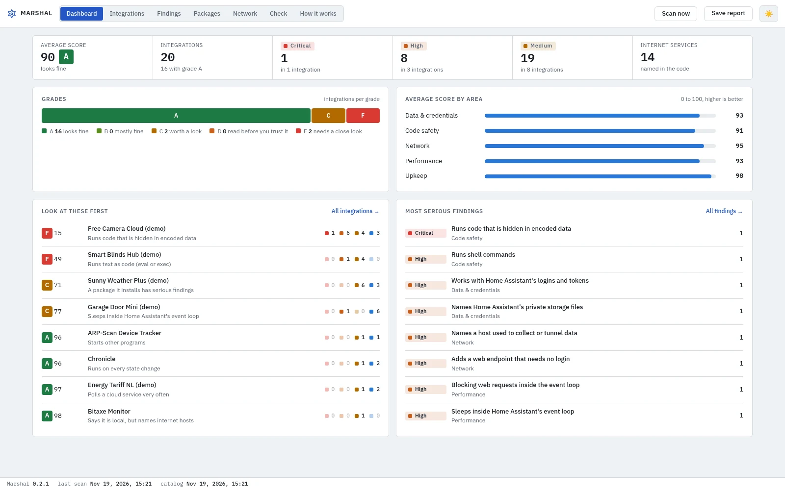
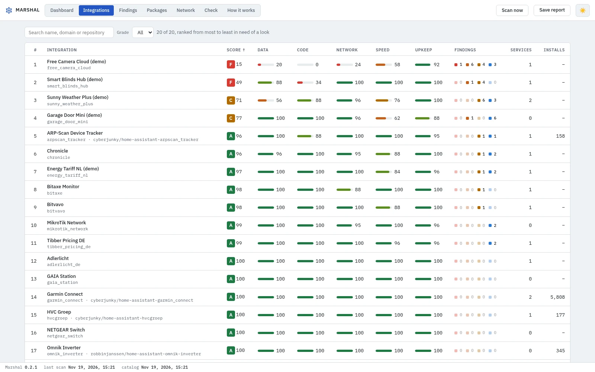
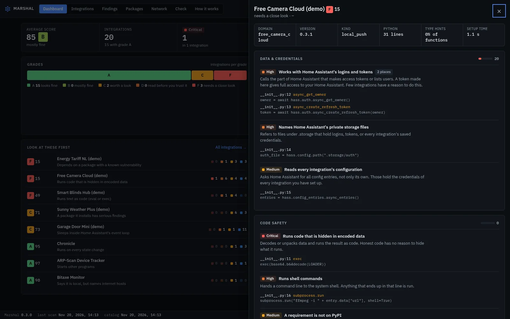
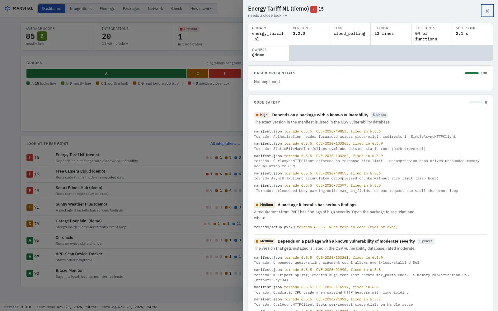
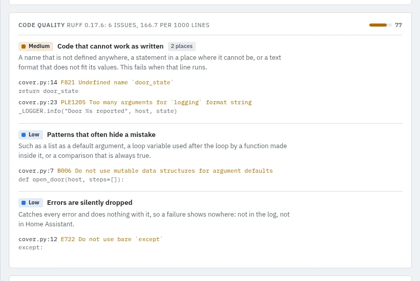
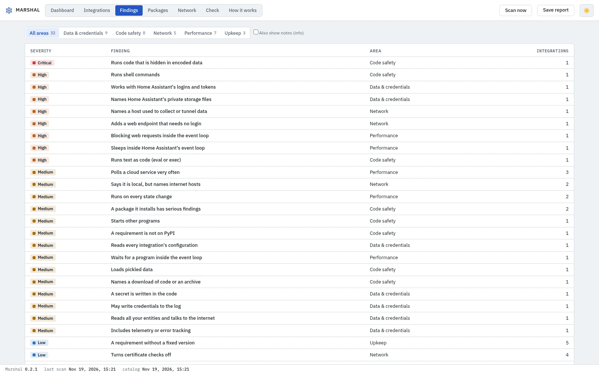
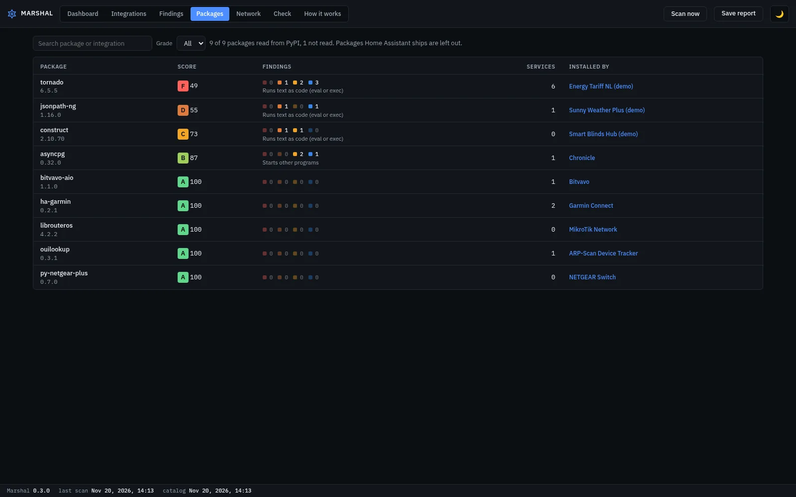
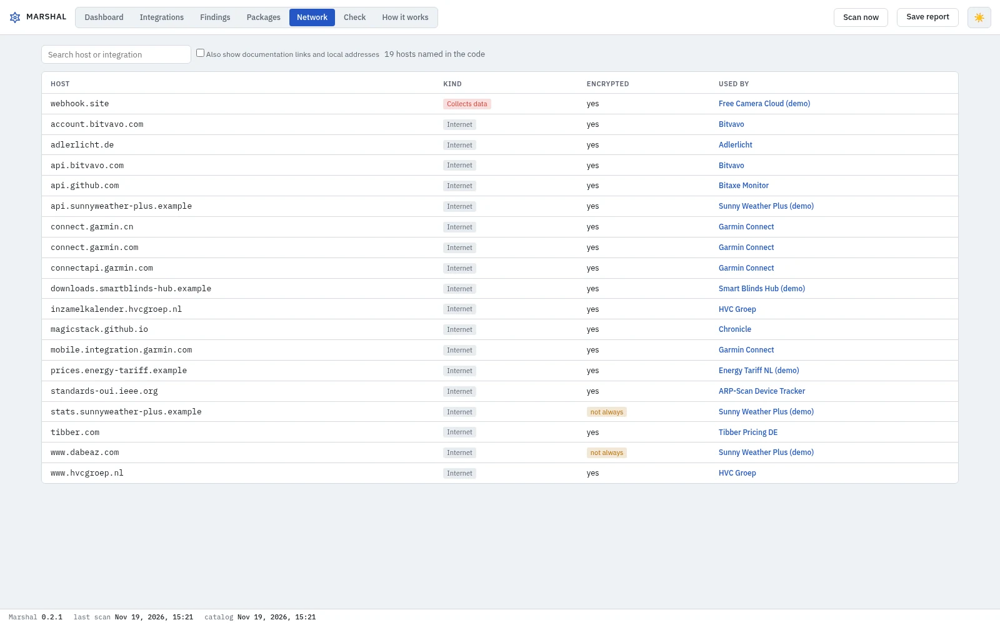

[![Version][version-shield]][changelog]
[![GitHub Activity][commits-shield]][commits]
[![License][license-shield]](https://github.com/cyberjunky/home-assistant-apps/blob/main/app-marshal/LICENSE)
![Project Maintenance][maintenance-shield]
![Supports aarch64 Architecture][aarch64-shield]
![Supports amd64 Architecture][amd64-shield]

# Marshal App for Home Assistant

Keeps watch over the custom integrations you install from the Home Assistant Marketplace. A custom
integration runs inside Home Assistant with all of its rights, and the Marketplace lists them without
testing or auditing them. Marshal reads the code of every integration you have installed, without
running any of it, and shows what deserves a second look: access to credentials and personal data,
risky code, known vulnerabilities in what it installs, the internet hosts it names, patterns that slow
Home Assistant down, and the quality of the code. Each integration
gets a score and a grade, and they are ranked worst first.

More screenshots

**Integrations** — every integration ranked worst first, with its grade, the score per area, findings by severity, internet services and installations

**An integration** — each finding with what it means, the file, the line and the code

**Known vulnerabilities** — each CVE in what an integration installs, how bad it is rated, and the version that fixes it

**Code quality** — what Ruff found, with the line: code that cannot work, likely mistakes, errors silently dropped

**Findings** — every check that found something, across all integrations

**Packages** — what the integrations install from PyPI, each read and graded, with the integrations that install it

**Network** — every internet host named in the code, and which integrations name it

The screenshots show my own integrations next to five made up for the occasion (the ones marked
*demo*), written to set off the checks.

## Supported Features

- 🔎 **Everything installed**: each folder under `custom_components`, scanned at start, within five minutes of an install or update, and once a day
- 🔑 **Data and credentials**: Home Assistant's logins and tokens, `secrets.yaml` and private storage, other integrations' configuration, credentials in log lines, secrets written in code, telemetry, reading every entity while talking to the internet
- 🧨 **Code safety**: `eval` and `exec`, code hidden in encoded data, shell commands, packages installed while running, changes to Home Assistant's own code, compiled programs, requirements from a URL, queries pasted together from text, archives unpacked without checking
- 📦 **The packages it installs**: each direct requirement is downloaded from PyPI and read the same way, with its own grade; its serious findings and the hosts it names count for the integration
- 🛡️ **Known vulnerabilities**: every requirement and everything it installs in turn, looked up in OSV at the version that would be installed, with the CVE, its severity and the version that fixes it; plus the security advisories the integration's own repository published
- 🌐 **Network**: every host named in the code, endpoints that need no login, paste sites and tunnels, certificate checks turned off, unencrypted connections, a "local" integration that names internet hosts
- 🐢 **Performance**: blocking calls inside the event loop, listeners on every state change, fast polling of cloud services, and, asked of Home Assistant, setup time and log errors
- 🧪 **Code quality**: read by Ruff, the linter Home Assistant itself uses: names that are not defined, patterns that often hide a mistake, errors silently dropped, tangled functions, and how much of the code has type hints
- 🧹 **Upkeep**: removed from the Marketplace catalog (and why), untouched for years, custom repositories, updates waiting, unpinned requirements
- 🛒 **Check before you install**: give a repository, get its score before it ever runs
- 📊 **Dashboard**: grades, scores per area, a ranking, every finding with the file, line and code, and a list of all hosts; saved as a single HTML file when you want to keep or share it

## Installation

Alternatively:

1. Go to **Settings → Apps → App Store**
2. Open the menu (⋮) and choose **Repositories**
3. Add `https://github.com/cyberjunky/home-assistant-apps`
4. Install **Marshal** from the store, start it and open it from the sidebar
5. The first scan starts by itself and takes a few seconds

## Configuration

See [DOCS.md](https://github.com/cyberjunky/home-assistant-apps/blob/main/app-marshal/DOCS.md) for every option, every check, how the
score is made and what Marshal cannot see.

A finding is a lead for you to look at, not a verdict, and a good score is not a guarantee.

## License

This project is licensed under the MIT License - see the [LICENSE](https://github.com/cyberjunky/home-assistant-apps/blob/main/app-marshal/LICENSE) file for
details.

---

## 💖 Support This Project

If you find this app useful, please consider supporting its continued development and
maintenance:

### 🌟 Ways to Support

- **⭐ Star this repository** - Help others discover the project
- **💰 Financial Support** - Contribute to development and hosting costs
- **🐛 Report Issues** - Help improve stability and compatibility
- **📖 Spread the Word** - Share with other Home Assistant users

### 💳 Financial Support Options

Every contribution, no matter the size, makes a difference and is greatly appreciated! 🙏

---

[version-shield]: https://img.shields.io/badge/dynamic/yaml?url=https%3A%2F%2Fraw.githubusercontent.com%2Fcyberjunky%2Fhome-assistant-apps%2Fmain%2Fapp-marshal%2Fconfig.yaml&query=%24.version&label=version&style=for-the-badge
[changelog]: https://github.com/cyberjunky/home-assistant-apps/blob/main/app-marshal/CHANGELOG.md
[commits-shield]: https://img.shields.io/github/commit-activity/y/cyberjunky/home-assistant-apps.svg?style=for-the-badge
[commits]: https://github.com/cyberjunky/home-assistant-apps/commits/main
[license-shield]: https://img.shields.io/github/license/cyberjunky/home-assistant-apps.svg?style=for-the-badge
[maintenance-shield]: https://img.shields.io/badge/maintainer-cyberjunky-blue.svg?style=for-the-badge
[aarch64-shield]: https://img.shields.io/badge/aarch64-yes-green.svg?style=for-the-badge
[amd64-shield]: https://img.shields.io/badge/amd64-yes-green.svg?style=for-the-badge
