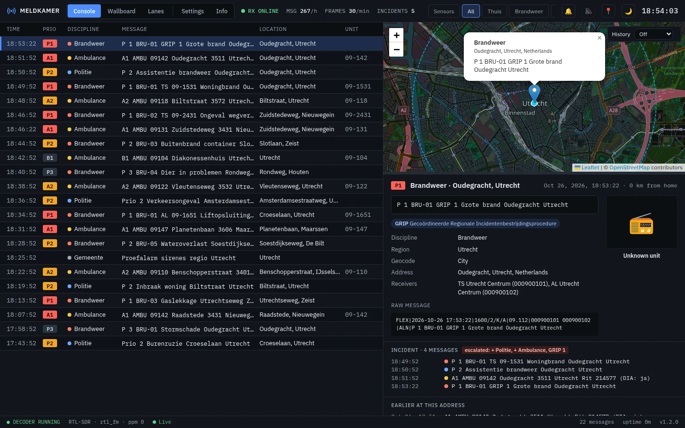
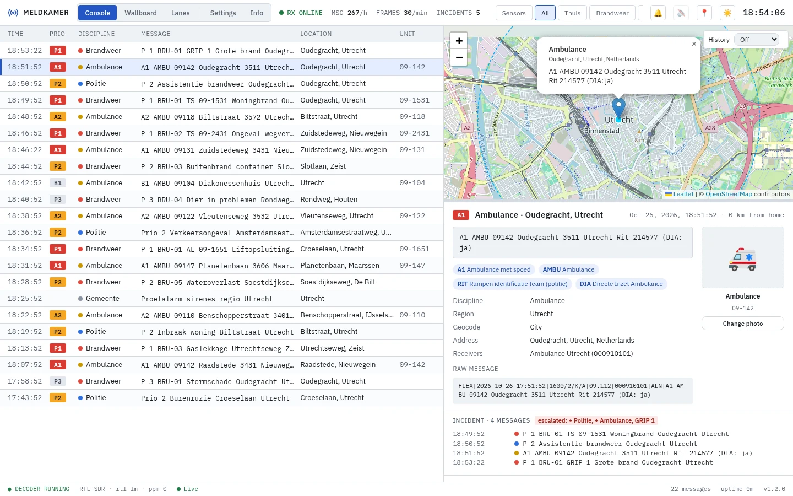
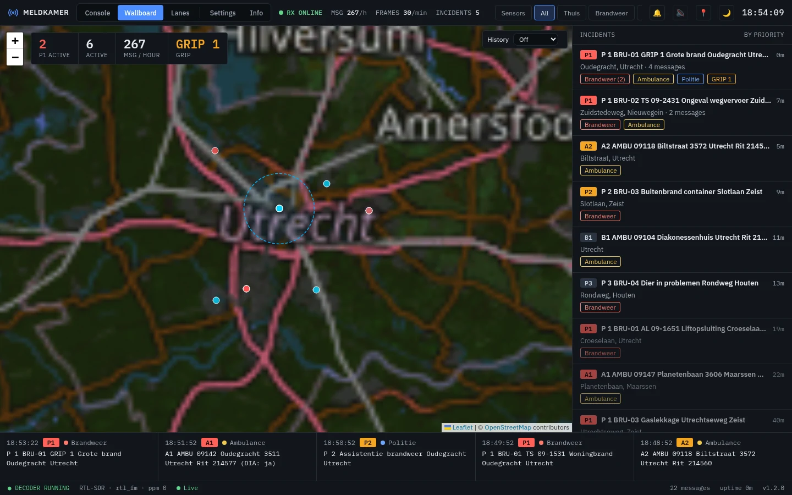
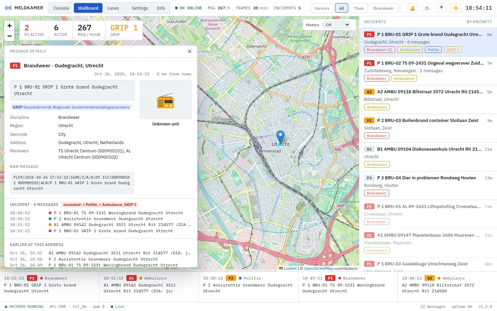
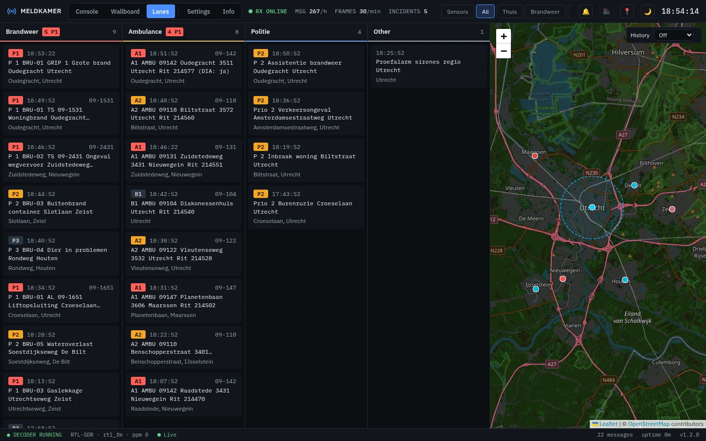
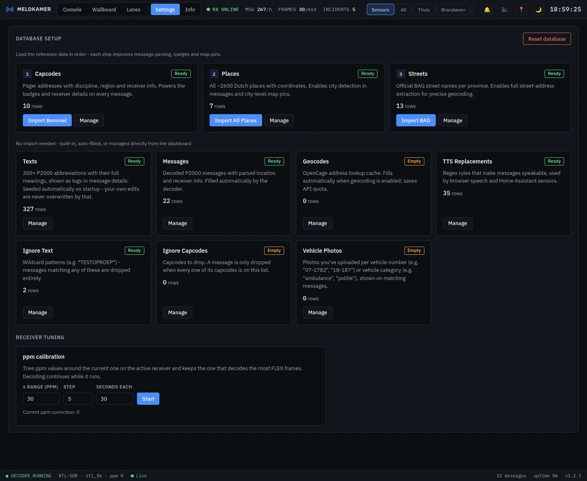
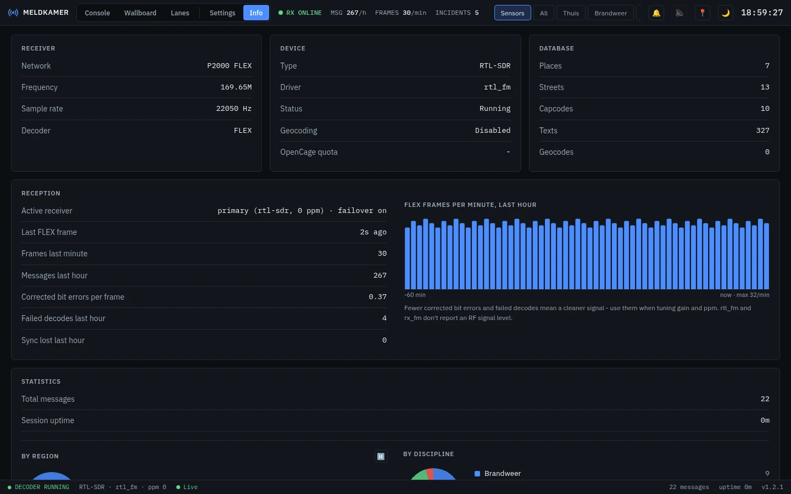

[![Version][version-shield]][changelog]
[![GitHub Activity][commits-shield]][commits]
[![License][license-shield]](LICENSE)
![Project Maintenance][maintenance-shield]
![Supports aarch64 Architecture][aarch64-shield]
![Supports amd64 Architecture][amd64-shield]

# Meldkamer App for Home Assistant

P2000 FLEX pager decoder dashboard for Home Assistant — decode Dutch emergency services
messages using RTL-SDR, HackRF, or network streaming, and see them on a live map with
street-level pins, incidents, statistics, sensors, events and text-to-speech.

Meldkamer runs entirely on your Home Assistant. It decodes the public P2000 broadcast
locally; everything it records stays in the app's data folder and is included in your Home
Assistant backups.

More screenshots (light theme, Wallboard, Lanes, Data, Info)

**Console, light theme** — follows Home Assistant's light/dark mode

**Wallboard** — large map, live counts, incidents by priority and a ticker of the newest messages

**Wallboard with a message selected** — the detail floats in the map's corner

**Lanes** — one column per discipline next to the map

**Data** — reference data and tables

**Info** — receiver, device, database, reception quality and statistics

> The screenshots show made-up messages, capcodes and units.

## Supported Features

- 📡 **SDR Support** — RTL-SDR, HackRF One, SoapySDR devices, or network streaming
- 🗺️ **Interactive Dashboard** — Live map, statistics, tabbed interface
- 🎯 **Sensor Filter Toggle** — Narrow the live dashboard feed to a configured sensor's criteria, or view everything
- 📍 **Locations** — Street-level map pins from the free BAG street data, OpenCage only for streets that aren't in it (optional), and the town centre as fallback
- 🏠 **Home Assistant Sensors** — Auto-create sensors with custom filters via REST API or MQTT, including filters on Home Assistant zones
- ⚡ **Home Assistant Events** — `meldkamer_message` for every message and `meldkamer_incident_escalated` when an incident grows, ready to use as automation triggers
- 🩺 **Receiver Health** — `binary_sensor.meldkamer_receiver_online` and `sensor.meldkamer_messages_per_hour`, so a dead SDR stick or `rtl_tcp` link doesn't go unnoticed
- 🚨 **Incidents** — Messages for the same address within a few minutes are grouped into one incident, with an alert when it escalates (GRIP level, priority, more units or disciplines)
- 🔁 **Repeat Suppression** — Messages the pager network resends are counted as repeats instead of being published again
- 🗣️ **Text-to-Speech** — Browser speech and Home Assistant speakers (`tts.speak`) read new messages aloud, using editable TTS replacement rules
- 🗺️ **Map History** — Heatmap of past incidents with a time slider
- 📶 **Reception Quality** — FLEX frames per minute, corrected bit errors and failed decodes
- 🔀 **Receiver Failover** — Switches to a backup `rtl_tcp` receiver when the active one stops producing frames
- 🚑 **Vehicle Classification** — Best-effort vehicle/unit recognition (ambulance, fire, helicopter, police, water rescue) from a Vehicles table (number → type), with stock photos per vehicle type and user-uploadable photos per vehicle or category
- 🔔 **Sound Notifications** — Configurable audio alerts for new messages
- 🔍 **Message Filtering** — Filter by text patterns and capcodes, managed live from the dashboard

## Installation

Alternatively:

1. Go to **Settings → Apps → App Store**
2. Open the menu (⋮) and choose **Repositories**
3. Add `https://github.com/cyberjunky/home-assistant-apps`
4. Find **Meldkamer** in the store and click **Install**
5. Plug in your SDR receiver, review the **Configuration** tab, and click **Start**
6. Open **Meldkamer** from the sidebar

Without the reference database, messages are decoded but have no discipline, town, street
or map pin. See [DOCS.md](DOCS.md) for filling the database, every configuration option,
the receiver setups, sensors, events, announcements, MQTT and troubleshooting.

## Configuration

Meldkamer works once a receiver is configured; the options cover the receiver (RTL-SDR,
HackRF, SoapySDR or network), geocoding, filters, Home Assistant sensors and events,
announcements and MQTT. See [DOCS.md](DOCS.md) for every option and example.

## 💖 Support This Project

If you find this app useful, please consider supporting its continued development and
maintenance:

### 🌟 Ways to Support

- **⭐ Star this repository** - Help others discover the project
- **💰 Financial Support** - Contribute to development and hosting costs
- **🐛 Report Issues** - Help improve stability and compatibility
- **📖 Spread the Word** - Share with other Home Assistant users

### 💳 Financial Support Options

Every contribution, no matter the size, makes a difference and is greatly appreciated! 🙏

## Community

Questions, ideas or just want to chat? Join The Junkyard on Discord:

## License

This project is licensed under the MIT License - see the [LICENSE](LICENSE) file for
details.

---

[version-shield]: https://img.shields.io/badge/dynamic/yaml?url=https%3A%2F%2Fraw.githubusercontent.com%2Fcyberjunky%2Fhome-assistant-apps%2Fmain%2Fapp-meldkamer%2Fconfig.yaml&query=%24.version&label=version&style=for-the-badge
[changelog]: https://github.com/cyberjunky/home-assistant-apps/blob/main/app-meldkamer/CHANGELOG.md
[commits-shield]: https://img.shields.io/github/commit-activity/y/cyberjunky/home-assistant-apps.svg?style=for-the-badge
[commits]: https://github.com/cyberjunky/home-assistant-apps/commits/main
[license-shield]: https://img.shields.io/github/license/cyberjunky/home-assistant-apps.svg?style=for-the-badge
[maintenance-shield]: https://img.shields.io/badge/maintainer-cyberjunky-blue.svg?style=for-the-badge
[aarch64-shield]: https://img.shields.io/badge/aarch64-yes-green.svg?style=for-the-badge
[amd64-shield]: https://img.shields.io/badge/amd64-yes-green.svg?style=for-the-badge
