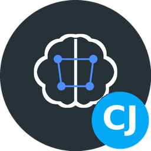
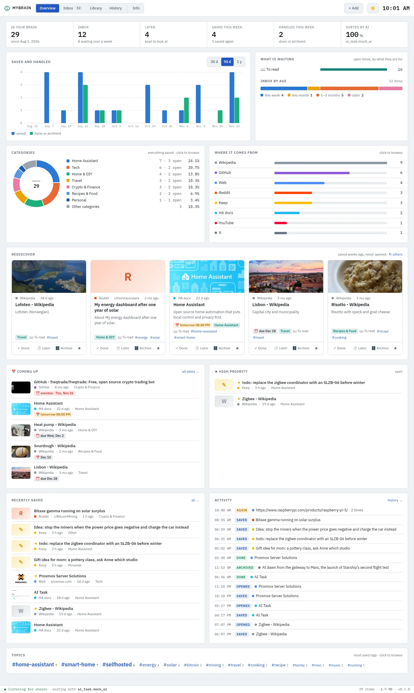
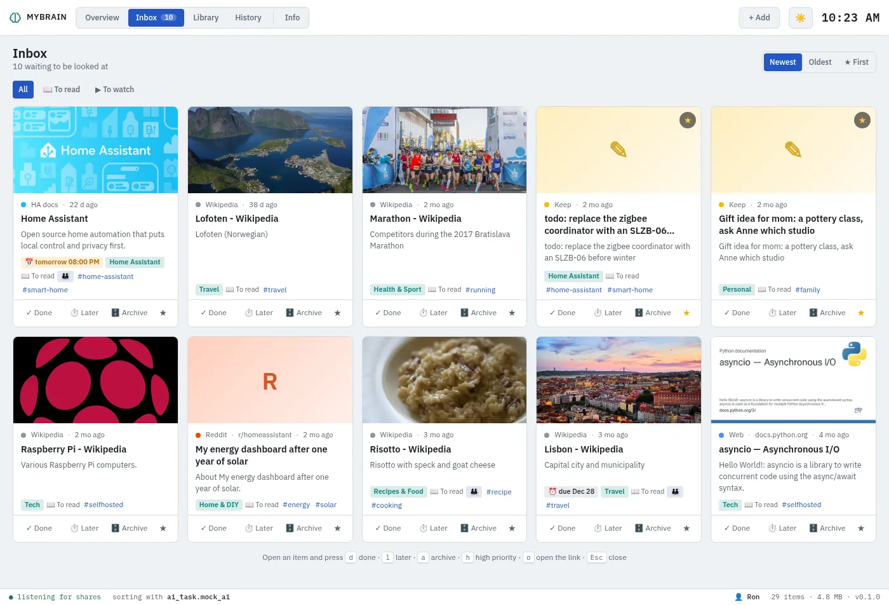
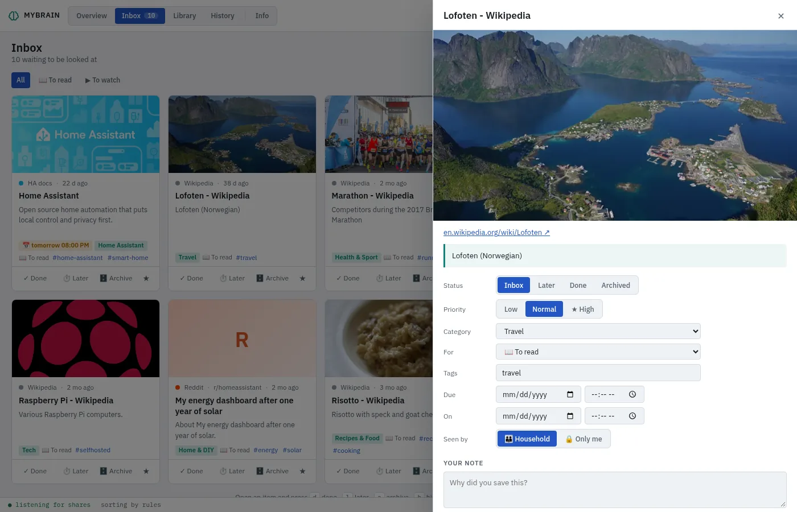
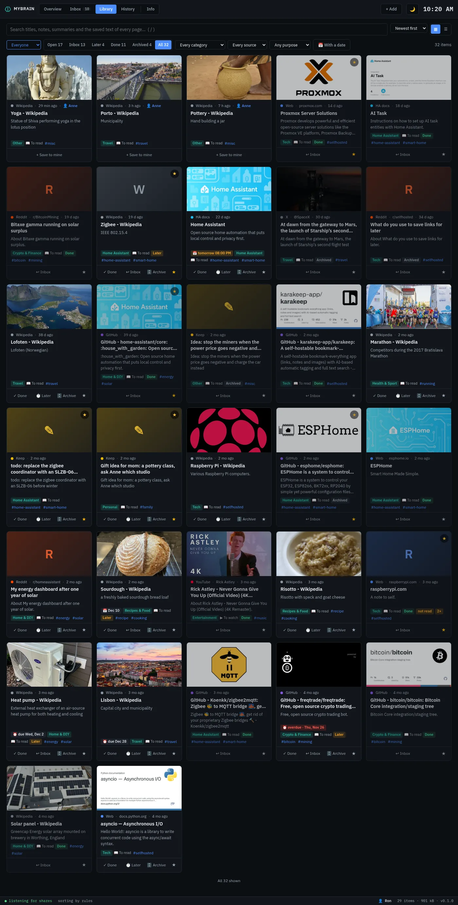
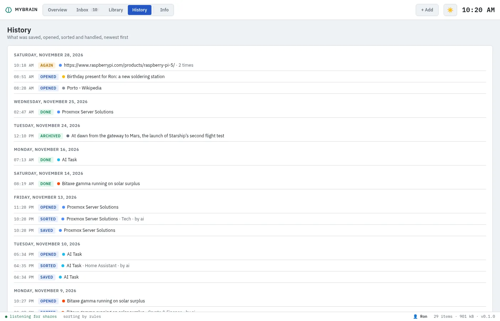

[![Version][version-shield]][changelog]
[![GitHub Activity][commits-shield]][commits]
[![License][license-shield]](https://github.com/cyberjunky/home-assistant-apps/blob/main/app-mybrain/LICENSE)
![Project Maintenance][maintenance-shield]
![Supports aarch64 Architecture][aarch64-shield]
![Supports amd64 Architecture][amd64-shield]

# MyBrain App for Home Assistant

> **Unofficial.** An independent project, not affiliated with, endorsed by or sponsored by the Home Assistant project.

A place for everything you mean to look at later: links, posts, videos and notes to yourself.
On your phone you tap **Share → Home Assistant** and it is saved. The app reads the page behind
the link (title, picture, text), notes where it came from (Reddit, X, YouTube, GitHub, a shop, a
note), and sorts it into a category with tags and what it is for: to read, to watch, to buy, to
try. With an AI integration in Home Assistant it also writes a line on what it is.

Then it helps you get through it: an **inbox** of what wasn't looked at yet, one tap for done,
later or archive, a **library** that finds anything by a word on the page, and an **overview** of
what is waiting, what is being forgotten and where it all comes from. Items with a due date or an
on date go into a calendar in Home Assistant, and a sensor tells what is next.

More screenshots

**Inbox** — what came in, newest first; done, later or archive in one tap

**An item** — the page, a summary, status, priority, category, tags, your own note, and its history

**Library** — everything, searchable, by status, category, source and purpose (dark theme)

**History** — what was saved, opened and handled, by day

## Supported Features

- 📲 **Two taps from your phone** — Share to the Home Assistant app; no extra app, no login, works away from home
- 🔎 **Read and kept** — Title, picture and the page's text are saved, so a link that dies is still found by what it said
- 🏷️ **Sorted by itself** — Category, tags, what it is for and a priority; by an AI Task entity in Home Assistant, or by built-in rules
- 🧭 **Where it came from** — Reddit (with the subreddit), X, YouTube, GitHub, Wikipedia, shops, Keep and more
- 📥 **An inbox** — What wasn't looked at yet; done, later, archive or ★ with one tap or one key
- 🔍 **Search everything** — Titles, notes, summaries and page text, with filters for status, category, source, purpose and tag
- 📊 **An overview** — Saved and handled per week, what is waiting, the inbox by age, categories, sources, topics and forgotten items to rediscover
- 🕘 **History** — Every save, open, sort and status change, per item and for everything
- ♻️ **No doubles** — The same link saved again (other tracking codes, a short link) comes back to the inbox instead of being saved twice
- 📅 **Dates and a calendar** — A due date or an on date per item (the AI finds them in the content); every open item with a date in a Local Calendar in Home Assistant
- 👪 **For the household** — Everyone has their own inbox, library and calendar; what you save is yours alone until you share it 👪, and what others share can be saved to your own with one tap
- 🔢 **Sensors** — per person `sensor.mybrain_next_<name>` with the next item that has a date, and `sensor.mybrain_inbox_<name>` with the size of the inbox

## Requirements

- Home Assistant OS or Supervised
- The Home Assistant companion app on your phone, to share to it (Android shares a link and the app it came from; iPhone shares the text)
- Optional: an AI integration that offers an AI Task entity for sorting with AI, such as [DeepSeek](https://github.com/cyberjunky/home-assistant-deepseek) (cheap), OpenAI, Google Gemini, Anthropic or Ollama
- Optional: a Local Calendar named MyBrain, for the calendar

## Installation

Alternatively:

1. Go to **Settings → Apps → App Store**
2. Open the menu (⋮) and choose **Repositories**
3. Add `https://github.com/cyberjunky/home-assistant-apps`
4. Install **MyBrain**

## Configuration

MyBrain works without any settings. See
[DOCS.md](https://github.com/cyberjunky/home-assistant-apps/blob/main/app-mybrain/DOCS.md) for sharing from
your phone, setting up AI sorting, the categories and the other options.

## Disclaimer

This app is an independent project. It is not affiliated with, endorsed by or sponsored by the
Home Assistant project. It reads the public pages of the links you save; what a site shows to an
app like this can differ from what you see in your browser. With AI sorting on, the title, the
start of the page's text and your note are sent to the AI service of the integration you chose.

## 💖 Support This Project

If you find this app useful, please consider supporting its continued development and
maintenance:

### 🌟 Ways to Support

- **⭐ Star this repository** - Help others discover the project
- **💰 Financial Support** - Contribute to development and hosting costs
- **🐛 Report Issues** - Help improve stability and compatibility
- **📖 Spread the Word** - Share with other Home Assistant users

### 💳 Financial Support Options

Every contribution, no matter the size, makes a difference and is greatly appreciated! 🙏

## License

This project is licensed under the MIT License - see the [LICENSE](https://github.com/cyberjunky/home-assistant-apps/blob/main/app-mybrain/LICENSE) file for
details.

---

[version-shield]: https://img.shields.io/badge/dynamic/yaml?url=https%3A%2F%2Fraw.githubusercontent.com%2Fcyberjunky%2Fhome-assistant-apps%2Fmain%2Fapp-mybrain%2Fconfig.yaml&query=%24.version&label=version&style=for-the-badge
[changelog]: https://github.com/cyberjunky/home-assistant-apps/blob/main/app-mybrain/CHANGELOG.md
[commits-shield]: https://img.shields.io/github/commit-activity/y/cyberjunky/home-assistant-apps.svg?style=for-the-badge
[commits]: https://github.com/cyberjunky/home-assistant-apps/commits/main
[license-shield]: https://img.shields.io/github/license/cyberjunky/home-assistant-apps.svg?style=for-the-badge
[maintenance-shield]: https://img.shields.io/badge/maintainer-cyberjunky-blue.svg?style=for-the-badge
[aarch64-shield]: https://img.shields.io/badge/aarch64-yes-green.svg?style=for-the-badge
[amd64-shield]: https://img.shields.io/badge/amd64-yes-green.svg?style=for-the-badge
