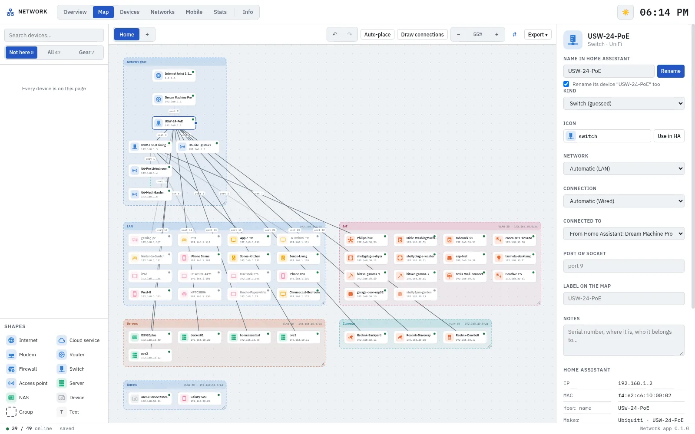
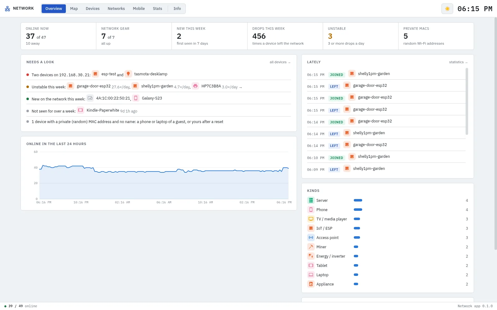
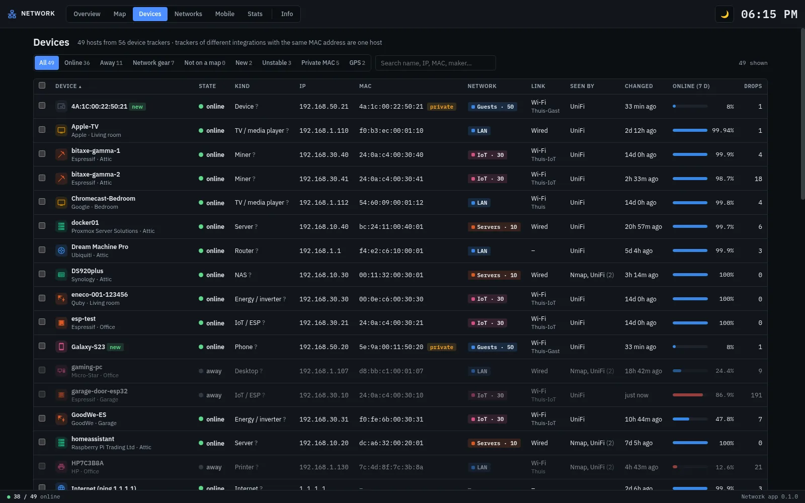
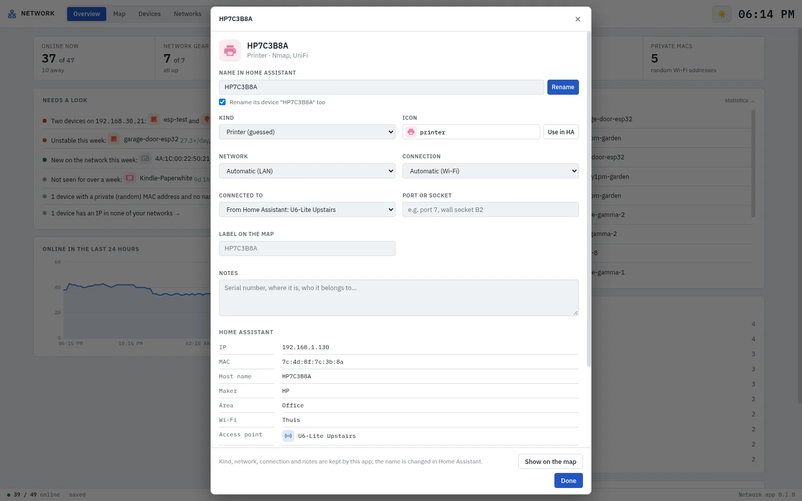
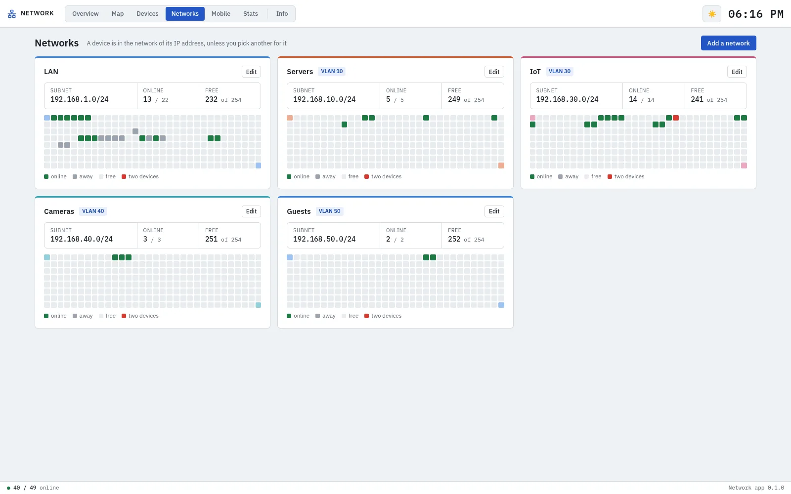
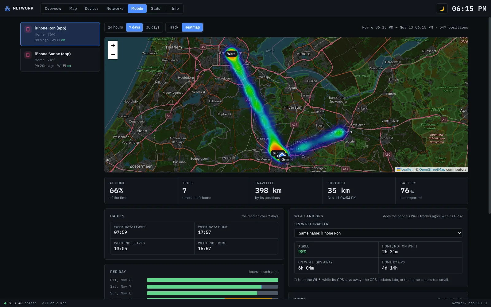
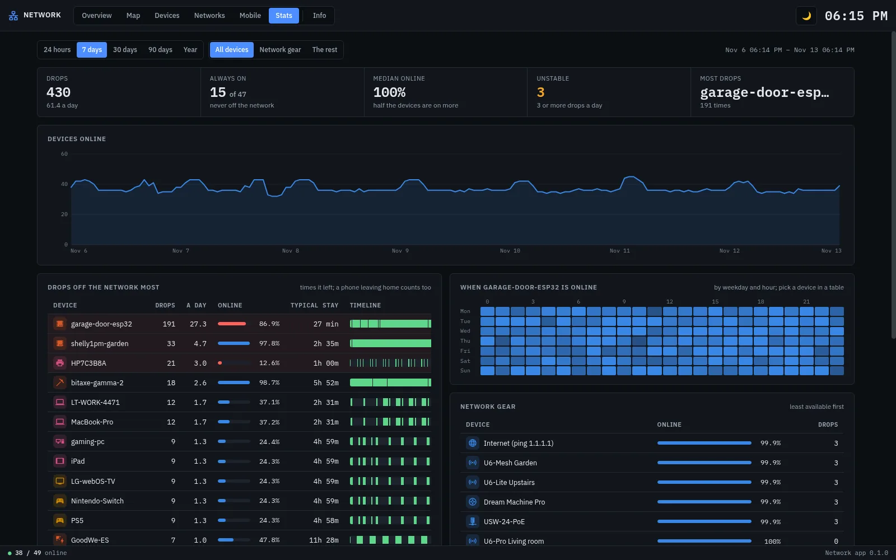

[![Version][version-shield]][changelog]
[![GitHub Activity][commits-shield]][commits]
[![License][license-shield]](https://github.com/cyberjunky/home-assistant-apps/blob/main/app-network/LICENSE)
![Project Maintenance][maintenance-shield]
![Supports aarch64 Architecture][aarch64-shield]
![Supports amd64 Architecture][amd64-shield]

# Network App for Home Assistant

Every device tracker in Home Assistant as a map of your network. Drag your devices onto pages,
group them per room, rack or VLAN, connect them with cables and Wi-Fi, give each the icon that
fits, and rename them right there: the name changes in Home Assistant too. Think Visio, but the
devices are live: you see what is online, what drops off the network all day, what is new, and
which two devices fight over one IP address.

Trackers of different integrations that see the same device (UniFi, Nmap and your router for the
same phone) are one device here. Phones with the Home Assistant app get a page of their own: their
track and a heatmap of where they spend their time, their days per zone, their habits, and whether
their Wi-Fi agrees with their GPS.

More screenshots

**Overview** — what is online, what needs a look (gear that is away, two devices on one IP, unstable and new devices), and what happened lately

**Devices** — every device with its kind, IP, MAC, network, link, integrations and how much it was online this week; edit and rename in place

**A device** — rename it in Home Assistant, its kind and icon, network, where it is connected, notes, and everything Home Assistant knows of it

**Networks** — your networks and VLANs, made from the addresses the app sees, with every address of a subnet: used, free, or taken twice

**Mobile** — a phone's track or a heatmap of where it spends its time, its days per zone, trips, habits and battery, and whether Wi-Fi and GPS agree

**Stats** — who drops off the network, how often and when; timelines, a heatmap of the week, availability of the network gear, comings and goings

## Supported Features

- 🗺️ **A map like Visio** — Pages, groups with a name, colour and network, cables, Wi-Fi, fiber and VPN links, notes; drag, resize, zoom, undo; export as PNG, SVG or PDF
- 🔎 **An overview that zooms in** — Move a group to a page of its own; a tile with its devices and how many are online stays on the overview, double-click it to go in
- ✨ **Starts itself** — Places every device in a group per network with the network gear as a tree on top, and draws the cabling Home Assistant knows of (switch ports and access points)
- ✏️ **Rename in Home Assistant** — The tracker's name, and its device's, change in Home Assistant itself; set its icon there too
- 🧩 **One device, many trackers** — Trackers with the same MAC address are one device; a private (random) Wi-Fi address is marked
- 🏷️ **Kinds and icons** — Phone, printer, switch, camera… guessed from names and makers, Home Assistant's own icons
- 🌐 **Networks and VLANs** — Made from the subnets it sees; a grid of every address, free ones and conflicts
- 📉 **Who drops off** — Drops per day, availability, timelines, the week as a heatmap, the longest time away; its own record of every change, kept for a year
- 📱 **Phones** — Track and heatmap on a map, time per zone per day, trips, usual times of leaving and coming home, distance, battery, and Wi-Fi against GPS
- 🔔 **Needs a look** — Network gear that is away, two devices on one IP, unstable, new and long-gone devices

## Requirements

- Home Assistant 2026.9 or later (the Mobile map uses its map tile proxy)
- One or more integrations that track devices: your router or access points (UniFi, FRITZ!Box, Omada, OpenWrt…), Nmap, Ping, the Home Assistant app on your phones

## Installation

Alternatively:

1. Go to **Settings → Apps → App Store**
2. Open the menu (⋮) and choose **Repositories**
3. Add `https://github.com/cyberjunky/home-assistant-apps`
4. Install **Network**
5. Start the app and open **Network** from the sidebar

There is nothing to configure: the app reads Home Assistant's device trackers itself. See the
[documentation](DOCS.md) for the options.

## 💖 Support This Project

If you find this app useful, please consider supporting its continued development and
maintenance:

### 🌟 Ways to Support

- **⭐ Star this repository** - Help others discover the project
- **💰 Financial Support** - Contribute to development and hosting costs
- **🐛 Report Issues** - Help improve stability and compatibility
- **📖 Spread the Word** - Share with other Home Assistant users

### 💳 Financial Support Options

Every contribution, no matter the size, makes a difference and is greatly appreciated! 🙏

## License

This project is licensed under the MIT License - see the [LICENSE](https://github.com/cyberjunky/home-assistant-apps/blob/main/app-network/LICENSE) file for
details.

---

[version-shield]: https://img.shields.io/badge/dynamic/yaml?url=https%3A%2F%2Fraw.githubusercontent.com%2Fcyberjunky%2Fhome-assistant-apps%2Fmain%2Fapp-network%2Fconfig.yaml&query=%24.version&label=version&style=for-the-badge
[changelog]: https://github.com/cyberjunky/home-assistant-apps/blob/main/app-network/CHANGELOG.md
[commits-shield]: https://img.shields.io/github/commit-activity/y/cyberjunky/home-assistant-apps.svg?style=for-the-badge
[commits]: https://github.com/cyberjunky/home-assistant-apps/commits/main
[license-shield]: https://img.shields.io/github/license/cyberjunky/home-assistant-apps.svg?style=for-the-badge
[maintenance-shield]: https://img.shields.io/badge/maintainer-cyberjunky-blue.svg?style=for-the-badge
[aarch64-shield]: https://img.shields.io/badge/aarch64-yes-green.svg?style=for-the-badge
[amd64-shield]: https://img.shields.io/badge/amd64-yes-green.svg?style=for-the-badge
