[![Version][version-shield]][changelog]
[![GitHub Activity][commits-shield]][commits]
[![License][license-shield]](https://github.com/cyberjunky/home-assistant-apps/blob/main/app-proxmox/LICENSE)
![Project Maintenance][maintenance-shield]
![Supports aarch64 Architecture][aarch64-shield]
![Supports amd64 Architecture][amd64-shield]

[](https://www.paypal.me/cyberjunkynl/)
[](https://github.com/sponsors/cyberjunky)

# Proxmox App for Home Assistant


> **Unofficial.** An independent project, not affiliated with, endorsed by or sponsored by Proxmox Server Solutions GmbH.

Dashboard for your [Proxmox VE](https://www.proxmox.com/en/proxmox-virtual-environment) cluster in
Home Assistant, with all the nitty gritty. The whole datacenter on one overview with health
checks, a page per node and per guest, storage with a fill-up forecast, backups with RPO and RTO at a glance, the
network as a map and as VLAN lanes you drag guests between, and the firewall as a flow per guest,
node or security group, with its rules, IP sets, aliases and the log with its statistics.

It reads the cluster over the Proxmox API with a token, through any of its nodes, and keeps
working when one is down. The history comes from Proxmox itself, so the charts are full from the
first minute.

**It changes nothing unless you let it.** With `read_only` off you can start and stop guests,
add, edit, reorder and delete firewall rules (also by dragging), and move a guest's network
device to another VLAN. Each asks first, and a host firewall rule that could lock you out asks
twice.

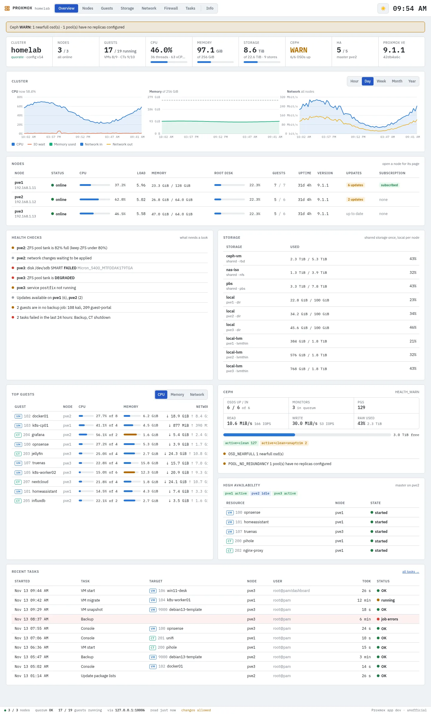

<details>
<summary>More screenshots</summary>

**Backups at a glance** — protected guests, RPO, last night, restore points, the longest restore, a 14-day calendar per guest and what needs a look
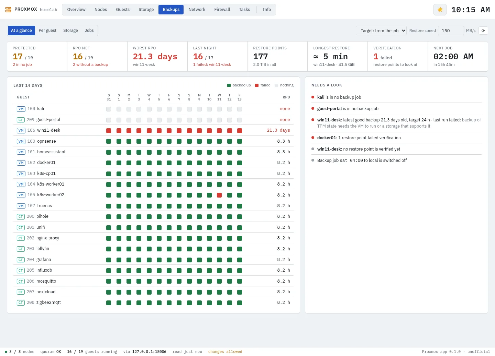

**Backup server** — a Proxmox Backup Server's datastores, jobs and tasks
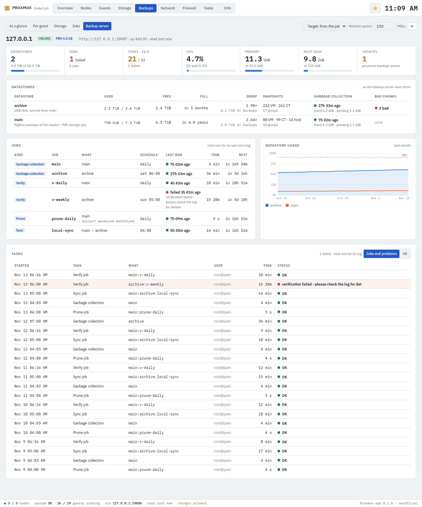

**Backups per guest** — RPO and its target, runs, restore points, sizes, backup time and estimated restore time
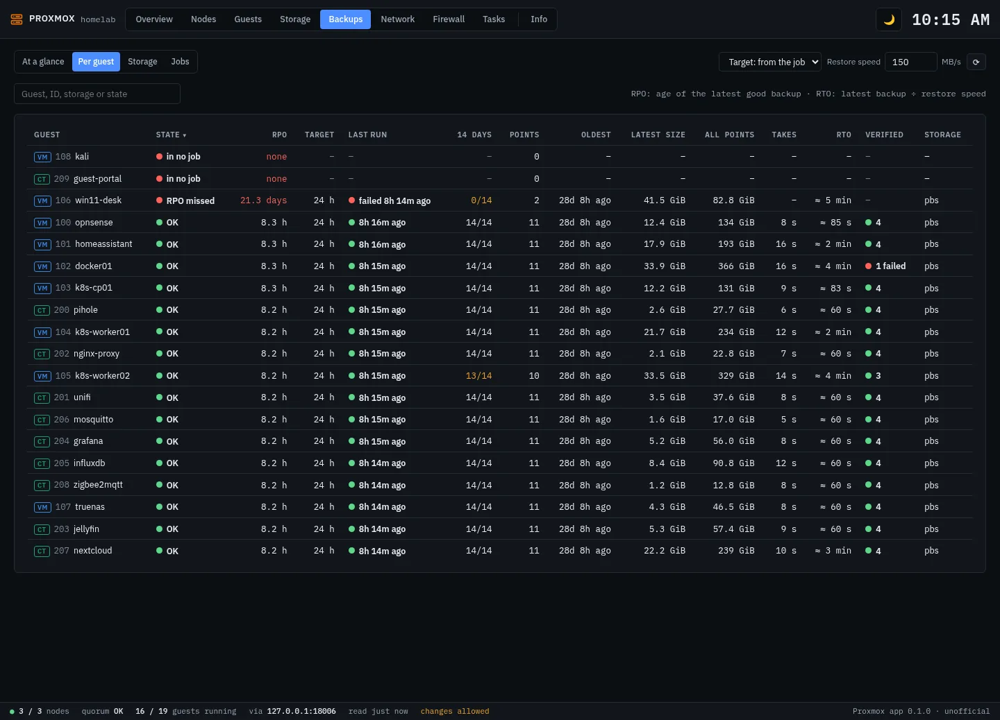

**Firewall flow** — what may reach a target and where it may go, every rule an arrow; drag an alias, IP set or security group onto it to add a rule
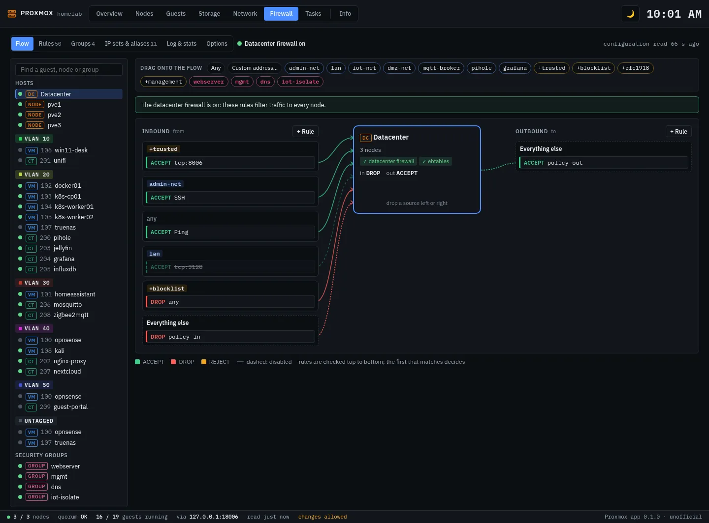

**VLANs** — a lane per bridge and VLAN with its subnet, gateway and host addresses; drag a guest to another lane to change its VLAN
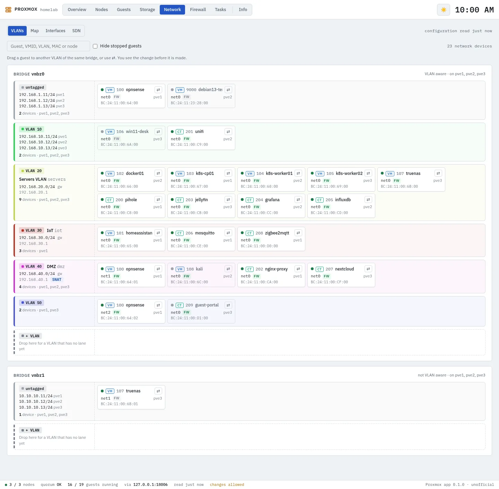

**Network map** — per node, the ports, bonds, bridges, VLAN interfaces and the guests on them
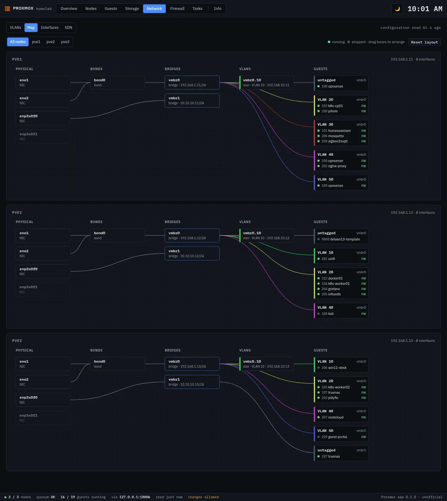

**Firewall log** — what was blocked and allowed per hour, per target, from where and to which ports, and the log itself
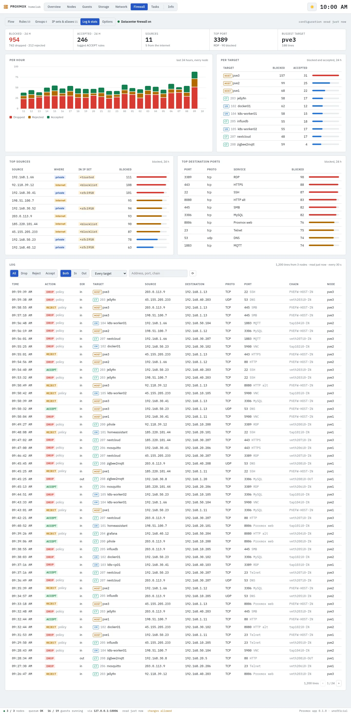

**Firewall rules** — any scope's rules in order, to switch, edit, drag into another order and delete
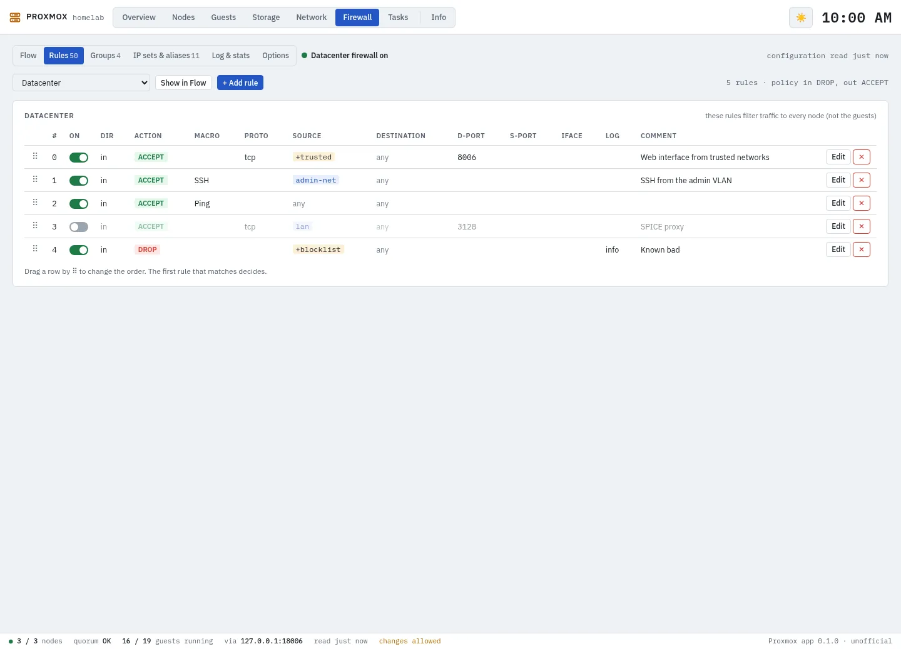

**Guests** — every VM and container with its usage, VLANs, firewall and last backup
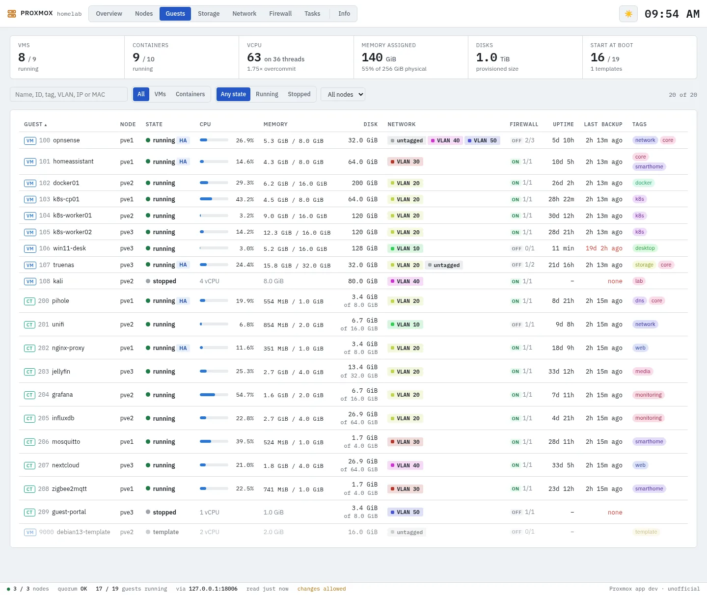

**A guest** — history, network devices with their addresses, disks, firewall, snapshots, backups and configuration
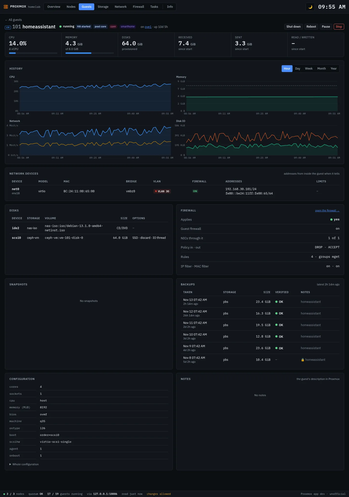

**A node** — usage and history, hardware and software, disks with SMART and wear, services and updates
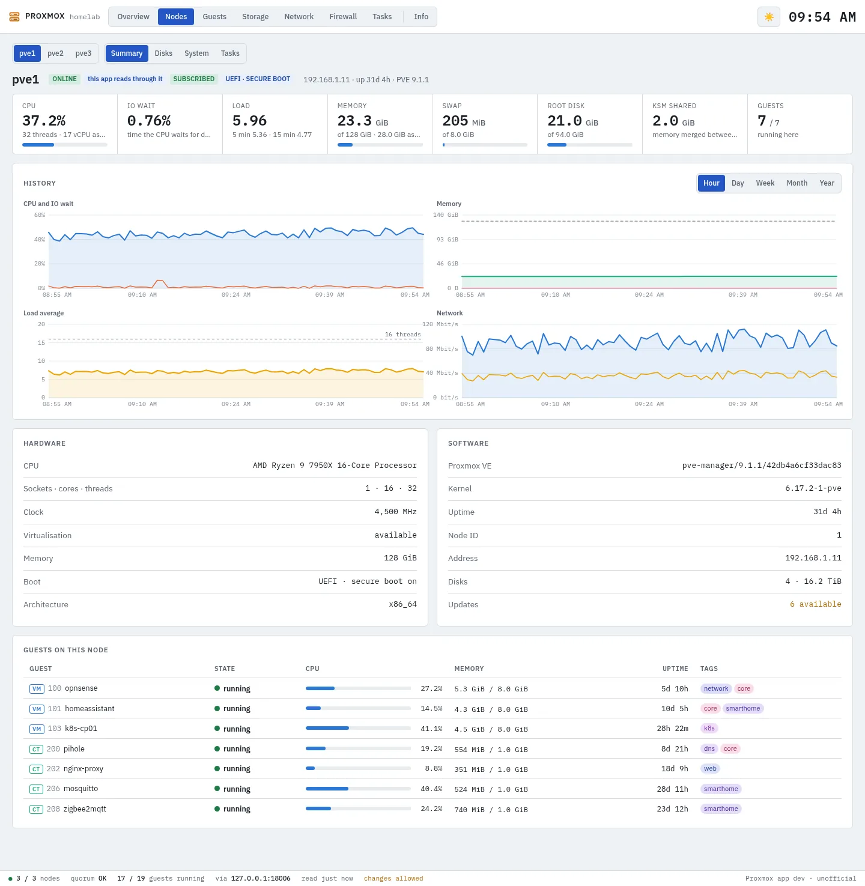

**Storage** — usage, growth and when it is full
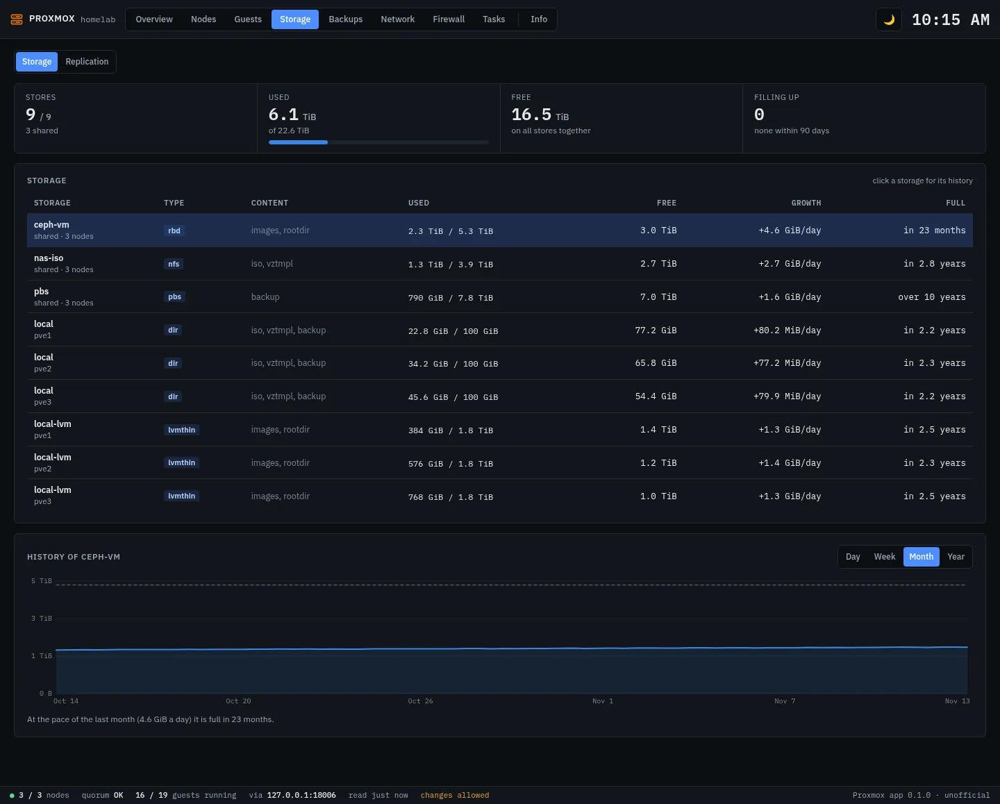

</details>

## Supported Features

- 🏢 **Datacenter at a glance** — Quorum, nodes, guests, CPU, memory and storage, Ceph and HA, and the cluster's history from an hour to a year
- 🩺 **Health checks** — Failing or worn disks, degraded or full ZFS pools, stopped services, failed tasks and replication, guests in no backup job, updates
- 🖥️ **Nodes and guests** — Every number Proxmox has, with history; hardware, disks, services and updates per node; network devices, addresses, disks, snapshots and backups per guest
- 💾 **Storage** — Usage with a forecast of when it is full, replication jobs
- 🗄️ **Backups** — At a glance whether every guest is protected and on time: RPO against the job's schedule, estimated restore time (RTO), a 14-day calendar, each night's job runs from their logs, restore points, verification, and what backups take on storage with PBS deduplication
- 🛡️ **Proxmox Backup Server** — Optional: its datastores with their forecast, deduplication, garbage collection and bad chunks, its verify, prune, sync and garbage collection jobs, and its tasks
- 🌐 **Network** — A map per node, VLAN lanes to drag guests between, every interface, pending changes and SDN
- 🛡️ **Firewall** — A flow per guest, node or group, drag-and-drop rules, the rule tables, groups, IP sets and aliases with where they are used, which guests the firewall doesn't cover, and the log with statistics
- 📋 **Tasks** — The cluster's task log, with each task's own log
- 🔒 **Read-only by default** — Power, firewall and VLAN changes only when you turn them on

## Requirements

- A Proxmox VE 8 or 9 node or cluster, reachable from Home Assistant on port 8006
- An API token (see **Making the API token** below)
- Optional: a Proxmox Backup Server with its own read-only token

## Installation

[](https://my.home-assistant.io/redirect/supervisor_add_addon_repository/?repository_url=https%3A%2F%2Fgithub.com%2Fcyberjunky%2Fhome-assistant-apps)

Alternatively:

1. Go to **Settings → Apps → App Store**
2. Open the menu (⋮) and choose **Repositories**
3. Add `https://github.com/cyberjunky/home-assistant-apps`
4. Install **Proxmox**
5. Make an API token in Proxmox (see below), and enter your nodes under `hosts` and the token under `token_id` and `token_secret` on the app's **Configuration** tab
6. Start the app and open **Proxmox** from the sidebar

## Configuration

Proxmox needs one or more nodes of your cluster and an API token:

```yaml
hosts:
  - 192.168.1.11
  - 192.168.1.12
token_id: homeassistant@pve!dashboard
token_secret: the-secret-proxmox-printed
```

### Making the API token

On any node of the cluster, as root (in the Proxmox web interface: the node → **Shell**):

```sh
pveum user add homeassistant@pve --comment "Home Assistant dashboard"
# Proxmox VE 9
pveum role add HADashboard --privs "Sys.Audit,Sys.Modify,VM.Audit,VM.GuestAgent.Audit,Datastore.Audit,SDN.Audit,Pool.Audit"
# Proxmox VE 8 (use this line instead of the one above)
pveum role add HADashboard --privs "Sys.Audit,Sys.Modify,VM.Audit,VM.Monitor,Datastore.Audit,SDN.Audit,Pool.Audit"
pveum acl modify / --users homeassistant@pve --roles HADashboard
pveum user token add homeassistant@pve dashboard --privsep 0
```

The last command prints the token's secret, once: copy it into `token_secret`. `token_id` is
`homeassistant@pve!dashboard`. This role only reads. For the buttons (power, firewall rules, VLANs) add
`VM.PowerMgmt,VM.Config.Network` to it with
`pveum role modify HADashboard --append 1 --privs "VM.PowerMgmt,VM.Config.Network"` and set
`read_only: false`. The app's **Info** page shows these commands too, and what the token can't read.

For a Proxmox Backup Server, every option, what each page shows and how it works: the app's
**Documentation** tab in Home Assistant, or [DOCS.md on GitHub](https://github.com/cyberjunky/home-assistant-apps/blob/main/app-proxmox/DOCS.md).

## Disclaimer

This app is an independent project. It is not affiliated with, endorsed by or sponsored by
Proxmox Server Solutions GmbH. Proxmox is a registered trademark of Proxmox Server Solutions
GmbH. With `read_only` off, the buttons in this app act on your cluster for real.

## 💖 Support This Project

If you find this app useful, please consider supporting its continued development and
maintenance:

### 🌟 Ways to Support

- **⭐ Star this repository** - Help others discover the project
- **💰 Financial Support** - Contribute to development and hosting costs
- **🐛 Report Issues** - Help improve stability and compatibility
- **📖 Spread the Word** - Share with other Home Assistant users

### 💳 Financial Support Options

[](https://www.paypal.me/cyberjunkynl/)
[](https://github.com/sponsors/cyberjunky)

Every contribution, no matter the size, makes a difference and is greatly appreciated! 🙏

## License

This project is licensed under the MIT License - see the [LICENSE](https://github.com/cyberjunky/home-assistant-apps/blob/main/app-proxmox/LICENSE) file for
details. Proxmox VE is not part of this app; the app only talks to its API.

---

[version-shield]: https://img.shields.io/badge/dynamic/yaml?url=https%3A%2F%2Fraw.githubusercontent.com%2Fcyberjunky%2Fhome-assistant-apps%2Fmain%2Fapp-proxmox%2Fconfig.yaml&query=%24.version&label=version&style=for-the-badge
[changelog]: https://github.com/cyberjunky/home-assistant-apps/blob/main/app-proxmox/CHANGELOG.md
[commits-shield]: https://img.shields.io/github/commit-activity/y/cyberjunky/home-assistant-apps.svg?style=for-the-badge
[commits]: https://github.com/cyberjunky/home-assistant-apps/commits/main
[license-shield]: https://img.shields.io/github/license/cyberjunky/home-assistant-apps.svg?style=for-the-badge
[maintenance-shield]: https://img.shields.io/badge/maintainer-cyberjunky-blue.svg?style=for-the-badge
[aarch64-shield]: https://img.shields.io/badge/aarch64-yes-green.svg?style=for-the-badge
[amd64-shield]: https://img.shields.io/badge/amd64-yes-green.svg?style=for-the-badge
