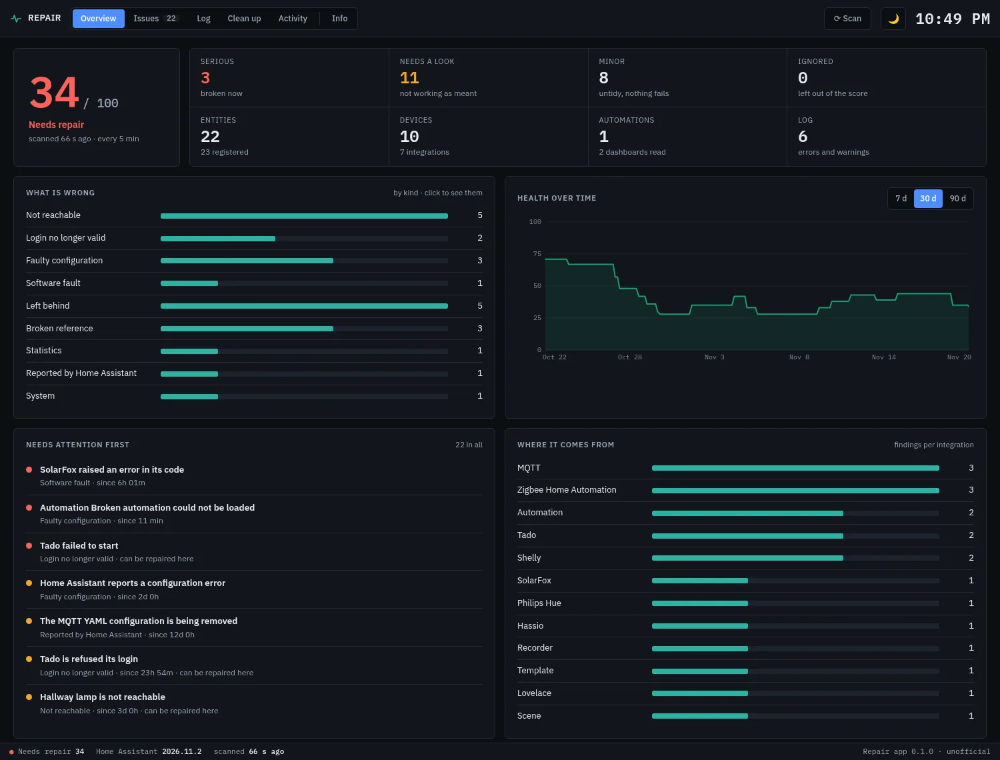
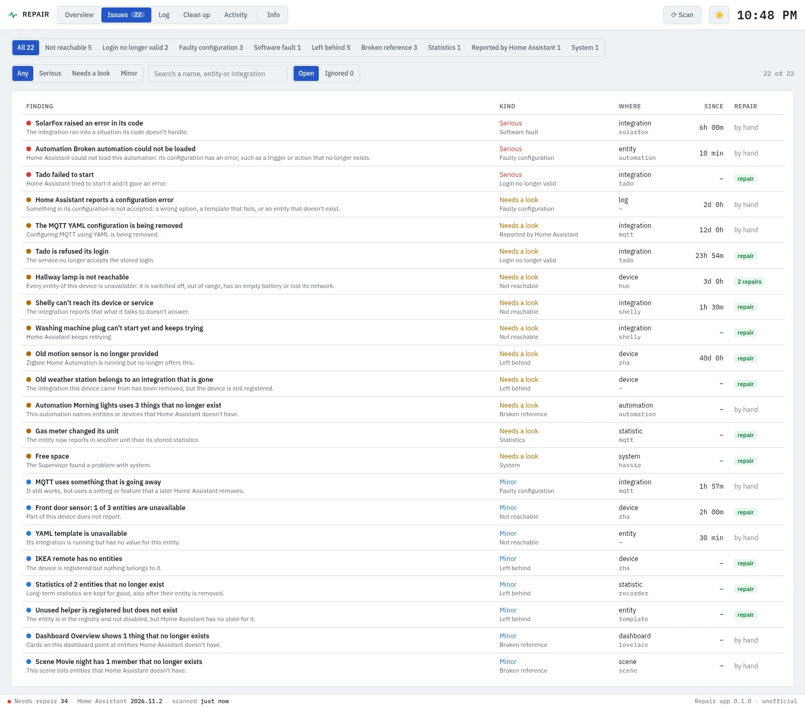
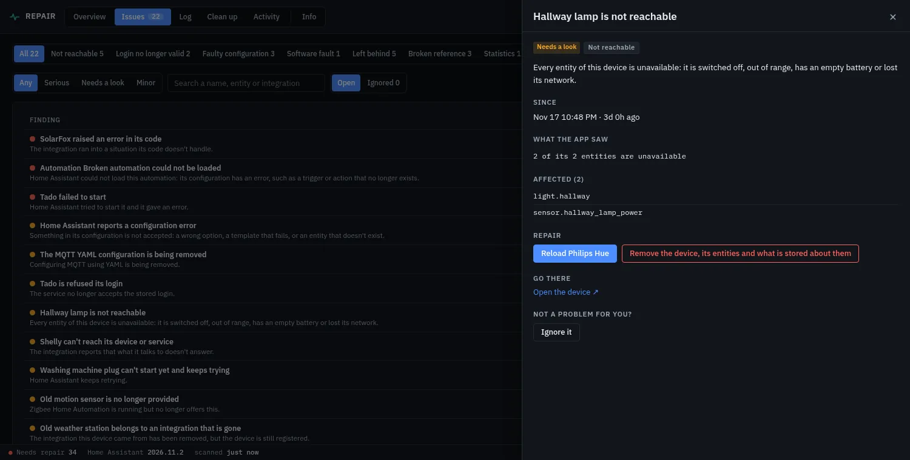
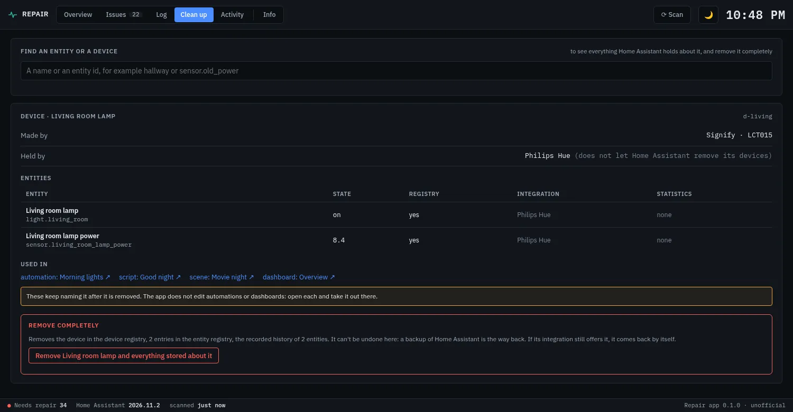
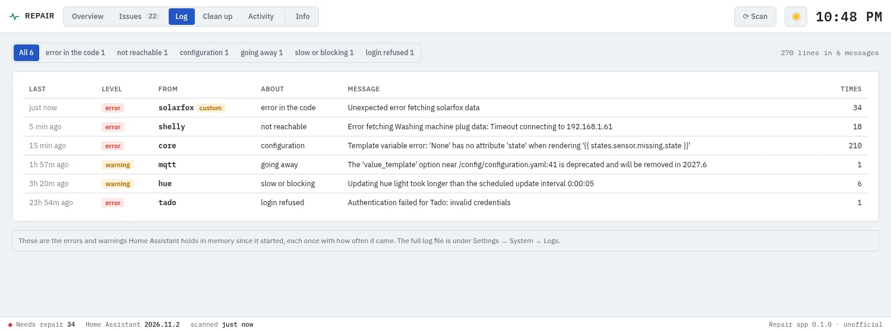
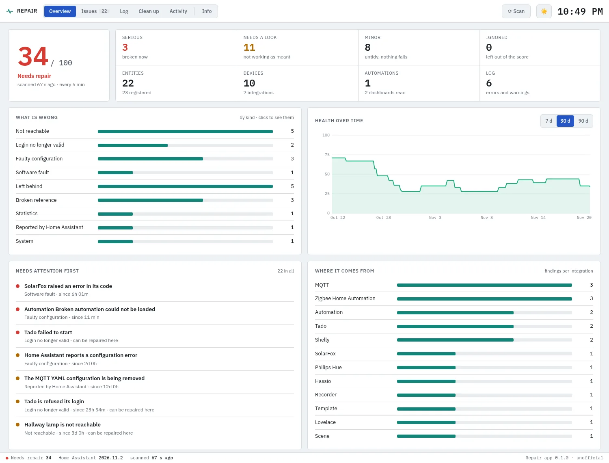

[![Version][version-shield]][changelog]
[![GitHub Activity][commits-shield]][commits]
[![License][license-shield]](https://github.com/cyberjunky/home-assistant-apps/blob/main/app-repair/LICENSE)
![Project Maintenance][maintenance-shield]
![Supports aarch64 Architecture][aarch64-shield]
![Supports amd64 Architecture][amd64-shield]

# Repair App for Home Assistant

> **Unofficial.** An independent project, not affiliated with, endorsed by or sponsored by the Home Assistant project.

Finds what is wrong in your Home Assistant, explains it, and repairs it where it can. Devices
that don't answer, integrations that failed or lost their login, automations that can't be
loaded, entities and devices left behind, automations and dashboards that name things that are
gone, statistics that no longer fit, and what the log complains about, sorted by what each line
is about.

Each finding says what it is, why the app thinks so, and what to do. Where Home Assistant
allows it a button does the repair: reload an integration, disable or remove an entity, remove
a device, delete statistics. A **Clean up** page removes an entity or device together with its
recorded history and long-term statistics.

**It changes Home Assistant only when you press a button**, and only through Home Assistant's
own API: it never writes to the database or the files under `.storage`. An optional deep scan
reads them, to find history of entities that are long gone. Make a backup before a big clean-up.

More screenshots

**Issues** — every finding, to filter by kind and by how serious it is, and to search

**A finding** — what it is, what the app saw, the repairs that fit, and where to go in Home Assistant

**Clean up** — everything Home Assistant holds about a device, where it is used, and removing it completely

**Log** — the errors and warnings, sorted by what each is about

**Overview, light theme** — follows Home Assistant's light/dark mode

## Supported Features

- 🩺 **A health score** — One number for the whole installation, kept per scan to see whether it gets better
- 🔌 **Not reachable** — Devices whose entities are all unavailable, integrations that keep retrying, logins that are refused
- 🧩 **Faulty configuration** — Automations that can't be loaded, a failing `configuration.yaml`, template errors, settings that are going away
- 🐛 **Software faults** — Errors in an integration's code, with a link to where to report them
- 🧹 **Left behind** — Entities their integration no longer offers, devices without an integration, statistics of entities that are gone
- 🔗 **Broken references** — Automations, scripts, scenes, groups and dashboards that name entities or devices that don't exist
- 📜 **The log, sorted** — Every error and warning by what it is about, with how often it came
- 🛠️ **Repairs** — Reload, disable, remove, delete statistics; each asks first and reports every step
- 🗑️ **Clean up** — An entity or a device with its registry entries, history and statistics, and a list of where it is still used

## Requirements

- Home Assistant OS or Supervised (the app talks to Home Assistant through the Supervisor)
- An administrator account to open the panel

## Installation

Alternatively:

1. Go to **Settings → Apps → App Store**
2. Open the menu (⋮) and choose **Repositories**
3. Add `https://github.com/cyberjunky/home-assistant-apps`
4. Install **Repair**
5. Start the app and open **Repair** from the sidebar

## Configuration

Repair needs no settings. See
[DOCS.md](https://github.com/cyberjunky/home-assistant-apps/blob/main/app-repair/DOCS.md) for the options, everything it finds, what it can and can't repair,
and how Clean up works.

## Disclaimer

This app is an independent project. It is not affiliated with, endorsed by or sponsored by the
Home Assistant project. It removes data from Home Assistant when you ask it to, and that can't
be undone by the app: keep backups. What it reports is its best reading of what Home Assistant
tells it, and it can be wrong.

## 💖 Support This Project

If you find this app useful, please consider supporting its continued development and
maintenance:

### 🌟 Ways to Support

- **⭐ Star this repository** - Help others discover the project
- **💰 Financial Support** - Contribute to development and hosting costs
- **🐛 Report Issues** - Help improve stability and compatibility
- **📖 Spread the Word** - Share with other Home Assistant users

### 💳 Financial Support Options

Every contribution, no matter the size, makes a difference and is greatly appreciated! 🙏

## License

This project is licensed under the MIT License - see the [LICENSE](https://github.com/cyberjunky/home-assistant-apps/blob/main/app-repair/LICENSE) file for
details.

---

[version-shield]: https://img.shields.io/badge/dynamic/yaml?url=https%3A%2F%2Fraw.githubusercontent.com%2Fcyberjunky%2Fhome-assistant-apps%2Fmain%2Fapp-repair%2Fconfig.yaml&query=%24.version&label=version&style=for-the-badge
[changelog]: https://github.com/cyberjunky/home-assistant-apps/blob/main/app-repair/CHANGELOG.md
[commits-shield]: https://img.shields.io/github/commit-activity/y/cyberjunky/home-assistant-apps.svg?style=for-the-badge
[commits]: https://github.com/cyberjunky/home-assistant-apps/commits/main
[license-shield]: https://img.shields.io/github/license/cyberjunky/home-assistant-apps.svg?style=for-the-badge
[maintenance-shield]: https://img.shields.io/badge/maintainer-cyberjunky-blue.svg?style=for-the-badge
[aarch64-shield]: https://img.shields.io/badge/aarch64-yes-green.svg?style=for-the-badge
[amd64-shield]: https://img.shields.io/badge/amd64-yes-green.svg?style=for-the-badge
