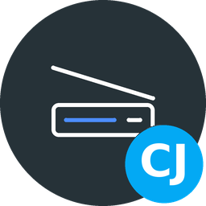
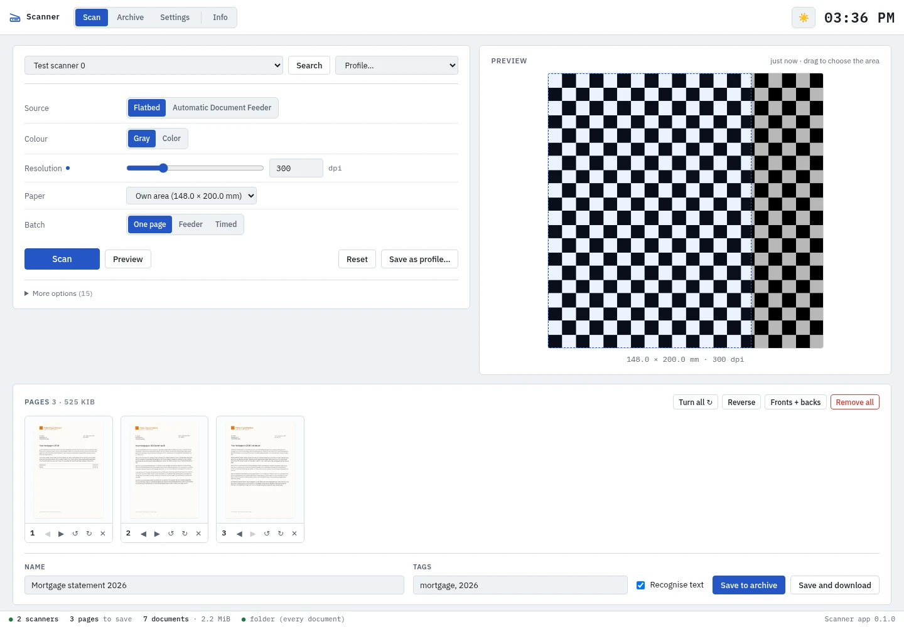
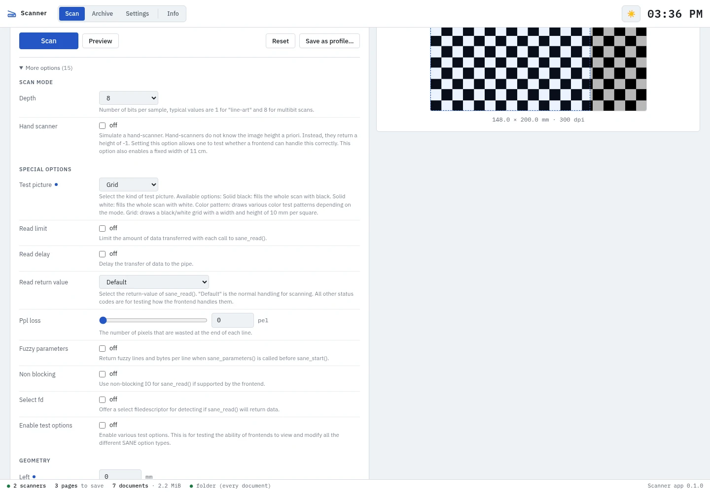
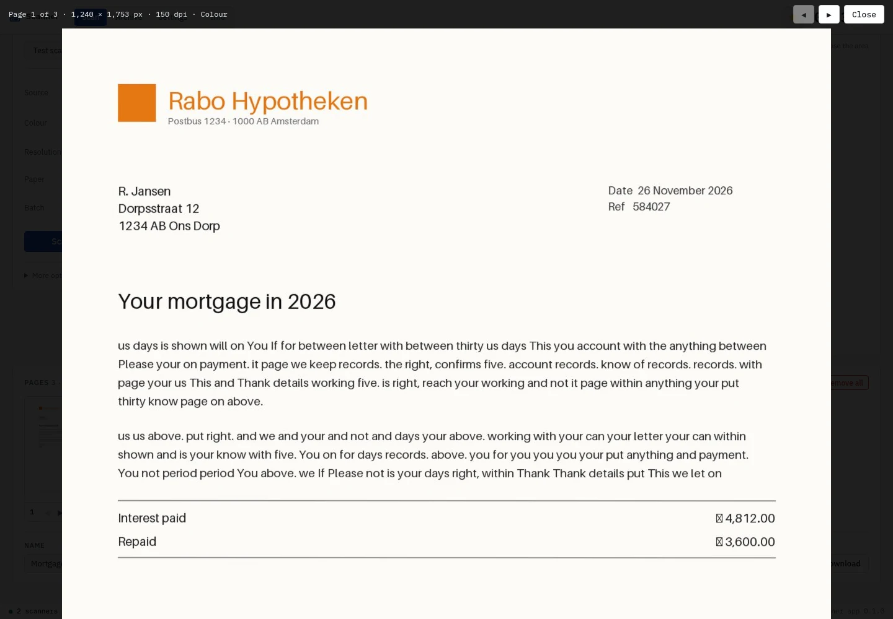
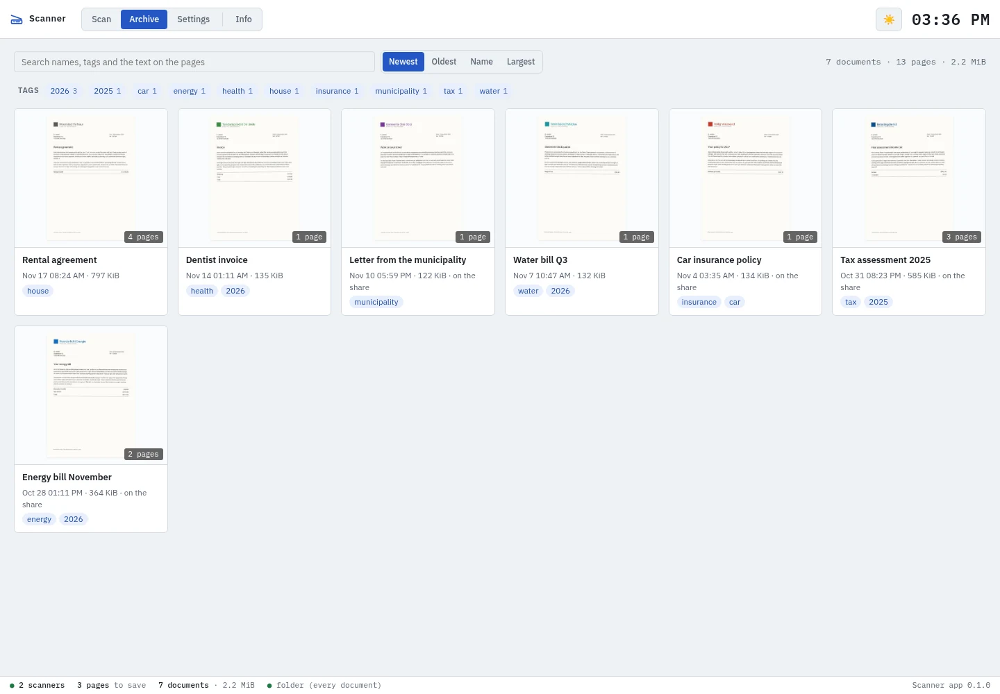
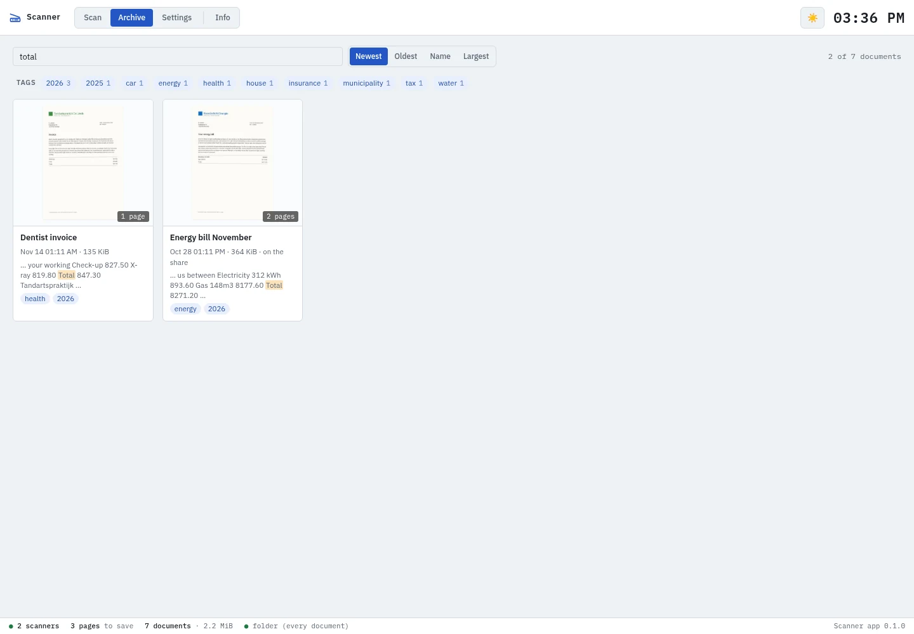
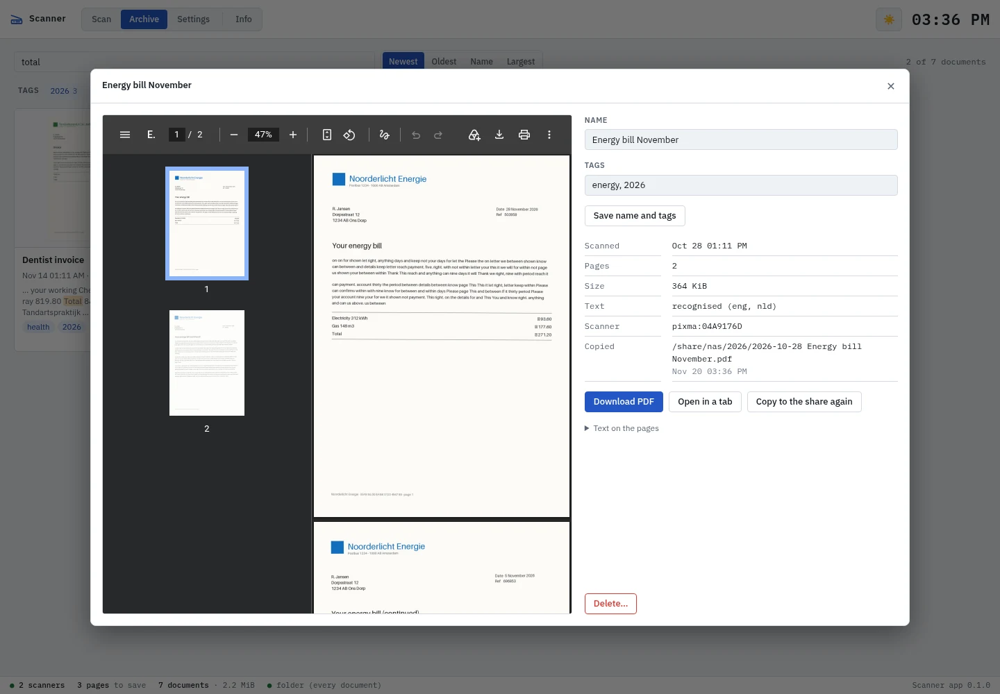
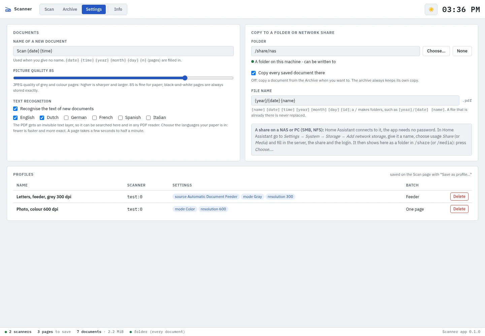
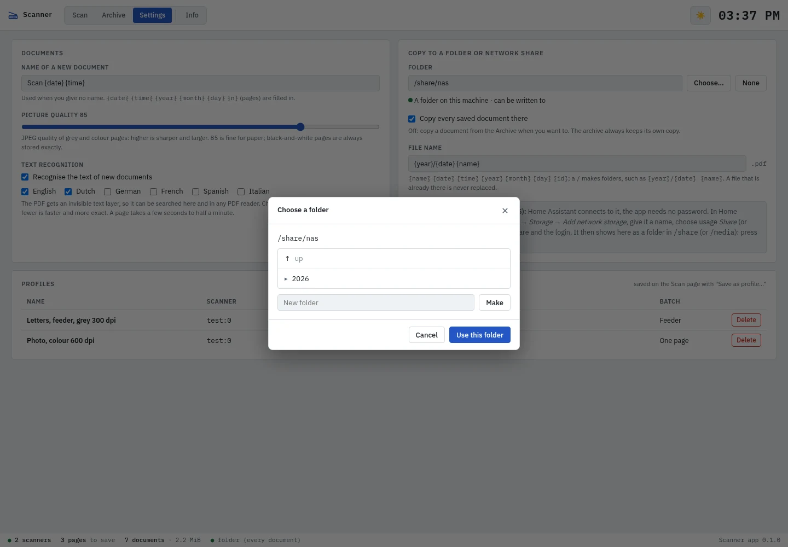
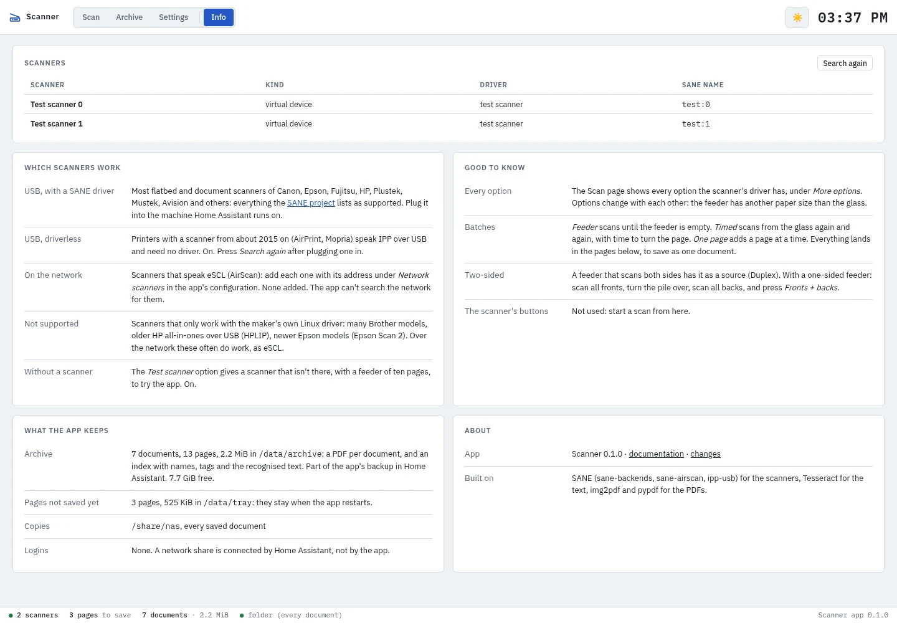

[![Version][version-shield]][changelog]
[![GitHub Activity][commits-shield]][commits]
[![License][license-shield]](https://github.com/cyberjunky/home-assistant-apps/blob/main/app-scanner/LICENSE)
![Project Maintenance][maintenance-shield]
![Supports aarch64 Architecture][aarch64-shield]
![Supports amd64 Architecture][amd64-shield]

# Scanner App for Home Assistant

Plug a USB scanner into the machine Home Assistant runs on and it is a scanner for the whole
house: open **Scanner** in the sidebar on any phone, tablet or PC and scan. No driver on any of
them.

The app shows every option the scanner has, scans one page or a whole batch (the feeder until it
is empty, or the glass with time to turn the page), and collects the pages so you can look at
them, turn, reorder and remove them before they become a document. Documents are saved as PDF in
an archive in the app, with the text on the pages recognised, so you find them back by a word
that is on the paper. Download a document, or have every document copied to a share on your NAS.

More screenshots

**Every option of the scanner** — whatever its driver has, grouped as the driver groups them

**A page at full size**

**Archive** — every document, with its tags

**Search** — by a word on the paper

**A document** — read it, rename it, download it, copy it to the share

**Settings** — names, quality, text recognition, the folder or network share

**Choosing the folder**

**Info** — the scanners found and which scanners work

## Supported Features

- 🖨️ **Any scanner SANE knows** — USB scanners with a SANE driver, driverless USB scanners (IPP over USB), and network scanners that speak eSCL (AirScan)
- 🎛️ **Every option** — source, colour, resolution and paper up front; everything else the driver has (brightness, duplex, thresholds…) under *More options*, changing with each other as the scanner says
- 🔍 **Preview** — a quick scan of the whole glass; drag on it to choose the area
- 📚 **Batches** — the feeder until it is empty or for a number of pages, or the glass on a timer with time to turn the page; stop any time and keep what was scanned
- 🔁 **Two-sided on a one-sided feeder** — scan all fronts, turn the pile over, scan all backs, press *Fronts + backs*
- 📄 **Pages before they are a document** — look at them at full size, turn, drag into order, remove; they stay when the app restarts
- 🔤 **Searchable PDFs** — text recognition (Tesseract) in English, Dutch, German, French, Spanish and Italian; the picture in the PDF is the scan itself, not compressed again
- 🗄️ **Archive** — names, tags, search by a word on the paper, open, download, rename, delete
- 📁 **Network share** — every document, or the ones you pick, copied to a folder in Home Assistant's share or media folder, which is where Home Assistant mounts an SMB or NFS share; the app holds no password
- 💾 **Profiles** — a scanner with its settings and batch mode under a name
- 🧪 **Test scanner** — try the app without a scanner

## Requirements

- Home Assistant OS or Supervised
- A scanner on a USB port of that machine, or on the network. Which ones work is in the [documentation](DOCS.md#which-scanners-work)

## Installation

Alternatively:

1. Go to **Settings → Apps → App Store**
2. Open the menu (⋮) and choose **Repositories**
3. Add `https://github.com/cyberjunky/home-assistant-apps`
4. Install **Scanner**
5. Plug in the scanner, start the app and open **Scanner** from the sidebar

No scanner at hand? Turn on *Test scanner* in the app's configuration. See the
[documentation](DOCS.md).

## 💖 Support This Project

If you find this app useful, please consider supporting its continued development and
maintenance:

### 🌟 Ways to Support

- **⭐ Star this repository** - Help others discover the project
- **💰 Financial Support** - Contribute to development and hosting costs
- **🐛 Report Issues** - Help improve stability and compatibility
- **📖 Spread the Word** - Share with other Home Assistant users

### 💳 Financial Support Options

Every contribution, no matter the size, makes a difference and is greatly appreciated! 🙏

## License

This project is licensed under the MIT License - see the [LICENSE](https://github.com/cyberjunky/home-assistant-apps/blob/main/app-scanner/LICENSE) file for
details. The image contains SANE (sane-backends, GPL-2.0+ with the SANE exception), sane-airscan (GPL-2.0+ with the SANE exception), ipp-usb (BSD-2-Clause) and Tesseract (Apache-2.0), unchanged, as Debian packages.

[version-shield]: https://img.shields.io/badge/dynamic/yaml?url=https%3A%2F%2Fraw.githubusercontent.com%2Fcyberjunky%2Fhome-assistant-apps%2Fmain%2Fapp-scanner%2Fconfig.yaml&query=%24.version&label=version&style=for-the-badge
[changelog]: https://github.com/cyberjunky/home-assistant-apps/blob/main/app-scanner/CHANGELOG.md
[commits-shield]: https://img.shields.io/github/commit-activity/y/cyberjunky/home-assistant-apps.svg?style=for-the-badge
[commits]: https://github.com/cyberjunky/home-assistant-apps/commits/main
[license-shield]: https://img.shields.io/github/license/cyberjunky/home-assistant-apps.svg?style=for-the-badge
[maintenance-shield]: https://img.shields.io/badge/maintainer-cyberjunky-blue.svg?style=for-the-badge
[aarch64-shield]: https://img.shields.io/badge/aarch64-yes-green.svg?style=for-the-badge
[amd64-shield]: https://img.shields.io/badge/amd64-yes-green.svg?style=for-the-badge
