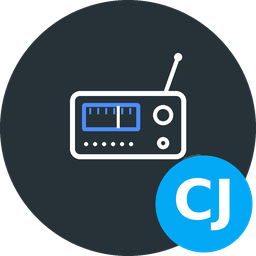
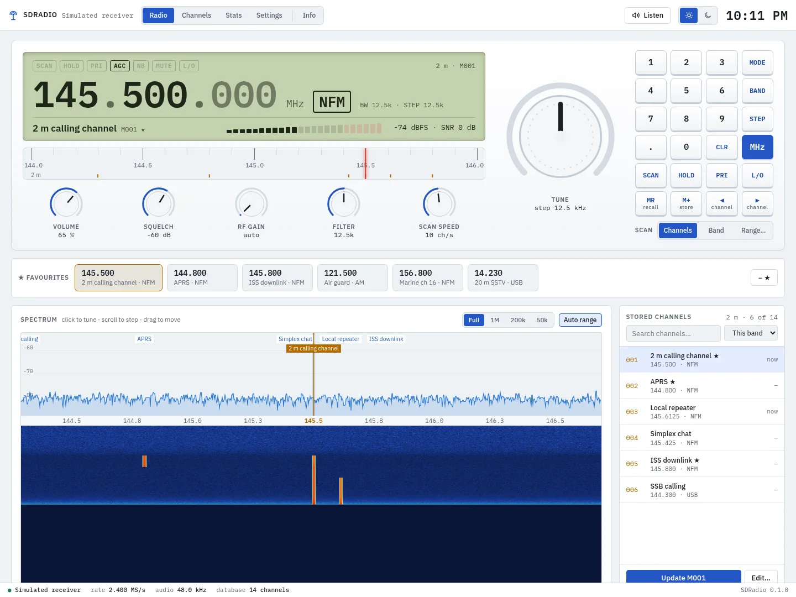
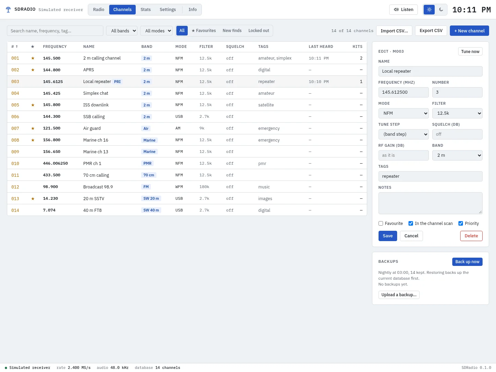
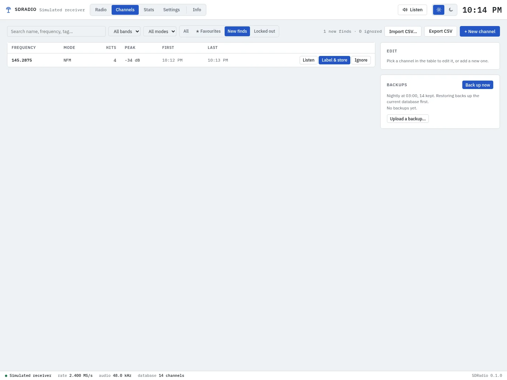
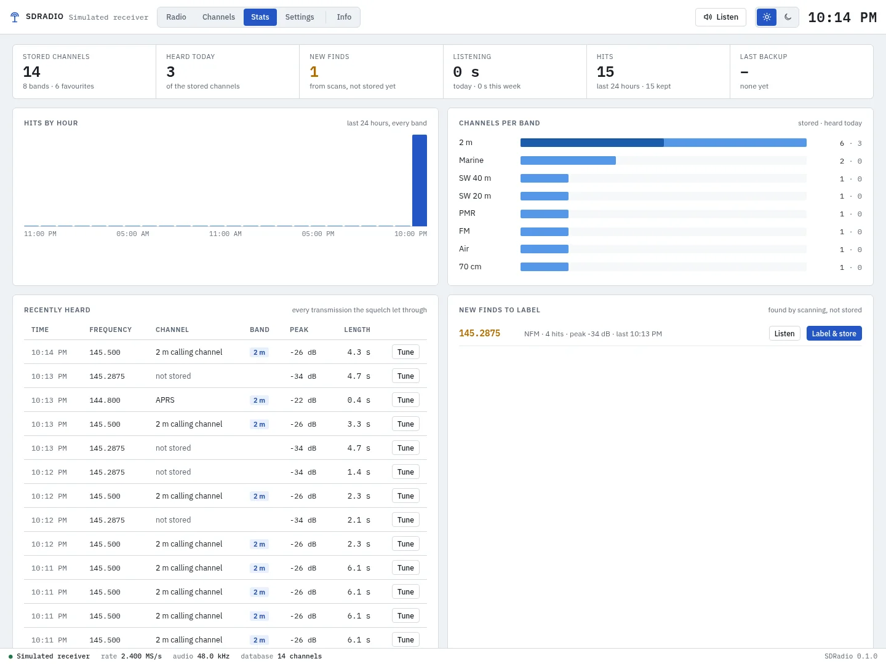
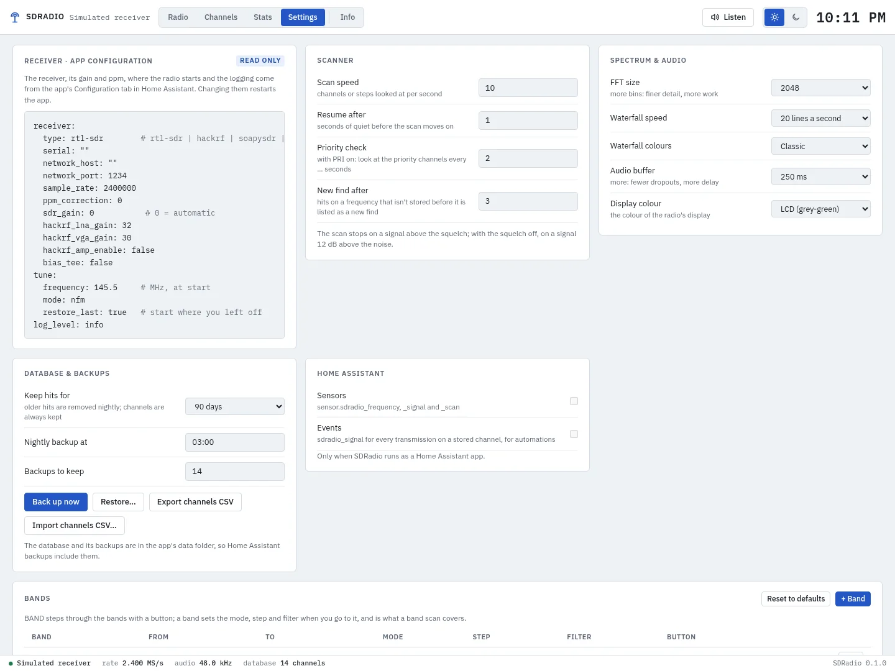
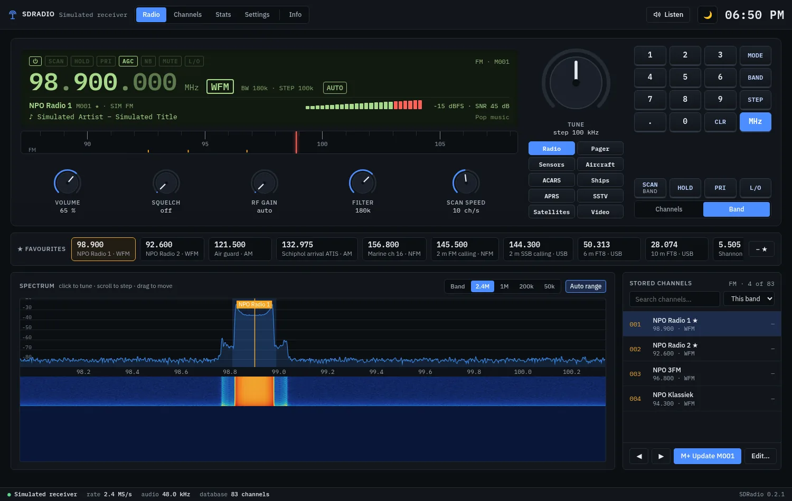

[![Version][version-shield]][changelog]
[![GitHub Activity][commits-shield]][commits]
[![License][license-shield]](LICENSE)
![Project Maintenance][maintenance-shield]
![Supports aarch64 Architecture][aarch64-shield]
![Supports amd64 Architecture][amd64-shield]

# SDRadio App for Home Assistant

A software defined radio receiver in Home Assistant, opened from the sidebar. Plug in an
RTL-SDR or HackRF (or point it at an `rtl_tcp` server), and you get a receiver front panel: a
display with the frequency, mode and signal meter, knobs, a tune dial and a keypad, a live
spectrum and waterfall to click on, and your stored channels beside it. Listen in the browser,
scan your channels, a band or a range, and keep every channel and every transmission heard in a
database, with CSV import and export, statistics and nightly backups.

More screenshots

**Channels** — every stored channel, edited on the page, with CSV import and export and the backups

**New finds** — signals the scan found that aren't stored yet: listen, label and store, or ignore

**Stats** — what was heard, by hour and by band, and the most active channels

**Settings** — the receiver options, scanner, spectrum, audio, backups, Home Assistant and the band plan

**The radio, dark theme**

## Supported Features

- 📻 **Receiver front panel** — Frequency display (scroll a digit to change it), mode, filter and step, indicators, channel name and a signal meter in dBFS with SNR; a band scale like an old radio dial; knobs for volume, squelch, RF gain, filter and scan speed; a tune dial and a keypad
- 🌊 **Spectrum and waterfall** — Live, with your stored channels labelled; click to tune, drag to move, scroll to step; zoom from the whole band (swept) to 50 kHz
- 🎧 **Listen in the browser** — AM, NFM, WFM, USB, LSB, CW and DSB, demodulated in the app; AGC and noise blanker
- 📝 **RDS** — On FM broadcast: the station's name, its radio text, and the artist and title when the station sends them
- 🔍 **Scanning** — The stored channels, a band or a range; HOLD, lock-out and priority channels; every transmission logged, and unknown signals listed as new finds
- 🗂️ **Channels** — Name, frequency, mode, filter, step, squelch, gain, band, tags, notes, favourite, scan and priority; favourites one click away on the radio
- 📄 **CSV** — Export, and import from SDRadio or CHIRP-style lists
- 📊 **Stats** — Hits by hour and band, recently heard, the most active channels, listening time
- 💾 **Backups** — The database every night and on request; download, upload and restore
- 🏠 **Home Assistant** — Optional sensors for the frequency, signal and scan, and an `sdradio_signal` event for automations
- 🌗 **Light and dark** — Light by default, dark with a click

## Installation

Alternatively:

1. Go to **Settings → Apps → App Store**
2. Open the menu (⋮) and choose **Repositories**
3. Add `https://github.com/cyberjunky/home-assistant-apps`
4. Install **SDRadio**, plug in the receiver, check the Configuration tab and start it
5. Open **SDRadio** from the sidebar and press **Listen**

## Configuration

| Option | Default | |
|---|---|---|
| `receiver.type` | `rtl-sdr` | `rtl-sdr`, `hackrf`, `soapysdr` or `network` (`rtl_tcp`); the receiver is found automatically |
| `receiver.sdr_gain` | `40` | `0` = automatic; the RF gain knob changes it while listening |
| `tune.frequency` / `tune.mode` | `145.5` / `nfm` | Where the radio starts |

All options, and how scanning, channels and backups work: [DOCS.md](DOCS.md).

One receiver serves one app at a time: two apps can't share a dongle, unless one of them uses it
through `rtl_tcp`.

### 🌟 Ways to Support

- **⭐ Star this repository** - Help others discover the project
- **💰 Financial Support** - Contribute to development and hosting costs
- **🐛 Report Issues** - Help improve stability and compatibility
- **📖 Spread the Word** - Share with other Home Assistant users

### 💳 Financial Support Options

Every contribution, no matter the size, makes a difference and is greatly appreciated! 🙏

## License

This project is licensed under the MIT License - see the [LICENSE](LICENSE) file for
details.

---

[version-shield]: https://img.shields.io/badge/dynamic/yaml?url=https%3A%2F%2Fraw.githubusercontent.com%2Fcyberjunky%2Fhome-assistant-apps%2Fmain%2Fapp-sdradio%2Fconfig.yaml&query=%24.version&label=version&style=for-the-badge
[changelog]: https://github.com/cyberjunky/home-assistant-apps/blob/main/app-sdradio/CHANGELOG.md
[commits-shield]: https://img.shields.io/github/commit-activity/y/cyberjunky/home-assistant-apps.svg?style=for-the-badge
[commits]: https://github.com/cyberjunky/home-assistant-apps/commits/main
[license-shield]: https://img.shields.io/github/license/cyberjunky/home-assistant-apps.svg?style=for-the-badge
[maintenance-shield]: https://img.shields.io/badge/maintainer-cyberjunky-blue.svg?style=for-the-badge
[aarch64-shield]: https://img.shields.io/badge/aarch64-yes-green.svg
[amd64-shield]: https://img.shields.io/badge/amd64-yes-green.svg
