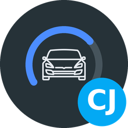
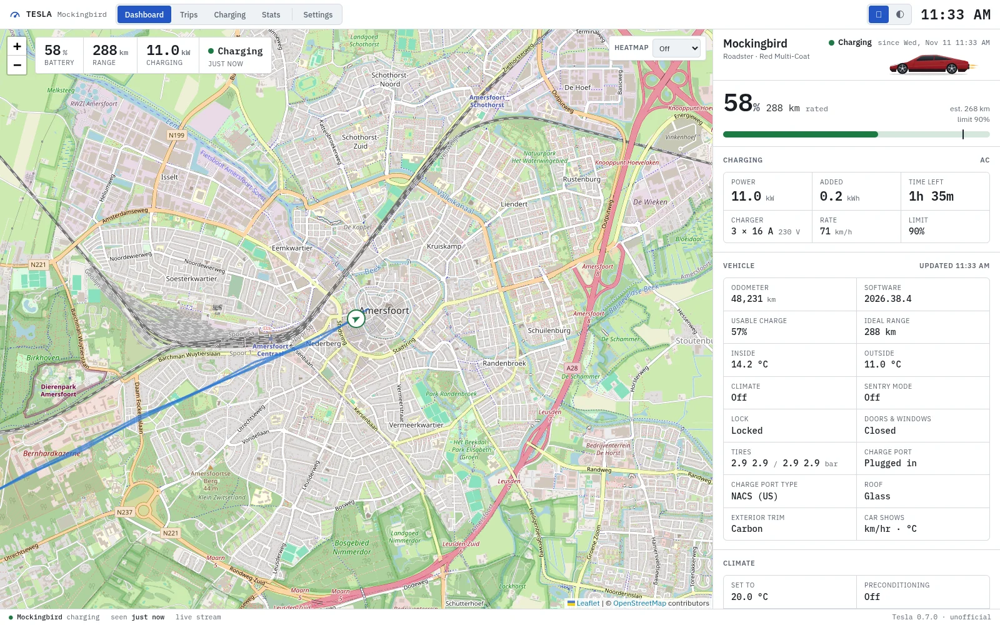
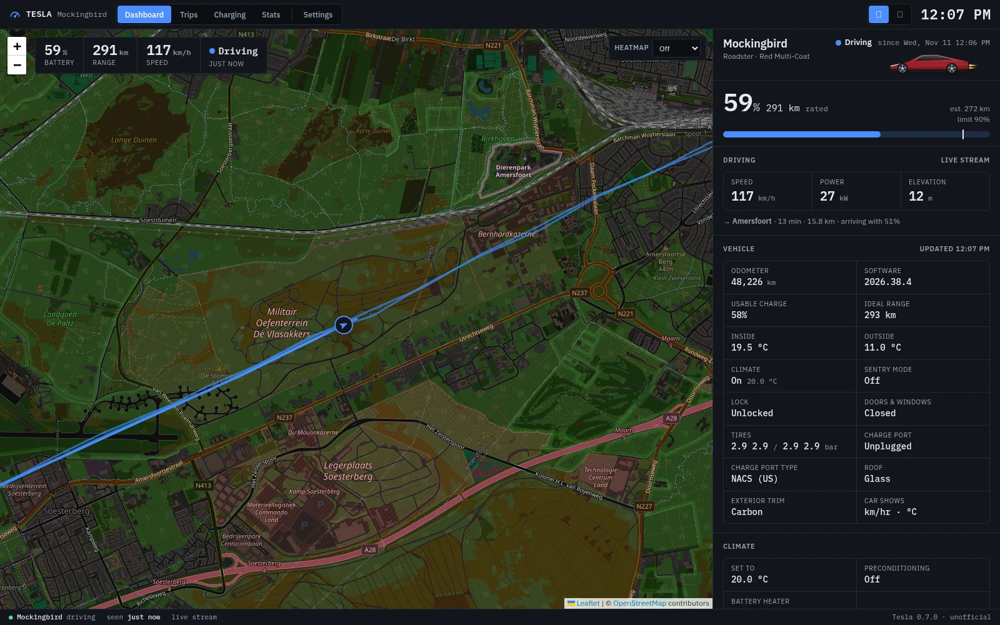
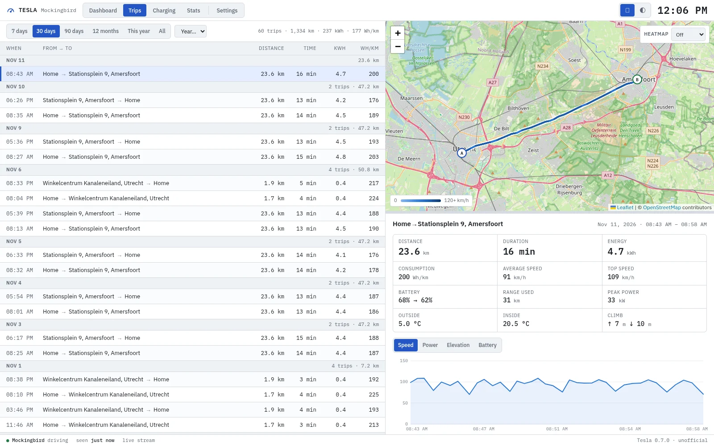
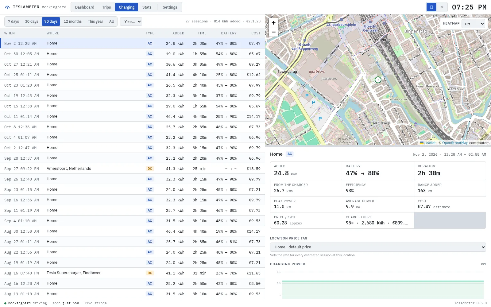
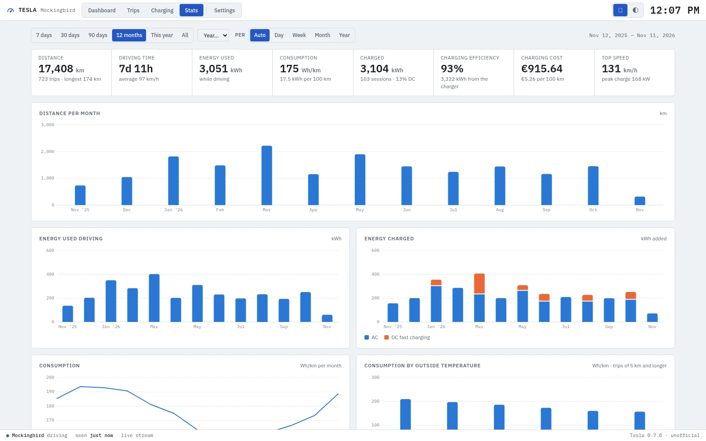

[![Version][version-shield]][changelog]
[![GitHub Activity][commits-shield]][commits]
[![License][license-shield]](https://github.com/cyberjunky/home-assistant-apps/blob/main/app-tesla/LICENSE)
![Project Maintenance][maintenance-shield]
![Supports aarch64 Architecture][aarch64-shield]
![Supports amd64 Architecture][amd64-shield]

# Tesla App for Home Assistant

> **Unofficial.** An independent project, not affiliated with, endorsed by or sponsored by Tesla, Inc.

Tesla logger and dashboard for Home Assistant — records every trip and charging session
of your car and shows them on a live map, with statistics on distance, energy,
consumption, charging and battery health.

This app runs entirely on your Home Assistant. It has no cloud service of its own, no
analytics and no telemetry: everything it records stays in the app's data folder and is
included in your Home Assistant backups.

More screenshots (dark theme, Trips, Charging, Stats)

This app follows Home Assistant's light or dark theme; the dashboard above is the light theme, and so are the Trips, Charging and Stats screenshots here.

**Dashboard, dark theme**

**Trips** — every drive, selectable, drawn on the map coloured by speed

**Charging** — every session with its power curve, efficiency and cost

**Stats** — totals and per-period charts, battery health, habits

## Supported Features

- 🔑 **One-time sign-in** — Tesla's own sign-in page right in the dashboard, with nothing to copy or paste and no separate token app. Access renews itself from then on
- 🗺️ **Live dashboard** — The car on the map with its heading, today's routes, battery, range, charging and driving details, temperatures, locks, doors, tire pressures and software version
- 🛣️ **Trips** — Every drive with start and end address, distance, duration, energy, consumption, speed, power and elevation; pick one to see it on the map, coloured by speed, and export it as GPX
- 🔌 **Charging** — Every session with energy added, energy drawn from the charger, efficiency, AC/DC, power curve and cost: what Tesla billed at Superchargers, your price per kWh elsewhere, or set per session
- 📊 **Statistics** — Distance, energy used and energy charged per day, week, month or year; consumption over time and by outside temperature; charging cost per 100 km
- 🔋 **Battery health** — The usable capacity every charge measures, followed over time, with degradation against the capacity when new and the range a full battery gives
- 💤 **Sleep friendly** — An idle car is left alone so it can fall asleep; standby ("vampire") loss while parked is measured and shown
- 📡 **Live stream** — Positions every second while driving, and activity is noticed without keeping the car awake
- 🏠 **Home Assistant zones** — Places inside a zone get the zone's name ("Home", "Work"); other addresses are looked up at OpenStreetMap
- 📨 **MQTT discovery** — The car appears in Home Assistant as a device with sensors, binary sensors and a device tracker
- 🧭 **Habits** — Most visited places, where you charge, when you drive, a heat map of everywhere you've been, records and the car's software history
- 💾 **Your data** — Everything is stored locally in the app; export trips and charges as CSV or download the whole database

## Installation

Alternatively:

1. Go to **Settings → Apps → App Store**
2. Open the menu (⋮) and choose **Repositories**
3. Add `https://github.com/cyberjunky/home-assistant-apps`
4. Install **Tesla** and start it
5. Open **Tesla** from the sidebar and sign in to Tesla

Signing in brings its own browser (Tesla has no way for third-party tools to log in by
themselves), so there is nothing to copy or paste. See [DOCS.md](https://github.com/cyberjunky/home-assistant-apps/blob/main/app-tesla/DOCS.md) for the sign-in
steps, the refresh-token alternative and importing existing history.

## Configuration

This app works out of the box; the options cover units and currency, charging cost,
how often the car is read, and the MQTT broker. See [DOCS.md](https://github.com/cyberjunky/home-assistant-apps/blob/main/app-tesla/DOCS.md) for every option,
how it works, the data it handles, the requirements and development notes.

## Disclaimer

This app is an independent project. It is not affiliated with, endorsed by or sponsored
by Tesla, Inc.; "Tesla" is a trademark of Tesla, Inc. It uses Tesla's owner API — the one
the Tesla app uses — which is not an official third-party interface and can change without
notice.

## 💖 Support This Project

If you find this app useful, please consider supporting its continued development and
maintenance:

### 🌟 Ways to Support

- **⭐ Star this repository** - Help others discover the project
- **💰 Financial Support** - Contribute to development and hosting costs
- **🐛 Report Issues** - Help improve stability and compatibility
- **📖 Spread the Word** - Share with other Home Assistant users

### 💳 Financial Support Options

Every contribution, no matter the size, makes a difference and is greatly appreciated! 🙏

## License

This project is licensed under the MIT License - see the [LICENSE](https://github.com/cyberjunky/home-assistant-apps/blob/main/app-tesla/LICENSE) file for
details.

---

[version-shield]: https://img.shields.io/badge/dynamic/yaml?url=https%3A%2F%2Fraw.githubusercontent.com%2Fcyberjunky%2Fhome-assistant-apps%2Fmain%2Fapp-tesla%2Fconfig.yaml&query=%24.version&label=version&style=for-the-badge
[changelog]: https://github.com/cyberjunky/home-assistant-apps/blob/main/app-tesla/CHANGELOG.md
[commits-shield]: https://img.shields.io/github/commit-activity/y/cyberjunky/home-assistant-apps.svg?style=for-the-badge
[commits]: https://github.com/cyberjunky/home-assistant-apps/commits/main
[license-shield]: https://img.shields.io/github/license/cyberjunky/home-assistant-apps.svg?style=for-the-badge
[maintenance-shield]: https://img.shields.io/badge/maintainer-cyberjunky-blue.svg?style=for-the-badge
[aarch64-shield]: https://img.shields.io/badge/aarch64-yes-green.svg?style=for-the-badge
[amd64-shield]: https://img.shields.io/badge/amd64-yes-green.svg?style=for-the-badge
