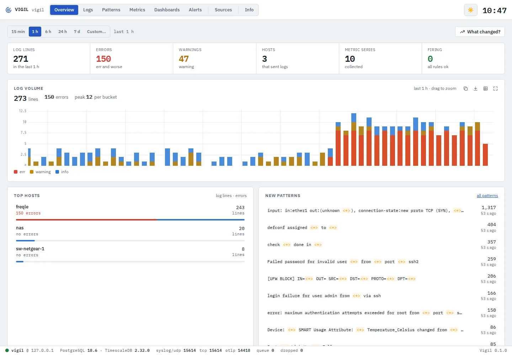
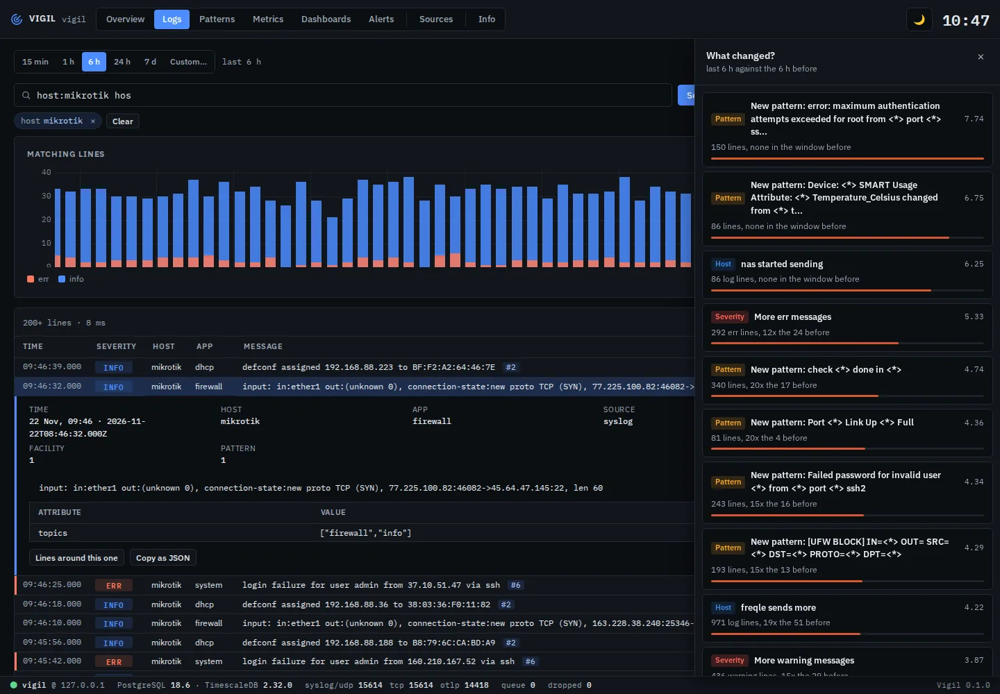
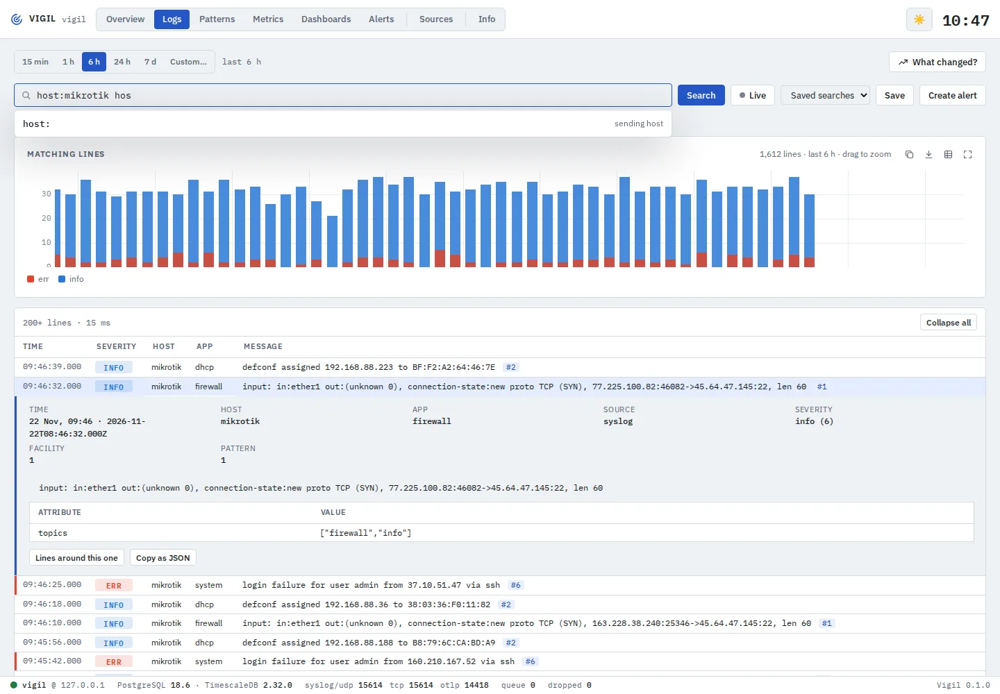
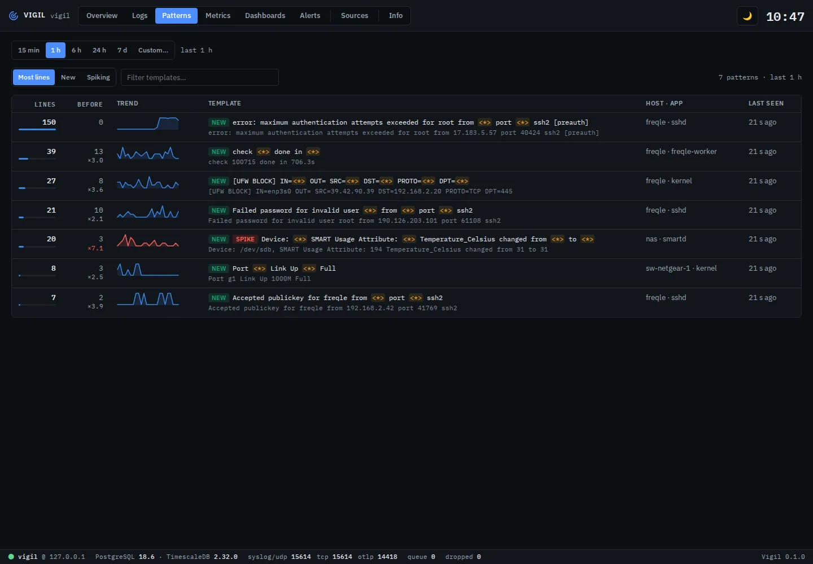
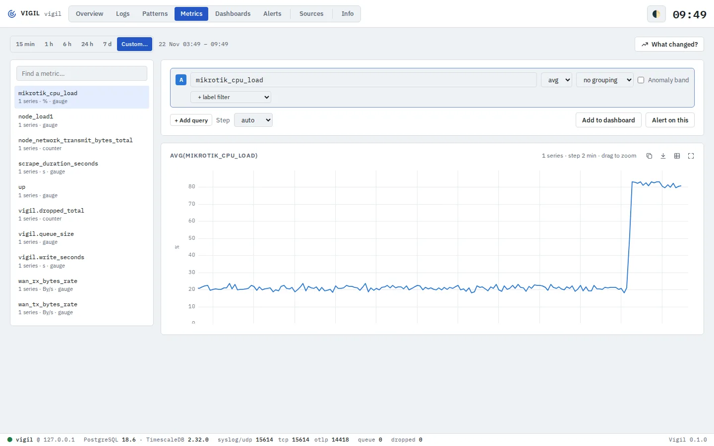
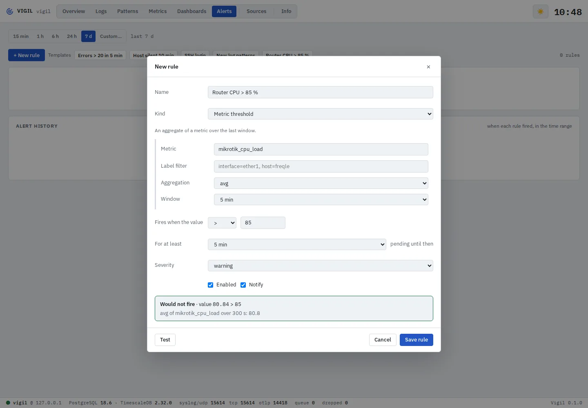
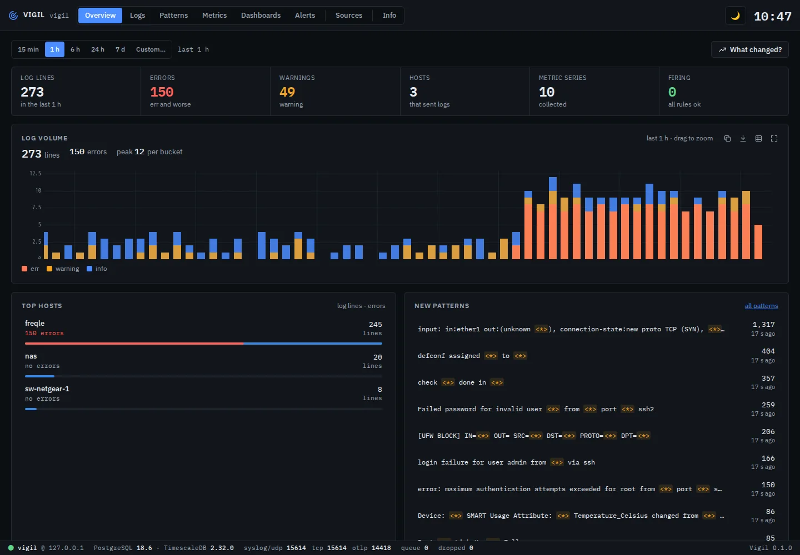

[![Version][version-shield]][changelog]
[![GitHub Activity][commits-shield]][commits]
[![License][license-shield]](https://github.com/cyberjunky/home-assistant-apps/blob/main/app-vigil/LICENSE)
![Project Maintenance][maintenance-shield]
![Supports aarch64 Architecture][aarch64-shield]
![Supports amd64 Architecture][amd64-shield]

# Vigil App for Home Assistant

Logs, metrics and alerts for your home network and servers, in one place in Home Assistant.
Routers, switches and servers send their logs by syslog; Vector or the OpenTelemetry Collector
send logs and metrics; Vigil collects from Prometheus exporters and the FRITZ!Box by itself.
Everything is stored in Vigil's own database on the [Chronicle](../app-chronicle/) app, and
opened from the sidebar: search the logs, chart the metrics, build dashboards and get alerts as
Home Assistant notifications. It also does the work for you: it groups log lines into
**patterns** and shows the new and spiking ones, draws an **anomaly band** around a metric, and
answers **"What changed?"** for any moment you pick.

More screenshots

**What changed?** — the last 6 hours against the 6 before: a new SSH attack pattern ranks first

**Logs** — search with filters, the matching lines by severity over time, a line opened with all its fields

**Patterns** — thousands of lines as a handful of templates, with the new and spiking ones marked

**Metrics** — a router's CPU over 6 hours, from a "What changed?" link

**Alerts** — a rule from a template, tested against the data before saving

**Overview, dark theme** — follows Home Assistant's light/dark mode

## Supported Features

- 📥 **Collects** — syslog over UDP and TCP (RFC 3164, RFC 5424, MikroTik's topics), OpenTelemetry over HTTP (JSON: logs and metrics), JSON lines, Prometheus exporters it scrapes itself, and the FRITZ!Box (line throughput, connection state, its event log)
- 🗄️ **Stores in Chronicle** — a database of its own on the Chronicle app (0.3.0 or later), with TimescaleDB's compression and how long to keep logs and metrics
- 🔎 **Logs** — search with free text, phrases and filters (`host:mikrotik severity:<=warning -dhcp`), the matches by severity over time (drag to zoom), every field of a line, lines around it, live tail, saved searches
- 🧩 **Patterns** — log lines grouped into templates with the changing parts masked; new and spiking patterns marked, with their trend
- 📈 **Metrics** — every series by name and labels, averages, sums, maxima and rates, grouped by a label, several queries on one chart, an anomaly band from the past week
- ❓ **What changed?** — for any time range, what is different from just before it: new and growing patterns, hosts that started, stopped or got louder, more errors, metrics that moved
- 🧱 **Dashboards** — your own panels on a grid (charts, numbers, bars, tables, log lists), with built-in Hosts and Network dashboards
- 🔔 **Alerts** — rules on a log search, a metric, silence, new patterns or an anomaly, tested before saving; firing and resolved as Home Assistant notifications, events (`vigil_alert`) and a notify service of your choice
- 📡 **Sources** — every sender with when it was last heard and how much it sends, and copy-paste setup for MikroTik, Netgear, rsyslog, Vector, the OpenTelemetry Collector and node_exporter
- 🔒 **Locked down** — the web UI only through Home Assistant; the ingest port only with a token or from your own network; its database login can't reach anything but its own database

## Installation

1. Install **Chronicle** (0.3.0 or later) and, in it, **Maintenance → App databases → New app database…** named `vigil`. Keep the password it shows.
2. Install **Vigil** from this repository, enter that password in its configuration, and start it.
3. Open **Vigil** from the sidebar, and point your devices at it: **Sources** has the setup for each kind.

## Configuration

| Option | Default | |
|---|---|---|
| `database_password` | | The password Chronicle showed for the `vigil` database |
| `database_host`, `database_port`, `database_name`, `database_user` | found / 5432 / vigil / vigil | Only when the database is elsewhere |
| `ingest_token` | | Required from senders on port 4318 outside your own network |
| `scrape_targets` | | Prometheus exporters: a name, the URL and the interval |
| `fritzbox`: `host`, `user`, `password` | | The FRITZ!Box to collect from, in its own section *FRITZ!Box (TR-064)* |
| `notify_service` | | Where alerts go besides a notification, such as `notify.mobile_app_phone` or `telegram_bot.send_message` |
| `logs_retention_days`, `metrics_retention_days` | 14 / 90 | How long to keep them |
| `log_level` | `info` | `debug`, `info`, `warning` or `error` |

Ports: syslog on **514** (UDP and TCP), OpenTelemetry and JSON on **4318**. Change or clear them
in the app's Network settings.

See [DOCS.md](https://github.com/cyberjunky/home-assistant-apps/blob/main/app-vigil/DOCS.md) for
setting up each source, the search language, rules, and security.

## 💖 Support This Project

If you find this app useful, please consider supporting its continued development and
maintenance:

### 🌟 Ways to Support

- **⭐ Star this repository** - Help others discover the project
- **💰 Financial Support** - Contribute to development and hosting costs
- **🐛 Report Issues** - Help improve stability and compatibility
- **📖 Spread the Word** - Share with other Home Assistant users

### 💳 Financial Support Options

Every contribution, no matter the size, makes a difference and is greatly appreciated! 🙏

## License

This project is licensed under the MIT License - see the [LICENSE](https://github.com/cyberjunky/home-assistant-apps/blob/main/app-vigil/LICENSE) file for
details.

---

[version-shield]: https://img.shields.io/badge/dynamic/yaml?url=https%3A%2F%2Fraw.githubusercontent.com%2Fcyberjunky%2Fhome-assistant-apps%2Fmain%2Fapp-vigil%2Fconfig.yaml&query=%24.version&label=version&style=for-the-badge
[changelog]: https://github.com/cyberjunky/home-assistant-apps/blob/main/app-vigil/CHANGELOG.md
[commits-shield]: https://img.shields.io/github/commit-activity/y/cyberjunky/home-assistant-apps.svg?style=for-the-badge
[commits]: https://github.com/cyberjunky/home-assistant-apps/commits/main
[license-shield]: https://img.shields.io/github/license/cyberjunky/home-assistant-apps.svg?style=for-the-badge
[maintenance-shield]: https://img.shields.io/badge/maintainer-cyberjunky-blue.svg?style=for-the-badge
[aarch64-shield]: https://img.shields.io/badge/aarch64-yes-green.svg
[amd64-shield]: https://img.shields.io/badge/amd64-yes-green.svg
